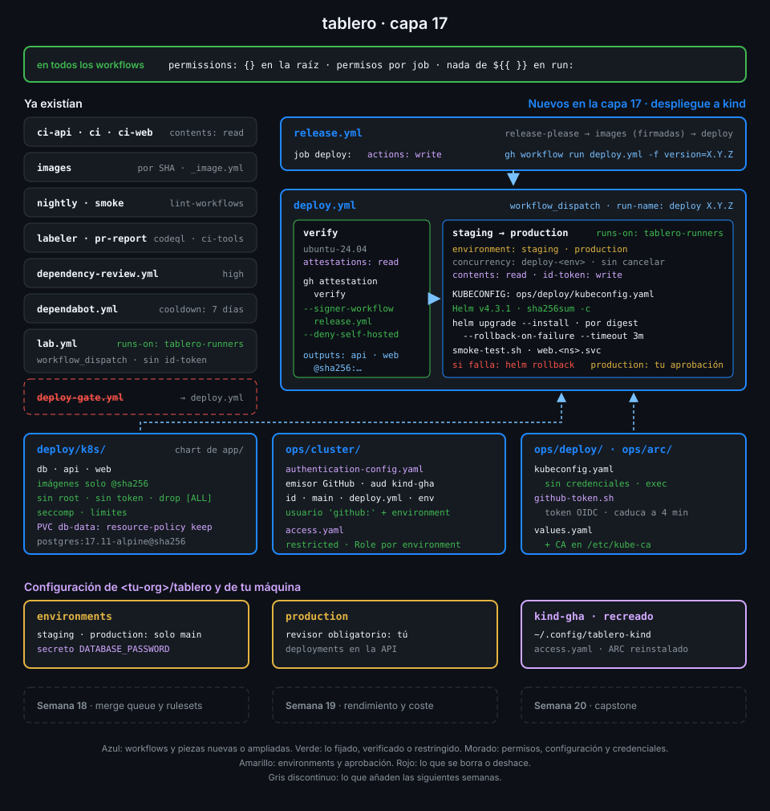

# Proyecto: capa 17 de tablero



## 🎯 Objetivo

Que cada release de `tablero` llegue al clúster sin que nadie escriba un comando: sus imágenes se
verifican, se despliegan por digest en staging, pasan un smoke test y, cuando apruebas, hacen el
mismo camino en production. Si un despliegue no arranca o no responde, vuelve solo a la versión
anterior. Y ni GitHub ni el runner guardan una credencial del clúster: el apiserver de kind
comprueba el token OIDC de cada job y le deja tocar solo su namespace.

## 📦 Qué añade esta capa

| Pieza de `tablero` | Qué hace | Por qué existe |
|---|---|---|
| `deploy/k8s/` (copiado de `app/`) | Chart de Helm con PostgreSQL, API y web; solo acepta imágenes por digest y sus pods corren sin root ni privilegios | La app trae cómo se despliega; el pipeline decide qué versión y dónde |
| `ops/cluster/authentication-config.yaml` (nuevo) | El apiserver acepta tokens de GitHub con audiencia `kind-gha`, del id de `tablero`, desde `main`, de `deploy.yml` y de un environment, y usa el environment como usuario | La verificación del token vive en el clúster, donde borrar un step no sirve de nada |
| `ops/cluster/access.yaml` (nuevo) | Namespaces `tablero-staging` y `tablero-production` con Pod Security `restricted`, y un Role por environment | Un token de staging no llega a production, y nadie despliega un pod privilegiado |
| `ops/deploy/kubeconfig.yaml` y `github-token.sh` (nuevos) | Un kubeconfig sin credenciales cuyo plugin `exec` pide el token OIDC del job cuando Helm lo necesita | El token vive 5 minutos y un despliegue con rollback puede durar más |
| `ops/arc/values.yaml` | El pod del runner monta el CA del clúster desde `kube-root-ca.crt` | Helm comprueba que habla con tu apiserver; el pod sigue sin identidad propia |
| `deploy.yml` (nuevo; borra `deploy-gate.yml`) | `verify` en un runner de GitHub y, en `tablero-runners`, `staging` y `production` con Helm, smoke test y rollback | El ensayo de la Semana 13 pasa a desplegar de verdad |
| `release.yml`, job `deploy` | Tras publicar las imágenes, lanza `deploy.yml` con la versión | La release la crea `GITHUB_TOKEN`, que solo puede disparar otros workflows con `workflow_dispatch` |

| Situación | Qué pasa |
|---|---|
| Fusionas el PR de release | Release, imágenes firmadas y un run `deploy X.Y.Z` que despliega en staging y espera tu aprobación para production |
| Alguien sube a GHCR una `tablero-api:X.Y.Z` construida en su portátil | `verify` falla en `gh attestation verify`: no la firmó `release.yml`. Nada se despliega |
| La nueva versión no arranca (falta una variable, la imagen no existe) | Helm espera 3 minutos, marca la revisión como fallida y vuelve a la anterior |
| Arranca, pero el smoke test falla | El step de rollback devuelve el namespace a la revisión anterior |
| Un workflow de otra rama pide un token con audiencia `kind-gha` | El apiserver lo rechaza: ni `ref` ni `job_workflow_ref` coinciden |
| Alguien roba el token del job de staging | Durante 5 minutos puede tocar Deployments, Services, Secrets y volúmenes de `tablero-staging`; production, nada |
| Lanzas `deploy.yml` a mano con la versión anterior | Se verifica y se despliega como cualquier otra: es tu rollback de negocio |

La Semana 18 lleva el pipeline a escala de equipo: ruleset en `main`, merge queue y un único check
requerido, y release-please con el token de una GitHub App para que su PR también pase por ahí.

## ✅ Requisitos verificables

- El chart deploy/k8s rechaza imágenes por tag y renderiza con imágenes por digest
- Cada pod del chart corre sin root, sin token de Kubernetes, sin escalada ni capacidades, con seccomp y con límites
- ops/cluster/access.yaml crea tablero-staging y tablero-production con Pod Security restricted
- Cada environment es un usuario de Kubernetes con un Role solo en su namespace, sin comodines ni permisos de clúster
- authentication-config.yaml acepta solo tokens de GitHub con audiencia kind-gha, del id de tablero, desde main y de deploy.yml, y usa el environment como usuario
- El pod del runner monta el CA del clúster desde kube-root-ca.crt y sigue sin token de Kubernetes
- Solo lab.yml y deploy.yml piden runners propios, y los dos se lanzan solo con workflow_dispatch
- El job verify de deploy.yml, en un runner de GitHub y con attestations: read como único permiso, verifica las imágenes firmadas por release.yml en runners de GitHub
- staging y production corren en tablero-runners, cada uno en su environment y en cola sin cancelar, y production espera a staging
- Los jobs de despliegue usan ops/deploy/kubeconfig.yaml, sin credenciales dentro, que pide el token OIDC del job con audiencia kind-gha
- Cada job de despliegue instala Helm con checksum, despliega las imágenes de verify con --rollback-on-failure y vuelve atrás si el smoke test falla
- release.yml lanza deploy.yml con la versión publicada tras las imágenes, desde un job con actions: write como único permiso
- actionlint y zizmor pasan sin hallazgos sobre los workflows de tablero
- El apiserver de kind-gha tiene cargada exactamente ops/cluster/authentication-config.yaml
- En kind-gha, github:staging y github:production solo pueden desplegar en su propio namespace
- El historial de Helm de staging tiene una revisión fallida y un rollback automático
- tablero-production en kind-gha corre la última release de tablero, por el digest que cubren sus attestations
- El run de deploy.yml de la última release terminó en success y su deployment de production quedó en success

## 🎨 Criterios de calidad

Lo que `check-week.sh` no ve y la [rúbrica](../rubrica-evaluacion.md) sí puntúa:

- `production` tiene un revisor obligatorio y solo admite la rama `main` (Semana 13), y lo
  compruebas con la API, no de memoria.
- Las contraseñas de `DATABASE_PASSWORD` son distintas en staging y production, solo letras y
  números (van dentro de `DATABASE_URL`), y ninguna aparece en un log ni en un commit.
- Cada regla de `authentication-config.yaml` lleva un `message` que dice qué falló, en una frase.
- Los Roles no tienen un verbo ni un recurso que el chart no use, y un comentario dice por qué
  Helm necesita `secrets`.
- Los recursos de prueba de las prácticas están borrados: ni ServiceAccounts de prueba en los
  namespaces de `tablero` ni pods sueltos en `arc-runners`.
- El chart de `deploy/k8s/` es el de `app/` sin cambios, o cada cambio va explicado en el commit.
- Sin `TODO` en el repo.

## 💡 Adaptación a tu dominio

| Tu caso | Dónde corre el despliegue | Quién verifica el token | Qué cambia |
|---|---|---|---|
| Clúster gestionado en una nube (EKS, GKE, AKS) | Un runner de GitHub | La nube: trust policy, workload identity federation o federated credential | El job cambia el token OIDC por credenciales de la nube; el apiserver no se toca |
| Clúster on-premise sin salida a internet | Un scale set de ARC dentro de la red | El apiserver, con la configuración de esta semana | El apiserver necesita llegar a `token.actions.githubusercontent.com` para leer las claves |
| Varios servicios en un monorepo | Una matriz por servicio en cada environment | El mismo apiserver | Un chart y una release de Helm por servicio, con su namespace o su Role |
| GitOps con Argo CD o Flux | El clúster tira del repo; Actions solo actualiza el digest | Nadie entra al clúster desde Actions | `deploy.yml` hace commit del digest verificado en el repo de configuración |

## 🚦 Cómo entregarlo

Si hiciste las cuatro prácticas ya lo tienes todo: repásalo contra los requisitos y los
criterios. Si no, parte del starter.

1. Copia el starter y el chart en `tablero`, borra el ensayo y completa los `TODO 1` a `TODO 17`:

   ```bash
   cd ~/code/tablero
   B=~/code/bc-github-actions
   S=$B/bootcamp/week-17-despliegue_continuo_a_kubernetes/3-proyecto/starter
   cp -r "$S"/. .
   mkdir -p deploy && cp -r "$B"/app/deploy/k8s deploy/
   git rm -q .github/workflows/deploy-gate.yml
   grep -rnE "TODO [0-9]+" .github ops | wc -l
   # 17
   ```

2. Recrea el clúster con la configuración OIDC montada, vuelve a instalar ARC con el CA en el
   pod del runner y aplica `ops/cluster/`
   ([práctica 01](../2-practicas/01-el-cluster-confia-en-github.md)).

3. Instala `tablero` a mano en staging, rompe un despliegue y mira cómo vuelve
   ([práctica 02](../2-practicas/02-chart-y-rollback-con-helm.md)).

4. Añade el job `deploy` a `release.yml` y comprueba lo que se puede ver en local antes del push:

   ```bash
   actionlint && GH_TOKEN=$(gh auth token) zizmor -q .github/ && echo limpio
   # limpio
   kubectl --context kind-gha auth can-i create deployments -n tablero-production --as github:staging
   # no
   ```

5. Haz push a `main`, lanza `deploy.yml` con la última versión, aprueba production y después deja
   que la siguiente release se despliegue sola
   ([práctica 03](../2-practicas/03-deploy-yml.md) y
   [práctica 04](../2-practicas/04-promocion-aprobacion-y-rollback.md)).

6. Lanza la verificación:

   ```bash
   cd ~/code/bc-github-actions
   ./scripts/check-week.sh 17
   # 18/18 comprobaciones superadas.
   ```

## 🧯 Errores comunes

| Síntoma | Causa | Solución |
|---|---|---|
| `El clúster gha es anterior a la Semana 17 (sin configuración OIDC).` | El clúster se creó con el `lab-up.sh` de la Semana 16 | `./scripts/lab-down.sh && ./scripts/lab-up.sh` y vuelve a lanzar `ops/arc/install.sh` ([práctica 01](../2-practicas/01-el-cluster-confia-en-github.md), paso 1) |
| `apiserver-oidc-config-loaded` en rojo justo después de copiar | El apiserver tarda hasta un minuto en recargar el archivo | Espera y repite; si sigue, busca `failed to load authentication config` en el log del apiserver |
| `"failed to load authentication config" err="empty config data"` | Escribiste el archivo en sitio y el apiserver lo leyó a medias | Copia a un temporal en la misma carpeta y renómbralo con `mv` |
| `Error: kubernetes cluster unreachable: the server has asked for the client to provide credentials` | El apiserver rechazó el token: audiencia, id del repo, rama, workflow o environment no coinciden | Compara cada regla con los claims del token ([práctica 01](../2-practicas/01-el-cluster-confia-en-github.md), paso 3) |
| `secrets is forbidden: User "github:staging" cannot list resource "secrets" ... "tablero-production"` | El job de staging intentó desplegar en production, o los RoleBindings están cruzados | Revisa `NAMESPACE` del job y los subjects de `access.yaml` |
| `violates PodSecurity "restricted:latest"` | Un pod del chart pide root, escalada o capacidades | Vuelve al chart de `app/deploy/k8s`: sus pods cumplen `restricted` |
| `container has runAsNonRoot and image has non-numeric user (nginx)` | La imagen declara su usuario por nombre | `runAsUser` numérico en el pod (101 en la web, 70 en PostgreSQL) |
| `images.api tiene que ir por digest` | Alguien pasó un tag al chart | Despliega con las salidas de `verify`, que siempre son `imagen@sha256:...` |
| `Error: verifying with issuer "sigstore.dev"` en `verify` | La imagen no la firmó `release.yml` de `tablero` en un runner de GitHub | No la despliegues: averigua de dónde salió ese tag |
| La API reinicia una o dos veces al desplegar | PostgreSQL aún no acepta conexiones cuando corren las migraciones | Es lo esperado: la readiness no la marca lista hasta que arranca |
| El smoke test falla con `password authentication failed` | El volumen se inicializó con otra contraseña y PostgreSQL la conserva | Usa la misma contraseña que la primera instalación o borra el PVC `db-data` (pierdes los datos) |
| `check-week.sh 13` y `check-week.sh 16` marcan checks en rojo | La capa 17 borra `deploy-gate.yml` y `deploy.yml` usa `tablero-runners` | Es lo esperado ([comprobaciones superadas por capas posteriores](../../../docs/autograding.md#comprobaciones-superadas-por-capas-posteriores)) |

## 🔗 Navegación

---

| ← Anterior | Siguiente → |
|:---|---:|
| [Promoción, aprobación y rollback](../2-practicas/04-promocion-aprobacion-y-rollback.md) | [Rúbrica de evaluación](../rubrica-evaluacion.md) |
