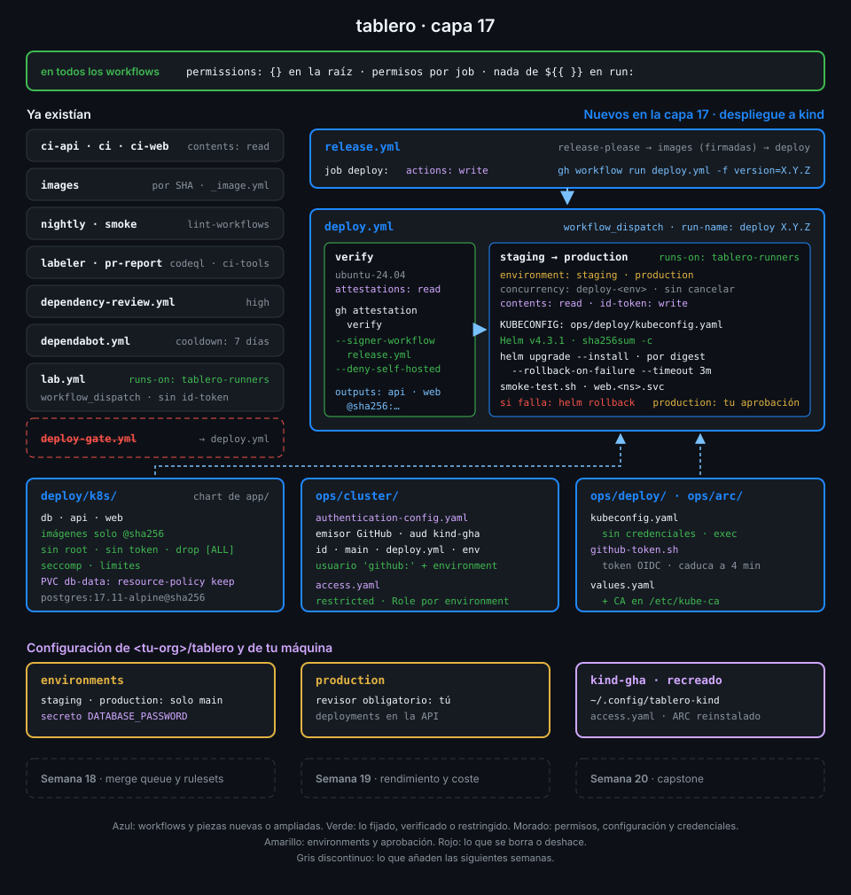

# Semana 17 — Despliegue continuo a Kubernetes

> Hasta ahora `tablero` publicaba imágenes firmadas y nadie las ejecutaba. Esta semana cada
> release llega sola a staging y, cuando la apruebas, a production, sin guardar ninguna credencial del clúster en GitHub.

## 🎯 Objetivos de la Semana

Al terminar la semana eres capaz de:

- Diseñar una cadena de despliegue continuo que promueve el mismo digest de staging a
  production, con una aprobación humana en medio y un registro de qué versión llegó a cada sitio
- Desplegar una aplicación con estado en Kubernetes con Helm: Deployments, Services, Secrets,
  volúmenes, readiness y el historial de revisiones de una release
- Hacer que el clúster verifique el token OIDC del job, como lo haría una nube: emisor, audiencia,
  repo, rama, workflow y environment, sin un solo secreto de Kubernetes en GitHub
- Limitar con RBAC lo que puede hacer cada environment y con Pod Security lo que puede correr en
  su namespace
- Dar a Helm una credencial que caduca en minutos y se renueva sola, desde un runner que no
  tiene identidad propia
- Desplegar solo lo que pasa `gh attestation verify` y volver atrás sin intervención cuando un
  despliegue no arranca o no pasa el smoke test

## 📋 Prerrequisitos

| Necesitas | Dónde se aprende |
|---|---|
| `check-week.sh 16` en 17/17 | [Semana 16](../week-16-actions_runner_controller_en_kind/README.md) |
| ARC en kind, Helm y el scale set `tablero-runners` | [Semana 16](../week-16-actions_runner_controller_en_kind/README.md) |
| Environments, reglas de protección y secretos de environment | [Semana 13](../week-13-secretos_entornos_y_oidc/README.md) |
| El token OIDC del job y sus claims | [Semana 13](../week-13-secretos_entornos_y_oidc/README.md) |
| Releases, imágenes versionadas y `gh attestation verify` | [Semana 14](../week-14-releases_cadena_de_suministro_y_attestations/README.md) |
| `workflow_dispatch`, `run-name` y concurrencia | [Semana 07](../week-07-disparadores_filtros_y_concurrencia/README.md) |

## 🗂️ Estructura de la Semana

```
week-17-despliegue_continuo_a_kubernetes/
├── README.md
├── rubrica-evaluacion.md          incluye el minisimulacro de cierre de la Fase 5
├── checks.json                    18 comprobaciones (contexto kind-gha)
├── 0-assets/                      diagramas SVG
├── 1-teoria/                      7 archivos, uno por concepto
├── 2-practicas/                   4 prácticas guiadas
├── 3-proyecto/
│   ├── README.md
│   └── starter/                   deploy.yml, ops/cluster/ y ops/deploy/
├── 4-recursos/{ebooks-free,videografia,webgrafia}/README.md
└── 5-glosario/README.md
```

## 📝 Contenidos

### Teoría

| # | Archivo | Qué aprendes | Tiempo |
|:--:|---|---|:--:|
| 01 | [Despliegue continuo y promoción](1-teoria/01-despliegue-continuo-y-promocion.md) | Entrega y despliegue continuos, promover un digest entre environments y los deployments de GitHub | 25 min |
| 02 | [Kubernetes para desplegar una app](1-teoria/02-kubernetes-para-desplegar-una-app.md) | Deployment, rollout, readiness, Service, Secret y volumen: lo justo para `tablero` | 25 min |
| 03 | [Helm: releases y rollback](1-teoria/03-helm-releases-y-rollback.md) | Chart, values, revisiones, `upgrade --install`, `--rollback-on-failure` y `helm rollback` | 25 min |
| 04 | [El apiserver verifica el token OIDC](1-teoria/04-el-apiserver-verifica-el-token-oidc.md) | `AuthenticationConfiguration`: reglas CEL sobre los claims y el environment como usuario | 30 min |
| 05 | [RBAC y Pod Security por environment](1-teoria/05-rbac-y-pod-security-por-environment.md) | Un Role por namespace, qué haría un token robado y qué rechaza `restricted` | 25 min |
| 06 | [Credenciales de corta vida en el runner](1-teoria/06-credenciales-de-corta-vida-en-el-runner.md) | Un kubeconfig sin secretos, el plugin `exec` y por qué el token caduca antes que el despliegue | 25 min |
| 07 | [Desplegar solo lo verificado](1-teoria/07-desplegar-solo-lo-verificado.md) | `gh attestation verify` antes de Helm, el digest que se despliega y despliegues en cola | 25 min |

### Prácticas

| # | Archivo | Qué haces | Tiempo |
|:--:|---|---|:--:|
| 01 | [El clúster confía en GitHub](2-practicas/01-el-cluster-confia-en-github.md) | El apiserver de kind acepta solo los tokens de `deploy.yml` y cada environment tiene su namespace | 1 h |
| 02 | [Chart y rollback con Helm](2-practicas/02-chart-y-rollback-con-helm.md) | Instalas `tablero` a mano como `github:staging`, rompes un despliegue y Helm vuelve atrás | 1 h |
| 03 | [deploy.yml](2-practicas/03-deploy-yml.md) | Verificas las imágenes y despliegas en staging y production desde un runner de ARC | 1 h |
| 04 | [Promoción, aprobación y rollback](2-practicas/04-promocion-aprobacion-y-rollback.md) | Cada release se despliega sola, apruebas production, lees los deployments y vuelves a la versión anterior | 1 h |

### Proyecto

[Capa 17 de `tablero`](3-proyecto/README.md): cada release de `tablero` se verifica, se despliega
por digest en staging y, tras tu aprobación, en production, dentro de kind; si no arranca, vuelve
sola a la versión anterior.



## ⏱️ Distribución del Tiempo (10 horas)

| Actividad | Horas |
|---|:--:|
| Teoría (7 archivos) | 3 |
| Práctica 01 — El clúster confía en GitHub | 1 |
| Práctica 02 — Chart y rollback con Helm | 1 |
| Práctica 03 — deploy.yml | 1 |
| Práctica 04 — Promoción, aprobación y rollback | 1 |
| Proyecto — capa 17 | 1 |
| Minisimulacro de cierre de la Fase 5 | 1 |
| Autoevaluación con la rúbrica | 1 |
| **Total** | **10** |

## 🎓 Cierre de la Fase 5

Con esta semana termina la Fase 5 (Runners y Despliegue). La [rúbrica](rubrica-evaluacion.md)
incluye un minisimulacro cronometrado de 60 minutos sobre las semanas 15-17: preguntas tipo GH-200
de los dominios que cubre la fase (D1 y D2, con repaso de D4) y una tarea práctica sobre `tablero`.

En el examen caen sobre todo los **environments en un despliegue** (revisores obligatorios,
ramas permitidas, secretos que solo ve el job que entra en el environment), **qué es un
deployment** de GitHub y dónde se ve, **`concurrency`** para que dos despliegues no se pisen,
**OIDC** frente a credenciales guardadas (`id-token: write`, el `sub` y la confianza en el
proveedor) y cómo se eligen los **runners propios** para un job que tiene que llegar a una red
privada.

## 🎩 Trucos y atajos

- **Qué versión corre en cada environment sin abrir GitHub**:
  `helm history tablero --kube-context kind-gha -n tablero-production --max 5` lista las últimas revisiones con su
  descripción. `deploy.yml` pone `tablero X.Y.Z` en cada una, así que también ves los rollbacks.
- **Si el apiserver cargó de verdad tu configuración OIDC**:
  `kubectl --context kind-gha get --raw /metrics | grep authentication_config_controller_last_config_info`
  enseña el SHA-256 del archivo cargado. Compáralo con `sha256sum ops/cluster/authentication-config.yaml`.
- **Lo que podría hacer un token robado de staging**:
  `kubectl --context kind-gha auth can-i --list -n tablero-staging --as github:staging`. Repite
  con `-n tablero-production`: no sale ningún recurso de la app, solo los `selfsubject*reviews`
  que tiene todo usuario autenticado.
- **Qué versión desplegó cada run**: con `run-name: deploy ${{ inputs.version }}`,
  `gh run list --workflow deploy.yml --json displayTitle,conclusion --jq '.[] | "\(.displayTitle) \(.conclusion)"'`
  es el historial de despliegues sin abrir ningún run.
- **El historial que guarda GitHub**:
  `gh api 'repos/{owner}/{repo}/deployments?environment=production&per_page=5' --jq '.[] | "\(.created_at) \(.sha[0:7])"'`
  lista qué commit llegó a production y cuándo, aunque los runs ya hayan caducado.

## 📌 Entregables

- `.github/workflows/deploy.yml`, el job `deploy` de `release.yml`, `deploy/k8s/`,
  `ops/cluster/` y `ops/deploy/` en `main`; `deploy-gate.yml` borrado
- El apiserver de `kind-gha` con tu `authentication-config.yaml` cargada y `access.yaml` aplicado
- La última release de `tablero` corriendo en `tablero-production`, desplegada por `deploy.yml`
  con tu aprobación
- Un rollback automático en el historial de Helm de staging
- La rúbrica respondida, con el minisimulacro de cierre de la Fase 5

## ✅ Verificación

```bash
cd ~/code/bc-github-actions
./scripts/check-week.sh 17
# Semana 17 — Despliegue continuo a Kubernetes  [repo: <tu-org>/tablero · contexto: kind-gha]
#
#   ✅ El chart deploy/k8s rechaza imágenes por tag y renderiza con imágenes por digest
#   ...
# 18/18 comprobaciones superadas.
```

Si algo sale en rojo, la pista te dice qué práctica y qué paso lo arreglan.

## 🔗 Navegación

---

| ← Anterior | Siguiente → |
|:---|---:|
| [Semana 16 — Actions Runner Controller en kind](../week-16-actions_runner_controller_en_kind/README.md) | [Despliegue continuo y promoción](1-teoria/01-despliegue-continuo-y-promocion.md) |
