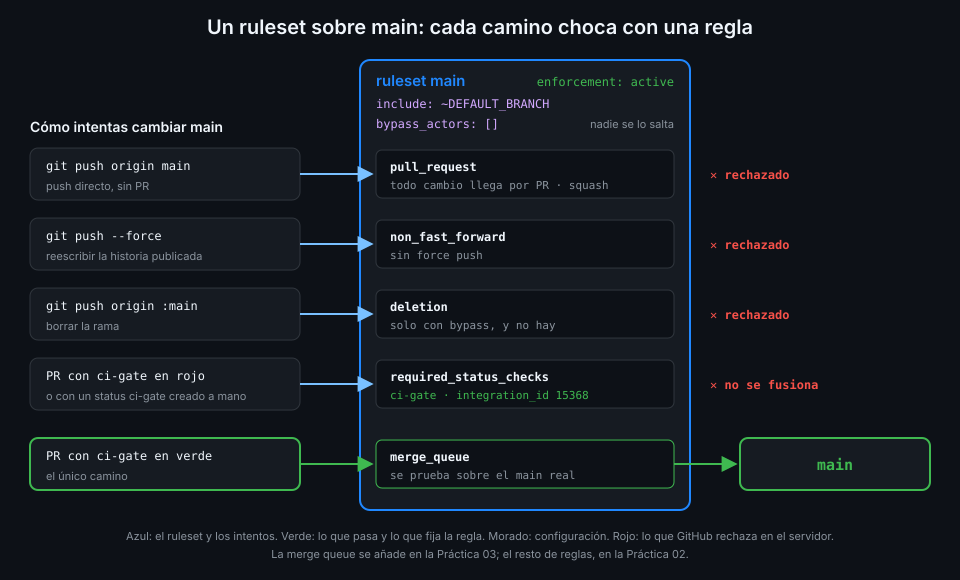

# De ramas protegidas a rulesets

> Hasta hoy, cualquiera con escritura en `tablero` podía hacer push a `main`, reescribir su
> historia o borrarla. Un ruleset convierte "lo que pactamos" en "lo que GitHub hace cumplir".



## 🎯 Objetivos

Al terminar este archivo eres capaz de:

- Explicar qué riesgos corre una rama `main` sin proteger, aunque el CI esté verde
- Distinguir la protección de rama clásica de un ruleset y saber por qué el bootcamp usa rulesets
- Describir las partes de un ruleset: destino, condiciones, `enforcement`, bypass y reglas
- Saber qué pasa cuando varios rulesets apuntan a la misma rama
- Decir qué rulesets hay en cada plan de GitHub y cuáles puedes usar en tu org Free
- Consultar las reglas que se aplican de verdad a una rama con la API

## 1. Qué problema resuelve

El CI de `tablero` lleva diecisiete semanas creciendo: tests contra PostgreSQL, imágenes
firmadas, despliegue a kind. Y sin embargo nada obliga a pasar por él. Un `git push origin main`
desde tu portátil entra en `main` sin que `ci` haya corrido, y `release.yml` lo convierte en
release en el mismo minuto.

Tres caminos llevan a `main` sin control:

- **Push directo**: el commit no pasa por PR, nadie lo ve antes y el CI llega tarde.
- **Force push**: reescribe la historia publicada. Un tag o un despliegue que apuntaba a un
  commit ahora apunta a algo que ya no está en la rama.
- **Borrado**: `git push origin :main` deja el repo sin rama por defecto.

Además hay un cuarto, más sutil: **un PR con el CI en rojo** se puede fusionar igual si nada lo
impide. El botón está ahí, verde o no.

Todo esto lo puedes pactar con tu equipo ("aquí no se hace push a `main`"). Un pacto funciona
hasta el viernes por la tarde. La protección de rama hace que GitHub rechace la operación en el
servidor, sin depender de la memoria de nadie.

## 2. Cómo funciona

### Dos mecanismos, el mismo objetivo

GitHub tiene dos formas de proteger una rama. La documentación lo dice así: "Rulesets and branch
protection rules can both protect branches in a repository. They work alongside each other, and
all applicable rules are enforced."

| | Protección de rama clásica | Ruleset |
|---|---|---|
| Cuántas por rama | Una sola regla por rama | Varios rulesets a la vez, que se suman |
| Activar y desactivar | Solo borrándola | `enforcement: active` o `disabled`, sin perder la configuración |
| Quién la ve | Solo quien administra el repo | Cualquiera con lectura en el repo |
| Bypass | Implícito para administradores | Explícito: lista de actores y modo |
| Como código | Endpoint propio, poco portable | Un JSON con la misma forma en la API y en la UI |
| Alcance de organización | No existe | Rulesets de org en Team y Enterprise |

El bootcamp usa rulesets. La protección clásica sigue existiendo y la verás en repos antiguos;
si un repo tiene las dos cosas, se aplican las dos.

### Las partes de un ruleset

Un ruleset es un objeto con cinco piezas:

| Pieza | Qué decide | En `tablero` |
|---|---|---|
| `target` | Sobre qué refs actúa: `branch`, `tag` o `push` | `branch` |
| `conditions.ref_name` | Qué ramas, por patrón (`include` y `exclude`) | `~DEFAULT_BRANCH` |
| `enforcement` | `active`, `disabled` o `evaluate` | `active` |
| `bypass_actors` | Quién puede saltarse las reglas y cómo | Nadie: `[]` |
| `rules` | La lista de reglas que se aplican | Archivo 02 |

`~DEFAULT_BRANCH` es un valor especial de `include`: la rama por defecto, se llame como se
llame. `~ALL` incluye todas. Un patrón de `exclude` gana: si casa, la condición no se cumple.

`enforcement: evaluate` aplica las reglas en modo de prueba, sin bloquear, para ver qué
rompería. Según la referencia de la API, "evaluate is only available with GitHub Enterprise".
En tu org Free solo tienes `active` y `disabled`.

### Varios rulesets, una sola rama

Un ruleset no tiene prioridad. Si varios apuntan a `main`, GitHub suma sus reglas y, cuando dos
definen la misma regla de forma distinta, "the most restrictive version of the rule applies".
Un ruleset que exige 1 aprobación y otro que exige 2 se traducen en 2.

Esto es lo que hace útiles los rulesets de organización: la org fija un mínimo, el repo añade lo
suyo, y ningún repo puede rebajar el mínimo de la org.

### Bypass: quién se lo salta y cómo

Cada entrada de `bypass_actors` tiene un `actor_type` (`OrganizationAdmin`, `RepositoryRole`,
`Team`, `Integration`, `DeployKey` o `User`), un `actor_id` y un `bypass_mode`:

| `bypass_mode` | Qué permite |
|---|---|
| `always` | Saltarse las reglas en cualquier operación, también en un push directo |
| `pull_request` | Saltárselas solo al fusionar un PR, no con push directo |
| `exempt` | Las reglas ni se evalúan para ese actor, y no queda entrada de bypass en la auditoría |

Un bypass es una puerta trasera legítima: el día que `ci-gate` se rompe por algo ajeno al código,
el admin puede fusionar el arreglo. También es la puerta que usaría alguien con la cuenta del
admin robada. `tablero` deja la lista vacía: si `ci-gate` se rompe, se arregla con otro PR, que
pasa por el mismo camino que todos. El `TODO 11` del starter quita justo un bypass del rol de
admin que viene puesto.

### Qué hay en cada plan

| Qué | Plan |
|---|---|
| Rulesets de repositorio | Repos públicos en Free y Free for organizations; públicos y privados en Pro, Team y Enterprise Cloud |
| Rulesets de organización | Team y Enterprise |
| `enforcement: evaluate` | Enterprise |
| Rulesets de tipo `push` | Team, en repos internos y privados |
| Límite | 75 rulesets por repo y 75 de organización |

Los rulesets de organización ya los viste en la
[Semana 11](../../week-11-actions_a_escala_de_organizacion/1-teoria/07-rulesets-que-exigen-workflows.md),
con la regla que exige workflows de otro repo. Allí fueron solo teoría porque piden el plan Team.
Esta semana usas los de **repositorio**, que tu org Free tiene en `tablero` por ser público. Las
reglas son las mismas; cambia dónde viven y quién puede quitarlas.

_Verificado con la API REST de rulesets (2022-11-28), gh 2.104.0 y ubuntu-24.04, noviembre de 2026._

## 3. Cómo se usa

### En la UI

Settings → Rules → Rulesets → New ruleset → New branch ruleset. La pantalla tiene los mismos
bloques que la tabla de arriba: nombre, enforcement, bypass list, target branches y rules. Sirve
para explorar. Para `tablero` lo escribes como código en `ops/github/ruleset-main.yaml` y lo
aplicas con la API (archivo 02): así el ruleset tiene historia en git y pasa por PR como todo lo
demás.

### Leer los rulesets de un repo

```bash
gh api 'repos/{owner}/{repo}/rulesets' --jq '.[] | "\(.id) \(.name) \(.enforcement) \(.source_type)"'
# 4815162 main active Repository
```

Por defecto la lista incluye los rulesets heredados de la org (`includes_parents=true`).

### Leer lo que se aplica de verdad a una rama

Varios rulesets se suman, así que lo útil no es cada uno por separado sino el resultado:

```bash
gh api 'repos/{owner}/{repo}/rules/branches/main' \
  --jq '.[] | "\(.type) ← \(.ruleset_source_type) \(.ruleset_id)"'
# deletion ← Repository 4815162
# non_fast_forward ← Repository 4815162
# pull_request ← Repository 4815162
# required_status_checks ← Repository 4815162
```

Cada elemento trae `type`, `parameters`, `ruleset_id` y `ruleset_source_type` (`Repository` u
`Organization`). La rama ni siquiera tiene que existir. Las reglas de rulesets en `evaluate` o
`disabled` no salen: es la vista de lo que **bloquea** hoy.

### Qué ve el que intenta saltárselo

Con el ruleset activo, un push directo a `main` falla en el servidor:

```bash
git push origin main
# remote: error: GH013: Repository rule violations found for refs/heads/main.
# remote: - Changes must be made through a pull request.
```

El texto exacto puede variar; lo que importa es que el push no entra. La Práctica 02 lo
comprueba con un push directo y con un force push.

## 4. Antipatrones

| Antipatrón | Por qué duele | Qué hacer en su lugar |
|---|---|---|
| Proteger `main` "por acuerdo" | El primer despiste entra en `main` sin CI y sale en una release | Ruleset activo con PR obligatorio |
| Rol de admin en `bypass_actors` con `always` | El admin, o quien robe su sesión, entra por push directo sin dejar PR | Lista vacía; si hace falta, `pull_request` y para un equipo concreto |
| Crear el ruleset solo en la UI | Nadie sabe quién lo cambió ni por qué; no se puede revisar | `ops/github/ruleset-main.yaml` en git, aplicado con la API |
| Patrón `main` en lugar de `~DEFAULT_BRANCH` | Si renombras la rama por defecto, el ruleset deja de protegerla | `~DEFAULT_BRANCH` |
| Mezclar protección clásica y rulesets sin saberlo | Se aplican las dos; una regla olvidada bloquea y nadie la encuentra | Una sola fuente: rulesets, y `rules/branches` para ver el total |
| Contar con `evaluate` en una org Free | No existe en el plan; la llamada falla | `disabled` para preparar, `active` para aplicar |

## 5. Trucos

- **Un ruleset que no bloquea todavía**: créalo con `enforcement: disabled`, revísalo en la UI y
  cámbialo a `active` con un `PUT` cuando estés listo. No pierdes nada al desactivarlo.
- **Saber de dónde viene una regla molesta**: el `ruleset_source_type` de `rules/branches` te dice
  si es tuya o de la org. Si es de la org, no la vas a encontrar en los ajustes del repo.
- **Comprobar sin romper nada**: `gh api repos/{owner}/{repo}/rules/branches/una-rama-que-no-existe`
  te dice qué reglas tendría una rama antes de crearla.

## 📚 Recursos Adicionales

- [GitHub Docs: About rulesets](https://docs.github.com/en/repositories/configuring-branches-and-merges-in-your-repository/managing-rulesets/about-rulesets)
- [GitHub Docs: Available rules for rulesets](https://docs.github.com/en/repositories/configuring-branches-and-merges-in-your-repository/managing-rulesets/available-rules-for-rulesets)
- [GitHub Docs: REST API endpoints for rules](https://docs.github.com/en/rest/repos/rules)
- [GitHub Docs: Creating rulesets for repositories in your organization](https://docs.github.com/en/organizations/managing-organization-settings/creating-rulesets-for-repositories-in-your-organization)

## ✅ Checklist de Verificación

- [ ] Sé qué cuatro caminos llevan a `main` sin control si no hay protección
- [ ] Sé tres diferencias entre la protección clásica y un ruleset
- [ ] Sé qué decide cada pieza de un ruleset y qué vale en `tablero`
- [ ] Sé qué regla gana cuando dos rulesets definen la misma de forma distinta
- [ ] Sé qué hace cada `bypass_mode` y por qué `tablero` no tiene bypass
- [ ] Sé qué rulesets tiene mi org Free y cuáles piden Team o Enterprise
- [ ] Sé leer con la API las reglas que se aplican de verdad a `main`

---

| ← Anterior | Siguiente → |
|:---|---:|
| [Semana 18 — Merge queue, rulesets y monorepos](../README.md) | [Las reglas de un ruleset](02-las-reglas-de-un-ruleset.md) |
