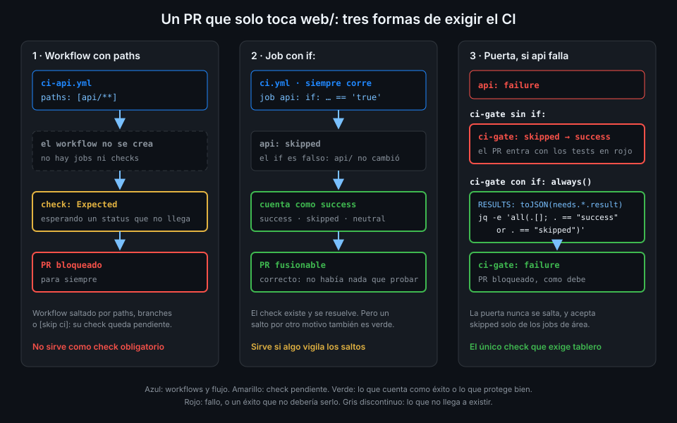

# Checks obligatorios y el job puerta

> Exigir un check parece sencillo hasta que su workflow no corre. Entonces el PR se queda
> esperando para siempre, o peor, entra sin que nada haya pasado.



## 🎯 Objetivos

Al terminar este archivo eres capaz de:

- Explicar por qué un workflow con filtros `paths` no puede ser un check obligatorio
- Explicar por qué un job saltado cuenta como éxito y qué riesgo crea eso
- Saber qué estados de un check dejan fusionar un PR
- Escribir un job puerta que solo pase si ningún job necesario falló ni se canceló
- Decidir qué jobs tiene que esperar la puerta y cuáles no

## 1. Qué problema resuelve

Hasta la Semana 17, `tablero` tiene un workflow por área: `ci-api.yml` con
`paths: [api/**, ...]`, `ci-web.yml` con `paths: [web/**, ...]`, y así. Es lo que aprendiste en la
[Semana 07](../../week-07-disparadores_filtros_y_concurrencia/1-teoria/02-filtros-de-rutas.md):
no gastar minutos en lo que no cambia.

Ahora quieres que el ruleset exija que el CI pase. La idea obvia es exigir los checks de cada
área: `test` de `ci-api`, `build` de `ci-web`... Y aquí aparecen dos problemas opuestos.

**Primer problema: el PR que espera para siempre.** Abres un PR que solo toca `web/`. `ci-api`
no corre, porque su filtro `paths` no casa. Su check no aparece nunca, y el PR se queda con
"Expected — Waiting for status to be reported". No hay nada que lo desbloquee.

**Segundo problema: el PR que entra sin probar.** Si en lugar de `paths` usas un job con `if:`
que se salta cuando su área no cambia, el check aparece como saltado. Y un check saltado **deja
fusionar**. Eso está bien cuando el área no cambió, pero un `if:` mal escrito, o un job que se
salta porque falló otro del que depende, también deja fusionar.

La solución tiene dos piezas: exigir **un solo check**, de un job que siempre corre, y que ese job
mire el resultado de todos los demás.

## 2. Cómo funciona

### Workflow saltado: pendiente

La referencia de sintaxis lo dice en la sección de filtros de rutas: "If a workflow is skipped due
to path filtering, branch filtering, or a commit message, then checks associated with that
workflow will remain in a "Pending" state. A pull request that requires those checks to be
successful will be blocked from merging."

Si el workflow no se crea, sus jobs no existen, y GitHub no tiene forma de saber que el check
"no aplicaba". Lo único que sabe es que el ruleset pide un nombre y ese nombre no ha llegado.

### Job saltado: éxito

En cambio, si el workflow corre y un job se salta por su `if:`, el check sí existe. Y la
documentación de condiciones es tajante: "A job that is skipped will report its status as
"Success". It will not prevent a pull request from merging, even if it is a required check."

La guía de checks obligatorios da la lista completa: "Successful check statuses are `success`,
`skipped`, and `neutral`."

| Qué pasa | Estado del check | ¿Deja fusionar? |
|---|---|---|
| El workflow no corre (`paths`, `branches`, `[skip ci]`) | No aparece: "Expected" | No, nunca |
| El job corre y pasa | `success` | Sí |
| El job se salta por `if:` | `skipped` | **Sí** |
| El job falla, se cancela o agota el tiempo | `failure`, `cancelled`, `timed_out` | No |

### La trampa del job saltado

Imagina una puerta ingenua:

```yaml
  ci-gate:
    name: ci-gate
    needs: [api, web]  # antipatron: sin if, un fallo en needs salta la puerta
    runs-on: ubuntu-24.04
    timeout-minutes: 5
    permissions: {}
    steps:
      - run: echo "todo verde"
```

Si `api` falla, GitHub no ejecuta `ci-gate`: un job con `needs` solo corre si todos sus `needs`
tuvieron éxito, salvo que su `if:` diga otra cosa. `ci-gate` queda **saltado**. Saltado es
éxito. El ruleset ve `ci-gate` en verde y deja fusionar un PR con los tests en rojo.

### La puerta que no se deja engañar

```yaml
  ci-gate:
    name: ci-gate
    needs: [structure, version, sql, changes, api, web, tools, smoke, workflows]
    # Sin always() un fallo en needs salta este job, y un check saltado cuenta como éxito.
    if: always()
    runs-on: ubuntu-24.04
    timeout-minutes: 5
    permissions: {}
    steps:
      - name: Ningún job necesario falló ni se canceló
        env:
          RESULTS: ${{ toJSON(needs.*.result) }}
        run: |
          echo "$RESULTS"
          jq -e 'all(.[]; . == "success" or . == "skipped")' <<<"$RESULTS" > /dev/null
```

Tres decisiones:

- **`if: always()`**: la puerta corre pase lo que pase en sus `needs`, incluso si el run se
  cancela. Nunca queda saltada, así que nunca da un éxito regalado.
- **`needs.*.result`** es la lista de resultados de todos los `needs`: `success`, `failure`,
  `cancelled` o `skipped`. `toJSON` la convierte en un array JSON que llega al shell por `env:`.
- **`jq -e 'all(...)'`** sale con código distinto de cero si algún resultado no es `success` ni
  `skipped`. El step falla, el job falla, `ci-gate` sale en rojo.

`skipped` se acepta a propósito: es lo que devuelve `api` cuando el PR no toca `api/`. Que el
salto sea legítimo lo decide el job `changes` (archivo 04), no la puerta.

### ¿Por qué no `!cancelled()` o `failure()`?

| `if:` de la puerta | Si un need falla | Si el run se cancela | Resultado |
|---|---|---|---|
| (ninguno) | Saltada → éxito | Saltada → éxito | Deja pasar fallos |
| `${{ !cancelled() }}` | Corre y falla | Saltada → éxito | Deja pasar una cancelación |
| `always()` | Corre y falla | Corre y falla | Correcto |

El job `summary` de `ci.yml` usa `!cancelled()` (Semana 02) y está bien: es un resumen, no un
check obligatorio. La puerta necesita `always()`.

### Por qué un nombre fijo

El ruleset exige el **nombre** del check. Para un job, ese nombre es su `name:`. `ci-gate` lleva
`name: ci-gate` explícito para que un cambio de idioma o de estilo en los nombres de los demás
jobs no toque nunca el ruleset. Los jobs de cada área pueden renombrarse, dividirse o
multiplicarse por matriz: el ruleset no se entera, porque solo conoce `ci-gate`.

_Verificado con actionlint 1.7.12, jq 1.7 y ubuntu-24.04, noviembre de 2026._

## 3. Cómo se usa

### Qué jobs espera la puerta

Todo lo que tiene que estar verde para fusionar va en `needs` de `ci-gate`:

| Job de `ci.yml` | En `needs` de `ci-gate` | Por qué |
|---|---|---|
| `structure`, `version`, `sql` | Sí | Comprobaciones baratas que valen para todo PR |
| `changes` | Sí | Si falla el cálculo de áreas, se saltaría todo y la puerta aceptaría `skipped` |
| `api`, `web`, `tools`, `smoke`, `workflows` | Sí | El CI de cada área |
| `runner-info` | No | Solo informa; si falla, no dice nada del código |
| `summary` | No | Es un resumen; ya mira los suyos |

`changes` es el que más importa. Si fallara y no estuviera en `needs`, las cinco áreas quedarían
saltadas (su `needs: changes` no se cumple) y la puerta vería cinco `skipped`: verde.

### Leer la puerta en un run

El `echo "$RESULTS"` deja en el log la lista que juzgó la puerta:

```bash
gh run view --log --job <job-id-de-ci-gate> | grep -o '\[".*"\]' | head -1
# ["success","success","success","success","skipped","success","skipped","success","skipped"]
```

Un resultado por job de `needs`, sin su nombre. Los tres `skipped` son `api`, `tools` y
`workflows`: el PR solo tocaba `web/`. Para saber cuál es cuál, mira el grafo del run en la UI.

### Ver el estado de los checks de un PR

```bash
gh pr checks <número> --required
# ci-gate  pass  1m12s  https://github.com/<tu-org>/tablero/actions/runs/...
```

`--required` filtra los checks que exige el ruleset. Si sale vacío y el PR sigue bloqueado, el
check exigido no ha llegado: estás en el primer problema.

## 4. Antipatrones

| Antipatrón | Por qué duele | Qué hacer en su lugar |
|---|---|---|
| Exigir el check de un workflow con `paths` | El PR que no toca esa ruta espera para siempre | Workflow sin `paths` y job puerta |
| Puerta sin `if: always()` | Un fallo en `needs` la salta, y saltada es verde | `if: always()` |
| Puerta con `${{ !cancelled() }}` | Un run cancelado deja la puerta saltada, en verde | `always()` y tratar `cancelled` como fallo |
| `contains(needs.*.result, 'failure')` como condición | Deja pasar `cancelled` | Lista blanca: solo `success` o `skipped` |
| Un job necesario fuera de `needs` de la puerta | Ese job puede fallar y el PR entra | Todo lo que bloquea, en `needs` |
| `needs.*.result` interpolado en `run:` | Expresión dentro del shell (regla 4) | Por `env:` |

## 5. Trucos

- **Probar la puerta sin romper nada**: en un PR de prueba, añade `exit 1` a un step de un área
  y comprueba que `ci-gate` sale en rojo. Quítalo después.
- **Ver qué estado tiene cada check de un commit**: `gh api repos/{owner}/{repo}/commits/<sha>/check-runs --jq '.check_runs[] | "\(.name) \(.conclusion)"'`
  enseña también los saltados, que la pestaña de checks esconde a veces.
- **Un need opcional**: si quieres que un job informe pero no bloquee, déjalo fuera de `needs` de
  la puerta, no le pongas `continue-on-error`. Así su fallo se ve en rojo y no engaña a nadie.

## 📚 Recursos Adicionales

- [GitHub Docs: Using conditions to control job execution](https://docs.github.com/en/actions/how-tos/write-workflows/choose-when-workflows-run/control-jobs-with-conditions)
- [GitHub Docs: Workflow syntax — paths](https://docs.github.com/en/actions/reference/workflows-and-actions/workflow-syntax#onpushpull_requestpull_request_targetpathspaths-ignore)
- [GitHub Docs: Troubleshooting required status checks](https://docs.github.com/en/pull-requests/collaborating-with-pull-requests/collaborating-on-repositories-with-code-quality-features/troubleshooting-required-status-checks)
- [GitHub Docs: Contexts — needs](https://docs.github.com/en/actions/reference/workflows-and-actions/contexts#needs-context)

## ✅ Checklist de Verificación

- [ ] Sé por qué un workflow con `paths` deja un check obligatorio en "Expected"
- [ ] Sé qué estados de un check dejan fusionar
- [ ] Sé por qué una puerta sin `if: always()` deja pasar un fallo
- [ ] Sé por qué `!cancelled()` no basta para la puerta y sí para el resumen
- [ ] Sé qué hace `jq -e 'all(...)'` con la lista de `needs.*.result`
- [ ] Sé por qué `changes` tiene que estar en `needs` de `ci-gate`

---

| ← Anterior | Siguiente → |
|:---|---:|
| [Las reglas de un ruleset](02-las-reglas-de-un-ruleset.md) | [CI de solo lo que cambia](04-ci-de-solo-lo-que-cambia.md) |
