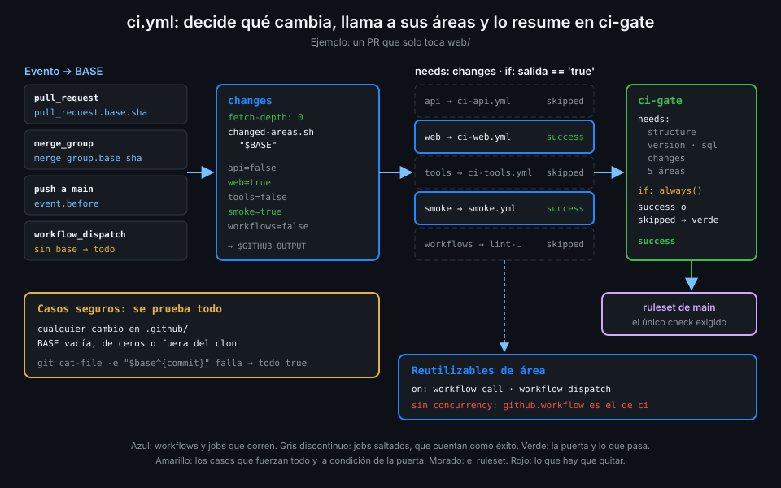

# CI de solo lo que cambia

> En un monorepo, correr todo en cada PR es caro y correr solo lo que cambia con `paths` choca
> con los checks obligatorios. La salida es decidirlo dentro del workflow, no antes.



## 🎯 Objetivos

Al terminar este archivo eres capaz de:

- Diseñar un CI de monorepo con un único punto de entrada y un job que decide qué áreas corren
- Elegir la base del diff correcta en un PR, en la merge queue, en un push y a mano
- Escribir el script que traduce un diff a áreas, con un caso seguro cuando no hay base
- Convertir los workflows de área en reutilizables llamados con `if:`
- Evitar que la concurrencia de un reutilizable cancele al workflow que lo llama
- Ajustar los workflows que dependían de los de área (`nightly`, `pr-report`)

## 1. Qué problema resuelve

El archivo 03 dejó dos condiciones: el ruleset exige un solo check, `ci-gate`, y su workflow no
puede tener filtros `paths`, porque entonces el check no aparecería. Pero quitar `paths` de todo
significa que un cambio de una línea en `web/README.md` corre los tests de la API contra
PostgreSQL, el smoke test con Compose y los linters de workflows. Minutos de runner y, sobre todo,
minutos tuyos esperando.

Lo que necesitas es la misma selección que hacía `paths`, pero tomada **dentro** de un workflow
que siempre corre. Así el workflow existe en todo PR, `ci-gate` siempre aparece, y lo que no
aplica se salta como job, que cuenta como éxito.

## 2. Cómo funciona

### La forma de `ci.yml`

`ci.yml` pasa a ser el único punto de entrada del CI:

1. **`changes`** hace checkout con historia completa, compara con la base y escribe una salida
   por área: `api=true`, `web=false`...
2. **Un job por área** (`api`, `web`, `tools`, `smoke`, `workflows`) con `needs: changes` y un
   `if:` sobre su salida. Cada uno llama al workflow de su área como reutilizable.
3. **`ci-gate`** espera a todos con `if: always()` (archivo 03).

Los workflows de área (`ci-api.yml`, `ci-web.yml`, `ci-tools.yml`, `smoke.yml`,
`lint-workflows.yml`) pierden sus disparadores `push` y `pull_request` y se quedan con
`workflow_call` y `workflow_dispatch`. Ya no deciden cuándo corren: los llama `ci.yml`.

### La base del diff depende del evento

"Lo que cambia" siempre es relativo a algo. Ese algo es distinto según qué disparó el run:

| Evento | Base | Qué significa |
|---|---|---|
| `pull_request` | `github.event.pull_request.base.sha` | La punta de la rama destino |
| `merge_group` | `github.event.merge_group.base_sha` | "The SHA of the merge group's parent commit": lo que tiene delante en la cola |
| `push` a `main` | `github.event.before` | El commit que había antes del push |
| `workflow_dispatch` | Ninguna | No hay nada con qué comparar |

Las tres expresiones caben en una, porque en cada evento solo una tiene valor y `||` devuelve el
primer valor no vacío:

```yaml
        env:
          # PR: la rama destino; cola: lo que hay delante en main; push: el commit anterior.
          BASE: ${{ github.event.pull_request.base.sha || github.event.merge_group.base_sha || github.event.before }}
```

Llega al shell por `env:` (regla 4), aunque un SHA no sea dato del usuario: así no hay excepción
que recordar.

### Sin base, todo

Hay casos en que la base no sirve:

- `workflow_dispatch`: la variable llega vacía.
- Un push que crea la rama: `before` vale cuarenta ceros.
- Un `before` que ya no está en el clon, por ejemplo tras un force push que lo sacó de la historia.

En los tres, el script hace lo seguro: **correr todo**. Un CI que se pasa de largo cuesta
minutos; uno que se queda corto deja pasar un fallo.

La otra regla segura: **cualquier cambio en `.github/` corre todo**. Un cambio en un workflow
reutilizable, en una action local o en el propio `ci.yml` puede romper cualquier área, y el diff
no tiene forma de saber cuál.

### El script

`scripts/changed-areas.sh` hace el trabajo en veinte líneas de bash. No hace falta una action de
terceros para un `git diff`:

```bash
#!/usr/bin/env bash
# Dice qué áreas de tablero cambian entre BASE y HEAD, una línea clave=true|false por área,
# lista para añadir a $GITHUB_OUTPUT. Sin BASE válida (dispatch, rama nueva) corre todo.
set -euo pipefail

base="${1:-}"
if [[ -n "$base" ]] && git cat-file -e "$base^{commit}" 2>/dev/null; then
  changed=$(git diff --name-only "$base" HEAD)
else
  changed=".github/"
fi

# Un cambio en .github/ puede alterar cualquier workflow o action: se prueba todo.
all=false
if grep -q '^\.github/' <<<"$changed"; then all=true; fi

area() {
  if [[ "$all" == true ]] || grep -qE "$1" <<<"$changed"; then echo true; else echo false; fi
}

echo "api=$(area '^api/')"
echo "web=$(area '^web/')"
echo "tools=$(area '^tools/')"
echo "smoke=$(area '^(api/|web/|compose\.yaml$|scripts/smoke-test\.sh$)')"
echo "workflows=$all"
```

`git cat-file -e "$base^{commit}"` comprueba que la base existe en el clon y es un commit. Los
cuarenta ceros y un SHA ausente fallan ahí y caen en el caso "todo". Fíjate en el truco: sin base,
el script finge un cambio en `.github/` y reutiliza la misma regla.

`smoke` cambia si cambia `api/`, `web/` o lo que monta el entorno del smoke test. `workflows`
solo cambia con `.github/`.

### El historial completo

`actions/checkout` trae por defecto un solo commit. Con eso `git diff` no encuentra la base:
`cat-file` fallaría y el script correría todo **siempre**, sin error visible. Por eso `changes`
hace checkout con `fetch-depth: 0`. Es el único job que lo necesita.

### Los reutilizables y la concurrencia

Hasta ahora cada workflow de área tenía su propio bloque `concurrency` con
`${{ github.workflow }}-${{ github.ref }}`. Llamados desde `ci.yml`, eso se rompe. La
documentación de reutilizables lo explica: "When a reusable workflow is triggered by a caller
workflow, the `github` context is always associated with the caller workflow." Y avisa: "A called
workflow uses the name of its caller workflow in ${{ github.workflow }}, so using this context
[...] in both caller and called workflows will cause the caller workflow to be cancelled when the
called workflow runs."

`ci-api` calcularía el grupo `ci-refs/pull/7/merge`, el mismo que el run de `ci` que lo llama, y
GitHub cancelaría uno de los dos. La solución es quitar `concurrency` de los reutilizables: el de
`ci.yml` ya cubre todo el run, áreas incluidas.

### Límites que se mueven de sitio

Un job que llama a un reutilizable (`uses:` a nivel de job) solo admite unas pocas claves:
`timeout-minutes` no está entre ellas. Los límites de tiempo viven en los jobs de dentro de cada
reutilizable, que ya los tenían desde la Semana 07.

_Verificado con actions/checkout@v7.0.1, actionlint 1.7.12 y ubuntu-24.04, noviembre de 2026._

## 3. Cómo se usa

### El job `changes` y una de las áreas

```yaml
  changes:
    name: Áreas que cambian
    runs-on: ubuntu-24.04
    timeout-minutes: 5
    permissions:
      contents: read
    outputs:
      api: ${{ steps.diff.outputs.api }}
      web: ${{ steps.diff.outputs.web }}
    steps:
      - uses: actions/checkout@3d3c42e5aac5ba805825da76410c181273ba90b1 # v7.0.1
        with:
          # La base del diff puede estar muchos commits atrás.
          fetch-depth: 0
          persist-credentials: false
      - name: Diff contra la base del evento
        id: diff
        env:
          BASE: ${{ github.event.pull_request.base.sha || github.event.merge_group.base_sha || github.event.before }}
        run: scripts/changed-areas.sh "$BASE" | tee -a "$GITHUB_OUTPUT"
  api:
    needs: changes
    if: needs.changes.outputs.api == 'true'
    uses: ./.github/workflows/ci-api.yml # zizmor: ignore[self-repository]
    permissions:
      contents: read
```

`tee -a` escribe las líneas en `$GITHUB_OUTPUT` y también en el log: ves en el run qué decidió.
Las salidas son cadenas, por eso el `if:` compara con `'true'` entre comillas. El reutilizable
local se llama con `./`, que corre en el mismo commit que `ci.yml`: no hay versión que fijar, y
el comentario silencia el aviso de zizmor que pide fijarla.

### Probarlo antes del push

El script solo necesita git. En tu rama:

```bash
scripts/changed-areas.sh origin/main
# api=false
# web=true
# tools=false
# smoke=true
# workflows=false
```

Es lo que hará `changes` en el PR.

### Lo que cambia alrededor

| Workflow | Antes | Ahora |
|---|---|---|
| `nightly.yml` | Lanza `ci-api`, `ci-web` y `smoke` por dispatch | Igual: siguen teniendo `workflow_dispatch` |
| `pr-report.yml` | `workflow_run` de `ci-web` | `workflow_run` de `ci`; si el PR no toca `web/`, no hay artefacto `dist-report` y no comenta |
| `images.yml` | `push` con `paths` | Igual: no es un check obligatorio, así que `paths` no molesta |

`pr-report` pregunta antes de descargar cuántos artefactos `dist-report` tiene el run, y solo
sigue si hay alguno. Sin esa comprobación fallaría en cada PR que no toca `web/`.

## 4. Antipatrones

| Antipatrón | Por qué duele | Qué hacer en su lugar |
|---|---|---|
| `paths` en un workflow cuyo check se exige | El PR que no toca esas rutas espera para siempre | Decidir dentro, con `changes` |
| Checkout por defecto en `changes` | Sin la base en el clon, todo corre siempre y nadie lo nota | `fetch-depth: 0` |
| Base vacía tratada como "nada cambió" | Un `workflow_dispatch` o una rama nueva no prueban nada | Sin base, todo |
| Ignorar `.github/` en el diff | Un cambio en un reutilizable rompe un área que no se prueba | `.github/` corre todo |
| `concurrency` con `github.workflow` en un reutilizable | Mismo grupo que el llamante: GitHub cancela uno de los dos | Sin `concurrency` en el reutilizable |
| Una action de terceros para un `git diff` | Otra dependencia que fijar, revisar y permitir en la org | Un script de veinte líneas |

## 5. Trucos

- **Forzar todo en un PR**: un cambio en blanco en cualquier archivo de `.github/` hace que
  `changes` marque todas las áreas. Útil para comprobar el CI completo antes de una release.
- **Ver qué decidió `changes` sin abrir el log**: `gh run view <run-id> --json jobs --jq '.jobs[] | "\(.name) \(.conclusion)"'`.
  Los saltados son las áreas que no cambiaron.
- **Lanzar un área sola**: `gh workflow run ci-api.yml --ref <rama>` sigue funcionando gracias a
  `workflow_dispatch`, sin pasar por `ci.yml`.

## 📚 Recursos Adicionales

- [GitHub Docs: Reusing workflow configurations](https://docs.github.com/en/actions/reference/workflows-and-actions/reusing-workflow-configurations)
- [GitHub Docs: Events that trigger workflows — merge_group](https://docs.github.com/en/actions/reference/workflows-and-actions/events-that-trigger-workflows#merge_group)
- [actions/checkout: fetch-depth](https://github.com/actions/checkout#usage)
- [Git: git-cat-file](https://git-scm.com/docs/git-cat-file)

## ✅ Checklist de Verificación

- [ ] Sé por qué la selección de áreas va dentro de `ci.yml` y no en `paths`
- [ ] Sé qué base usa el diff en un PR, en la cola, en un push y a mano
- [ ] Sé por qué sin base o con cambios en `.github/` se corre todo
- [ ] Sé por qué `changes` necesita `fetch-depth: 0`
- [ ] Sé por qué los reutilizables de área no tienen `concurrency`
- [ ] Sé qué cambia en `nightly`, `pr-report` e `images`

---

| ← Anterior | Siguiente → |
|:---|---:|
| [Checks obligatorios y el job puerta](03-checks-obligatorios-y-el-job-puerta.md) | [Merge queue](05-merge-queue.md) |
