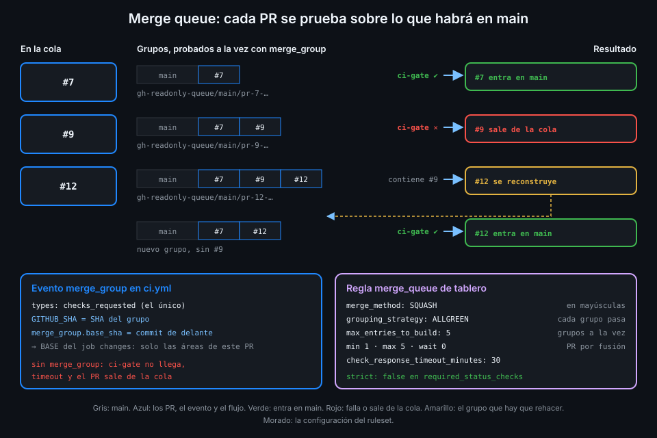

# Merge queue

> Dos PR en verde por separado pueden dejar `main` en rojo juntos. La merge queue prueba cada PR
> sobre lo que de verdad habrá en `main` cuando entre, y solo entonces lo fusiona.



## 🎯 Objetivos

Al terminar este archivo eres capaz de:

- Explicar por qué un PR con el CI en verde puede romper `main`
- Comparar "rama al día" (`strict`) con la merge queue
- Describir cómo construye la cola sus grupos y qué prueba en cada uno
- Preparar un workflow para la cola con el evento `merge_group`
- Elegir los parámetros de la regla `merge_queue` y saber qué hace cada uno
- Meter un PR en la cola desde `gh` y seguirlo

## 1. Qué problema resuelve

El CI de un PR prueba **la rama del PR fusionada con `main` en el momento en que corrió**. Si
`main` avanza después, ese resultado se queda viejo.

Un caso real en `tablero`: el PR A renombra una función de `api/` y actualiza sus llamadas. El PR
B, abierto antes, añade una llamada nueva a la función con el nombre antiguo. Los dos pasan el CI
por separado, porque cada uno se probó contra un `main` sin el otro. Fusionas A, fusionas B, y
`main` no compila. Ningún PR estaba mal; la combinación sí.

Hay dos formas de cerrar ese hueco:

| | Rama al día (`strict: true`) | Merge queue |
|---|---|---|
| Qué exige | Que la rama del PR contenga el último `main` antes de fusionar | Nada al autor: la cola construye la combinación |
| Quién actualiza | El autor, a mano o con el botón "Update branch" | La cola, sola |
| Con mucho movimiento | Carrera: actualizas, otro fusiona, vuelves a actualizar | Los PR esperan en fila y se prueban en grupo |
| Qué se prueba | La rama actualizada | `main` + los PR que van delante + el tuyo |

La merge queue da la garantía de `strict` sin la carrera. Por eso el ruleset de `tablero` lleva
`strict_required_status_checks_policy: false` (archivo 02): con cola, `strict` solo añadiría una
espera más.

## 2. Cómo funciona

### Grupos sobre `main`

Cuando un PR entra en la cola, GitHub crea una rama temporal con el prefijo
`gh-readonly-queue/main/`. Su contenido es `main`, más los PR que ya están delante en la cola,
más este PR. La documentación dice que estas ramas "contain a different `sha` from the pull
request": no es el commit del PR, es la combinación.

Sobre esa rama corren los checks obligatorios. Si pasan, el PR se fusiona. Si fallan, el PR sale
de la cola y los que iban detrás se reconstruyen sin él.

Con varios PR en fila, la cola no espera a que termine uno para probar el siguiente:

| Rama temporal | Contenido | Si pasa |
|---|---|---|
| `gh-readonly-queue/main/pr-7-…` | `main` + #7 | Entra #7 |
| `gh-readonly-queue/main/pr-9-…` | `main` + #7 + #9 | Entra #9 |
| `gh-readonly-queue/main/pr-12-…` | `main` + #7 + #9 + #12 | Entra #12 |

Las tres se prueban a la vez. Si #9 falla, sale; la de #12 se rehace como `main` + #7 + #12.

### El evento `merge_group`

Los checks de la rama temporal no se disparan con `push` ni con `pull_request`. Tienen su propio
evento, y la documentación de la cola no deja margen: "You **must** use the `merge_group` event to
trigger your GitHub Actions workflow when a pull request is added to a merge queue." Si el
workflow que publica `ci-gate` no escucha `merge_group`, la cola espera un `ci-gate` que nunca
llega, agota el tiempo y saca el PR.

| Dato | Valor en un run de `merge_group` |
|---|---|
| Tipo de actividad | `checks_requested` (el único) |
| `GITHUB_SHA` | El SHA del grupo |
| `GITHUB_REF` | La ref del grupo: `refs/heads/gh-readonly-queue/main/…` |
| `github.event.merge_group.base_sha` | "The SHA of the merge group's parent commit" |
| `github.event.merge_group.head_sha` | El SHA del grupo |
| `github.event.merge_group.base_ref` | La rama destino: `refs/heads/main` |

`base_sha` es la base del diff de `changes` en la cola (archivo 04): el commit que el grupo tiene
justo delante. Así, en la cola, `changes` decide las áreas de **este** PR, no las de todos los
que van delante, que ya se probaron en su grupo.

El evento admite los filtros `branches` y `branches-ignore`, que se refieren a la rama destino.
La sintaxis no ofrece `paths` para `merge_group`: otra razón para decidir las áreas dentro del
workflow.

### `ci.yml` con la cola

```yaml
name: ci
on:
  push:
    branches: [main]
  pull_request:
  # Sin este evento la merge queue espera un ci-gate que nunca llega.
  merge_group:
  workflow_dispatch:
# Un run por workflow y ref: en un PR, el push nuevo cancela el run anterior;
# en main cada commit termina su run.
concurrency:
  group: ${{ github.workflow }}-${{ github.ref }}
  cancel-in-progress: ${{ github.event_name == 'pull_request' }}
permissions: {}
jobs:
  ci-gate:
    name: ci-gate
    runs-on: ubuntu-24.04
    timeout-minutes: 5
    permissions: {}
    steps:
      - run: echo "el ci-gate completo está en el archivo 03"
```

La concurrencia no cambia: en la cola, `github.ref` es la ref del grupo, distinta para cada
grupo, y `cancel-in-progress` solo es `true` en `pull_request`. Dos grupos nunca se cancelan entre
sí.

Fíjate en el orden: `merge_group` va en `ci.yml` **antes** de activar la cola. Si activas la
regla primero, el siguiente PR que encoles se quedará esperando hasta el timeout.

### Los parámetros de la regla

La cola es una regla más del ruleset, `merge_queue`, con todos sus parámetros obligatorios:

| Parámetro | Rango | Qué decide | En `tablero` |
|---|---|---|---|
| `merge_method` | `MERGE`, `SQUASH`, `REBASE` | Cómo entra cada PR. En **mayúsculas** | `SQUASH` |
| `grouping_strategy` | `ALLGREEN`, `HEADGREEN` | Qué commits del grupo tienen que pasar | `ALLGREEN` |
| `max_entries_to_build` | 0-100 | Cuántos grupos se prueban a la vez | `5` |
| `min_entries_to_merge` | 0-100 | Cuántos PR espera reunir antes de fusionar | `1` |
| `max_entries_to_merge` | 0-100 | Cuántos PR fusiona de una vez | `5` |
| `min_entries_to_merge_wait_minutes` | 0-360 | Cuánto espera a reunir el mínimo | `0` |
| `check_response_timeout_minutes` | 1-360 | Tras cuánto un check sin respuesta cuenta como fallo | `30` |

**`ALLGREEN`** exige que pase cada grupo. **`HEADGREEN`**, según la API, "only the commit at the
head of the merge group [...] must pass its required checks to merge": el grupo de cabeza
contiene a todos los de delante, así que su verde se toma como prueba de todos. Ahorra esperas
en repos con mucho tráfico; en `tablero`, con uno o dos PR a la vez, `ALLGREEN` es lo honesto.

**`check_response_timeout_minutes: 30`** se elige mirando el CI: un run completo de `ci` en
`tablero` tarda bastante menos, así que 30 minutos solo salta si algo se cuelga o si el workflow
no escucha `merge_group`.

No te fíes de los valores que propone la UI: elige cada uno sabiendo qué hace. La UI expresa los
mismos parámetros con nombres de pantalla ("Build concurrency", "Status check timeout"...).

### Por qué un PR sale de la cola

La documentación da los motivos: "Timed out awaiting a successful CI result based off the
configured timeout setting", y "if there are failed required status checks or conflicts with the
base branch, the pull request will be removed from the queue." El PR vuelve a su estado normal,
con un evento en su línea de tiempo que dice por qué.

### Dónde está disponible

"Pull request merge queues are available in any public repository owned by an organization, or
in private repositories owned by organizations using GitHub Enterprise Cloud." `<tu-org>/tablero`
cumple: público y de una organización. En un repo de tu cuenta personal no está disponible.

_Verificado con la API REST de rulesets, gh 2.104.0, actionlint 1.7.12 y ubuntu-24.04, noviembre de 2026._

## 3. Cómo se usa

### Meter un PR en la cola

Con la cola activa, el botón del PR pasa a decir "Merge when ready". Desde la terminal,
`gh pr merge` hace lo mismo:

```bash
gh pr merge 7
# Si los checks del PR aún no pasan, activa el auto-merge: entrará en la cola al pasar.
# Si ya pasan, lo mete en la cola directamente.
```

`--admin` se saltaría la cola, pero solo a quien tenga bypass, y en `tablero` nadie lo tiene.

### Seguir la cola

```bash
gh run list --workflow ci.yml --event merge_group --limit 5 \
  --json headBranch,status,conclusion --jq '.[] | "\(.headBranch) \(.status) \(.conclusion)"'
# gh-readonly-queue/main/pr-7-… completed success
```

Para saber si un PR entró por la cola, busca un run de `merge_group` cuya rama temporal lleve
su número (`gh-readonly-queue/main/pr-7-…`) y, después, el run de `push` del commit que dejó en
`main`. La Práctica 03 lo comprueba así.

## 4. Antipatrones

| Antipatrón | Por qué duele | Qué hacer en su lugar |
|---|---|---|
| Activar la cola sin `merge_group` en el workflow | Cada PR espera hasta el timeout y sale de la cola | `merge_group` en `ci.yml` primero, la regla después |
| `strict: true` además de la cola | Dos esperas para la misma garantía | `strict: false` |
| `paths` para filtrar en `merge_group` | La sintaxis no lo ofrece | Decidir dentro con `changes` y `base_sha` |
| Diff de la cola contra `main` en lugar de `base_sha` | Mezcla las áreas de los PR de delante | `merge_group.base_sha` |
| Timeout de 360 minutos "por si acaso" | Un CI colgado bloquea la cola seis horas | Algo más que tu CI más lento |
| `merge_method: squash` en minúsculas | La API lo rechaza | `SQUASH` |

## 5. Trucos

- **Ver el contenido de un grupo**: `git fetch origin 'refs/heads/gh-readonly-queue/*:refs/remotes/queue/*'`
  mientras la cola trabaja te deja las ramas temporales en local para mirarlas con `git log`.
- **Sacar un PR de la cola**: `gh pr merge <n> --disable-auto` desactiva el auto-merge; en la UI,
  "Remove from queue".
- **Saber por qué salió**: la línea de tiempo del PR en la UI deja un evento con el motivo, y el
  run de `merge_group` que falló está en `gh run list --event merge_group`.

## 📚 Recursos Adicionales

- [GitHub Docs: Managing a merge queue](https://docs.github.com/en/repositories/configuring-branches-and-merges-in-your-repository/configuring-pull-request-merges/managing-a-merge-queue)
- [GitHub Docs: Merging a pull request with a merge queue](https://docs.github.com/en/pull-requests/collaborating-with-pull-requests/incorporating-changes-from-a-pull-request/merging-a-pull-request-with-a-merge-queue)
- [GitHub Docs: Events that trigger workflows — merge_group](https://docs.github.com/en/actions/reference/workflows-and-actions/events-that-trigger-workflows#merge_group)
- [GitHub Docs: Create a repository ruleset — merge_queue](https://docs.github.com/en/rest/repos/rules#create-a-repository-ruleset)

## ✅ Checklist de Verificación

- [ ] Sé explicar con un ejemplo cómo dos PR verdes rompen `main`
- [ ] Sé qué ventaja tiene la cola sobre `strict: true`
- [ ] Sé qué contiene una rama `gh-readonly-queue/main/…`
- [ ] Sé por qué el workflow de `ci-gate` tiene que escuchar `merge_group`
- [ ] Sé qué base usa `changes` en la cola y por qué
- [ ] Sé qué hacen `ALLGREEN`, `HEADGREEN` y el timeout de checks
- [ ] Sé meter un PR en la cola con `gh pr merge` y seguirlo

---

| ← Anterior | Siguiente → |
|:---|---:|
| [CI de solo lo que cambia](04-ci-de-solo-lo-que-cambia.md) | [CODEOWNERS y revisión en equipo](06-codeowners-y-revision-en-equipo.md) |
