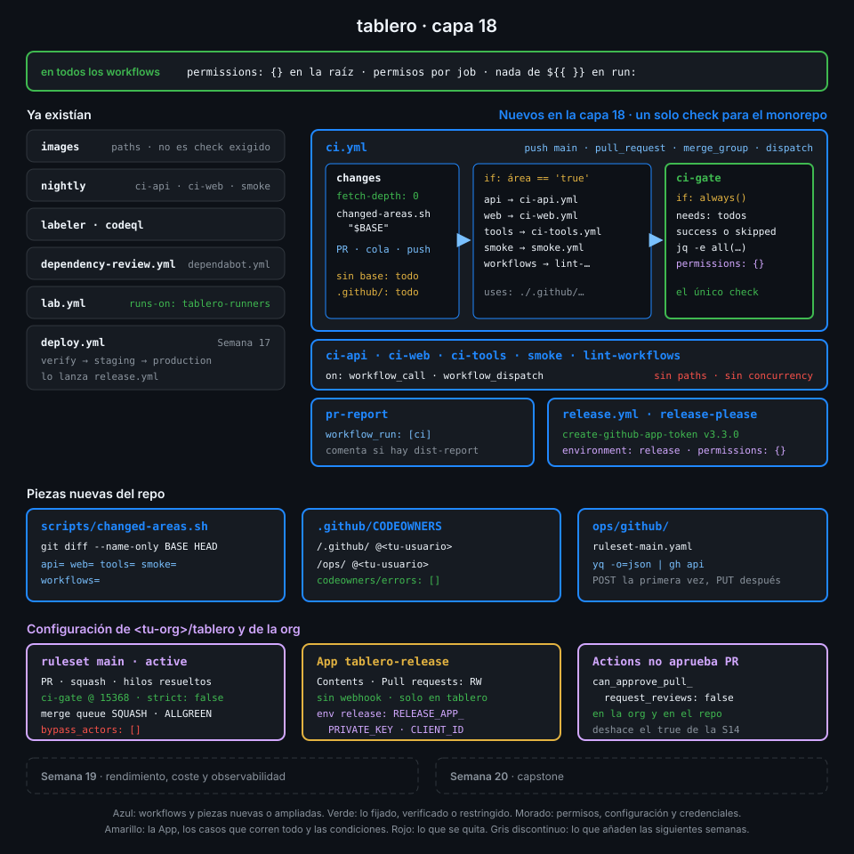

# Proyecto: capa 18 de tablero



## 🎯 Objetivo

Que `main` de `tablero` solo cambie por un PR que ha pasado un único check, `ci-gate`, y que la
merge queue ha vuelto a probar sobre el `main` real. Cada PR corre solo el CI de las áreas que
toca, pero `ci-gate` siempre llega, así que nunca se queda en "Expected". Nadie se salta el
ruleset, tampoco tú como admin. Y el PR de release lo abre una GitHub App, de modo que pasa por
la misma puerta que los tuyos, mientras `GITHUB_TOKEN` deja de poder crear o aprobar PR.

## 📦 Qué añade esta capa

| Pieza de `tablero` | Qué hace | Por qué existe |
|---|---|---|
| `scripts/changed-areas.sh` (nuevo) | Imprime `api=`, `web=`, `tools=`, `smoke=` y `workflows=` según el diff entre una base y `HEAD`; todo `true` si cambia `.github/` o la base no sirve | Un filtro `paths` deja un check en "Pending" para siempre; un diff dentro de un job no |
| `ci.yml`, job `changes` (nuevo) | Trae el historial completo y calcula las áreas contra la base del PR, del grupo de la cola o del push | Cada evento guarda su base en un sitio distinto del payload |
| `ci.yml`, jobs `api`, `web`, `tools`, `smoke` y `workflows` (nuevos) | Llaman a los workflows de área como reutilizables, cada uno solo si su área cambió | Un job saltado cuenta como éxito; un workflow saltado, como pendiente |
| `ci.yml`, job `ci-gate` (nuevo) | Corre siempre, sin permisos, y falla si algún job terminó en algo distinto de `success` o `skipped` | Un único check obligatorio que no cambia cuando añades o quitas un área |
| `ci.yml`, evento `merge_group` | La cola pide los checks y `ci.yml` contesta | Sin él, el PR espera en la cola hasta el timeout y sale |
| `ci-api.yml`, `ci-web.yml`, `ci-tools.yml`, `smoke.yml` y `lint-workflows.yml` | Solo `workflow_call` y `workflow_dispatch`, sin `concurrency` propia | En un reutilizable `github.workflow` es el del llamante: su grupo cancelaría al run de `ci` |
| `pr-report.yml` | Escucha a `ci` y solo comenta si el run trae `dist-report` | Si el PR no toca `web/`, no hay informe que publicar |
| `.github/CODEOWNERS` (nuevo) | Te asigna `/.github/` y `/ops/` | GitHub pide revisión al dueño de lo que más duele cambiar |
| `ops/github/ruleset-main.yaml` (nuevo) | Sin borrado ni force push, PR obligatorio con 0 aprobaciones, `ci-gate@15368`, merge queue y `bypass_actors: []` | La protección de `main` versionada y revisable como cualquier otro código |
| `release.yml`, job `release-please` | `permissions: {}`, `environment: release` y el token de la App `tablero-release`, limitado a contents y pull-requests | Con `GITHUB_TOKEN` el CI del PR de release se queda esperando aprobación y `ci-gate` no corre solo |
| Ajuste de la org y del repo | `can_approve_pull_request_reviews=false` | Ya nadie lo necesita, y dejar que Actions apruebe PR es un riesgo |

| Situación | Qué pasa |
|---|---|
| Abres un PR que solo toca `web/` | Corren `web` y `smoke`; `api`, `tools` y `workflows` salen `skipped` y `ci-gate` pasa |
| Abres un PR que toca `.github/` | Corre todo: un workflow o una action cambiados pueden romper cualquier área |
| `api` falla o se cancela | `ci-gate` falla y el PR no se puede fusionar |
| Intentas un `git push` directo o un `--force` a `main` | El servidor lo rechaza con `GH013`, también a ti |
| Dos PR verdes entran en la cola a la vez | La cola prueba el segundo encima del primero; si no casan, saca el segundo y `main` sigue verde |
| release-please abre el PR de release | Lo firma la App, corre `ci`, pasa `ci-gate` y entra por la cola como cualquier otro |
| Fusionas el PR de release | Release, imágenes y `deploy.yml` de la Semana 17, igual que antes |

La Semana 19 mide este CI: ahora que cada PR corre solo lo que cambia, toca saber cuánto tarda,
cuánto cuesta y dónde se va el tiempo de cada run.

## ✅ Requisitos verificables

- scripts/changed-areas.sh marca solo las áreas que tocan los archivos cambiados, y todas si cambia .github/ o no hay base
- ci.yml corre en pull_request, en merge_group y en push a main
- El job changes de ci.yml calcula las áreas con scripts/changed-areas.sh contra la base del PR, de la cola o del push, con el historial completo
- ci.yml llama a ci-api, ci-web, ci-tools, smoke y lint-workflows como reutilizables, cada uno solo si su área cambia
- ci-api, ci-web, ci-tools, smoke y lint-workflows solo se disparan por workflow_call o a mano, y sin concurrency propia
- ci-gate corre siempre, sin permisos, después de todos los jobs de ci.yml salvo runner-info y summary
- ci-gate pasa si todo terminó en success o skipped, y falla si algún job falló o se canceló
- pr-report.yml escucha a ci y solo comenta cuando el run trae el artefacto dist-report
- actionlint y zizmor pasan sin hallazgos sobre los workflows de tablero
- CODEOWNERS asigna dueño a /.github/ y a /ops/
- ops/github/ruleset-main.yaml protege la rama por defecto sin excepciones: sin borrado ni force push, PR obligatorio sin aprobaciones, ci-gate de GitHub Actions como check y merge queue
- El job release-please de release.yml no da permisos a GITHUB_TOKEN y usa un token de la GitHub App, limitado a contents y pull-requests, desde el environment release
- La rama main de tablero tiene activas las reglas del ruleset, con ci-gate de GitHub Actions como check obligatorio
- GitHub no encuentra errores en el CODEOWNERS de tablero
- Ni la organización ni tablero dejan que GITHUB_TOKEN cree o apruebe pull requests
- El environment release solo admite main y guarda la clave privada y el client ID de la App
- El PR del último commit de main pasó ci-gate en la merge queue y ci volvió a pasar en el push a main
- El último PR de release lo abrió la GitHub App, no GITHUB_TOKEN, y ci-gate corrió en verde sobre él

## 🎨 Criterios de calidad

Lo que `check-week.sh` no ve y la [rúbrica](../rubrica-evaluacion.md) sí puntúa:

- `ruleset-main.yaml` lleva un comentario por regla que dice qué riesgo frena, y otro que explica
  por qué `strict_required_status_checks_policy` vale `false` con la cola activa.
- El ruleset activo es el del archivo: lo compruebas sacando el de la API con `yq -P` y
  comparándolo, no de memoria.
- La App `tablero-release` pide solo Contents y Pull requests (más Metadata), sin webhook, solo
  instalable en tu cuenta e instalada solo en `tablero`.
- La clave `.pem` vive fuera de cualquier repo con permisos `600`, y solo existe una clave activa
  en la App (las de prueba, borradas).
- `changed-areas.sh` explica en su cabecera por qué `.github/` y una base inválida corren todo.
- Los PR de prueba de las prácticas están cerrados o fusionados y sus ramas borradas.
- Sin `TODO` en el repo.

## 💡 Adaptación a tu dominio

| Tu caso | Cómo decides qué correr | Qué protege `main` | Qué cambia |
|---|---|---|---|
| Monorepo con decenas de paquetes | Un grafo de dependencias (Nx, Turborepo, Bazel) en lugar de prefijos de carpeta | El mismo ruleset con `ci-gate` | `changes` emite una lista JSON y una matriz llama al reutilizable por paquete |
| Equipo de 5-10 personas | Igual que aquí | Ruleset con 1 aprobación, `require_code_owner_review` y `require_last_push_approval` | CODEOWNERS con equipos de la org en lugar de tu usuario |
| Muchos repos en una org Team o Enterprise | Igual que aquí | Un ruleset de **organización** con condición por nombre de repo | El YAML se aplica con `orgs/{org}/rulesets` y cada repo hereda las reglas |
| Varios bots que abren PR (Renovate, release-please, generadores) | Igual que aquí | El mismo ruleset: los PR de los bots pasan por la cola | Una App por bot, cada una con solo los permisos que usa |

## 🚦 Cómo entregarlo

Si hiciste las cuatro prácticas ya lo tienes todo: repásalo contra los requisitos y los
criterios. Si no, parte del starter y sigue el orden de las prácticas: desde que el ruleset está
activo, todo llega a `main` por PR.

1. Copia el starter en una rama y completa los `TODO 1` a `TODO 14`:

   ```bash
   cd ~/code/tablero
   git switch main && git pull --ff-only
   git switch -c ci/layer-18
   S=~/code/bc-github-actions/bootcamp/week-18-merge_queue_rulesets_y_monorepos/3-proyecto/starter
   cp -r "$S"/. .
   grep -rnE "TODO [0-9]+" .github ops scripts | wc -l
   # 14
   ```

2. Convierte los workflows de área en reutilizables, ajusta `pr-report.yml`, fusiona y comprueba
   un PR que solo toque `web/`
   ([práctica 01](../2-practicas/01-un-solo-check-para-un-monorepo.md)). Antes del push:

   ```bash
   actionlint && GH_TOKEN=$(gh auth token) zizmor -q .github/ && echo limpio
   # limpio
   scripts/changed-areas.sh origin/main
   ```

3. Aplica el ruleset con `POST` y comprueba que `main` rechaza pushes directos y PR en rojo
   ([práctica 02](../2-practicas/02-ruleset-y-codeowners-en-main.md)).

4. Añade `merge_group` por PR, activa la cola con `PUT` y fusiona dos PR a través de ella
   ([práctica 03](../2-practicas/03-merge-queue.md)).

5. Crea la App, el environment `release`, cambia `release.yml`, cierra
   `can_approve_pull_request_reviews` y lleva una release de punta a punta
   ([práctica 04](../2-practicas/04-release-please-con-una-github-app.md)).

6. Lanza la verificación:

   ```bash
   cd ~/code/bc-github-actions
   ./scripts/check-week.sh 18
   # 18/18 comprobaciones superadas.
   ```

## 🧯 Errores comunes

| Síntoma | Causa | Solución |
|---|---|---|
| El PR entra en la cola y a los 30 minutos sale sin que corra `ci-gate` | `ci.yml` de `main` no escucha `merge_group`, así que nadie contesta a la cola | Añade `merge_group` por PR antes de activar la cola ([práctica 03](../2-practicas/03-merge-queue.md), paso 1) |
| `ci-gate` sale `skipped` cuando falla un área, y el PR se fusiona | El job puerta no tiene `if: always()`: con un `needs` fallido se salta, y saltado cuenta como éxito | `if: always()` y `jq -e` sobre `toJSON(needs.*.result)` ([práctica 01](../2-practicas/01-un-solo-check-para-un-monorepo.md), paso 4) |
| El run de `ci` aparece cancelado sin un push nuevo | Un reutilizable conserva `concurrency` con `github.workflow`, que es el del llamante: mismo grupo que `ci` | Quita el bloque `concurrency` de los workflows de área ([práctica 01](../2-practicas/01-un-solo-check-para-un-monorepo.md), paso 3) |
| El PR espera un `ci-gate` que nunca llega aunque el job está verde | El check del ruleset no tiene `integration_id` 15368, o el `name:` del job no es `ci-gate` | Corrige el YAML y aplícalo con `PUT` ([práctica 02](../2-practicas/02-ruleset-y-codeowners-en-main.md), paso 3) |
| El push directo a `main` entra | El ruleset está en `disabled` o tu rol sigue en `bypass_actors` (`TODO 11`) | `bypass_actors: []` y `enforcement: active` |
| `changes` marca todo `true` en un PR pequeño | Checkout superficial: la base no está en el clon | `fetch-depth: 0` en el checkout de `changes` |
| El PR de release sigue siendo de `app/github-actions` y su CI espera aprobación | Quedó abierto un PR de release viejo, de la Semana 14, y release-please lo actualiza | Ciérralo con `gh pr close <n> --delete-branch`; el siguiente push a `main` lo reabre la App ([práctica 04](../2-practicas/04-release-please-con-una-github-app.md), paso 5) |
| GitHub no deja crear la App: el nombre ya está en uso | El nombre de una GitHub App es único en todo GitHub y otro alumno ya creó `tablero-release` | Usa `<tu-org>-tablero-release`; en los comandos, el slug que te dé GitHub ([práctica 04](../2-practicas/04-release-please-con-una-github-app.md), paso 1) |
| `client-id` o `private-key` llegan vacíos al step del token | Secreto o variable en el repo en vez de en `release`, o falta `environment: release` en el job | [Práctica 04](../2-practicas/04-release-please-con-una-github-app.md), pasos 2 y 3 |
| `check-week.sh` de semanas anteriores marca checks en rojo | La capa 18 cambia piezas que esas comprobaciones miraban | Es lo esperado: mira la tabla siguiente |

Comprobaciones de capas anteriores que esta capa pone en rojo a propósito
([comprobaciones superadas por capas posteriores](../../../docs/autograding.md#comprobaciones-superadas-por-capas-posteriores)):

| Semana | Comprobación | Por qué cambia |
|:--:|---|---|
| 07 | `ci-api-paths`, `ci-web-paths` | Los workflows de área pierden `push` y `pull_request`: los llama `ci.yml` |
| 08 | `lint-paths` | Lo mismo con `lint-workflows.yml` |
| 08 | `jobs-timeout` | Un job que llama a un reutilizable no admite `timeout-minutes`: el límite vive en el reutilizable |
| 08 | `lint-green-on-main` | `lint-workflows` ya no tiene runs propios: corre dentro de `ci` |
| 09 | `paths-include-reusable` | Ya no hay filtros `paths` que mantener |
| 09 | `callers-green-on-main` | `ci-api` y `ci-web` corren dentro de `ci` |
| 10 | `test-actions-green-on-main` | Igual: lo comprueba `merged-through-queue` |
| 11, 12 | `green-on-main` | Igual |
| 12 | `pr-report-safe` | `pr-report.yml` escucha a `ci` en vez de a `ci-web` |
| 14 | `release-please-permissions` | El job deja `GITHUB_TOKEN` sin permisos y escribe con el token de la App |

Y una vuelve a verde: `org-default-token-read` de la Semana 11, que la Semana 14 había puesto en
rojo al abrir `can_approve_pull_request_reviews`.

## 🔗 Navegación

---

| ← Anterior | Siguiente → |
|:---|---:|
| [Práctica 04 — release-please con una GitHub App](../2-practicas/04-release-please-con-una-github-app.md) | [Rúbrica de evaluación](../rubrica-evaluacion.md) |
