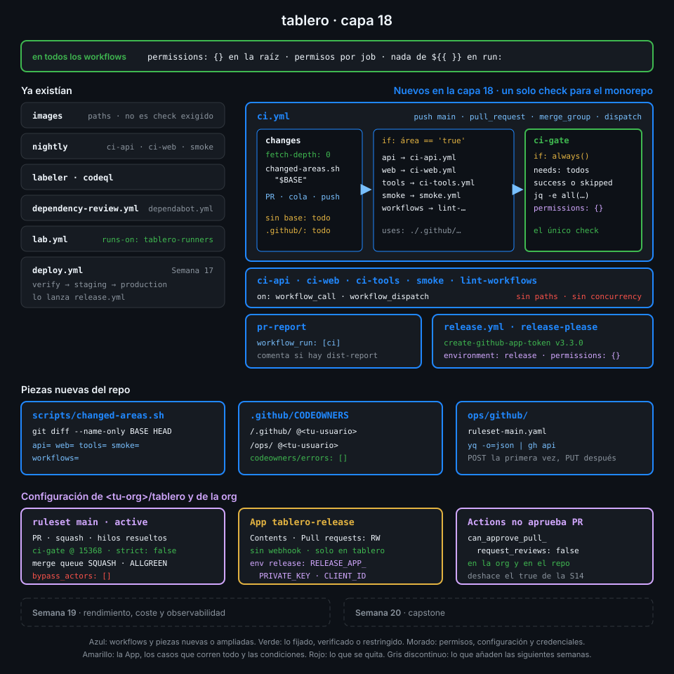

# Semana 18 — Merge queue, rulesets y monorepos

> Hasta ahora `main` aceptaba cualquier push y cada área del monorepo tenía su propio CI suelto.
> Esta semana nada entra en `main` sin pasar por un PR, un único check y una cola que lo prueba contra lo último.

## 🎯 Objetivos de la Semana

Al terminar la semana eres capaz de:

- Proteger una rama con un ruleset de repositorio escrito como código: qué regla frena cada
  riesgo, quién puede saltárselo y qué hay en cada plan de GitHub
- Explicar por qué un workflow con filtros `paths` no puede ser un check obligatorio y por qué
  un job saltado cuenta como éxito
- Resumir el CI de un monorepo en un único job puerta que solo pasa si nada falló ni se canceló
- Correr en cada PR solo el CI de las áreas que cambian, con un diff contra la base correcta en
  un PR, en la merge queue y en un push
- Usar la merge queue y el evento `merge_group` para que lo que entra en `main` se haya probado
  sobre el `main` real
- Asignar dueños con CODEOWNERS y configurar la revisión obligatoria que usaría un equipo
- Hacer que un bot abra PR que pasan los checks obligatorios con el token de una GitHub App,
  sin dejar que `GITHUB_TOKEN` cree o apruebe PR

## 📋 Prerrequisitos

| Necesitas | Dónde se aprende |
|---|---|
| `check-week.sh 17` en verde | [Semana 17](../week-17-despliegue_continuo_a_kubernetes/README.md) |
| Filtros `paths`, concurrencia y `workflow_dispatch` | [Semana 07](../week-07-disparadores_filtros_y_concurrencia/README.md) |
| Workflows reutilizables y `workflow_call` | [Semana 09](../week-09-workflows_reutilizables/README.md) |
| Políticas de Actions de la organización y rulesets que exigen workflows | [Semana 11](../week-11-actions_a_escala_de_organizacion/README.md) |
| `workflow_run` seguro y permisos mínimos | [Semana 12](../week-12-modelo_de_amenazas_y_endurecimiento/README.md) |
| Environments y secretos de environment | [Semana 13](../week-13-secretos_entornos_y_oidc/README.md) |
| release-please y el ajuste `can_approve_pull_request_reviews` | [Semana 14](../week-14-releases_cadena_de_suministro_y_attestations/README.md) |
| Una GitHub App y su clave privada | [Semana 16](../week-16-actions_runner_controller_en_kind/README.md) |

## 🗂️ Estructura de la Semana

```
week-18-merge_queue_rulesets_y_monorepos/
├── README.md
├── rubrica-evaluacion.md
├── checks.json                    18 comprobaciones
├── 0-assets/                      diagramas SVG
├── 1-teoria/                      7 archivos, uno por concepto
├── 2-practicas/                   4 prácticas guiadas
├── 3-proyecto/
│   ├── README.md
│   └── starter/                   ci.yml, changed-areas.sh, CODEOWNERS y ruleset-main.yaml
├── 4-recursos/{ebooks-free,videografia,webgrafia}/README.md
└── 5-glosario/README.md
```

## 📝 Contenidos

### Teoría

| # | Archivo | Qué aprendes | Tiempo |
|:--:|---|---|:--:|
| 01 | [De ramas protegidas a rulesets](1-teoria/01-de-ramas-protegidas-a-rulesets.md) | Qué protege un ruleset, cómo se suman varios, bypass y qué hay en cada plan | 25 min |
| 02 | [Las reglas de un ruleset](1-teoria/02-las-reglas-de-un-ruleset.md) | Borrado, force push, PR obligatorio, checks con `integration_id` y el ruleset como código | 25 min |
| 03 | [Checks obligatorios y el job puerta](1-teoria/03-checks-obligatorios-y-el-job-puerta.md) | Workflow saltado = pendiente, job saltado = éxito, y un `ci-gate` que no se deja engañar | 25 min |
| 04 | [CI de solo lo que cambia](1-teoria/04-ci-de-solo-lo-que-cambia.md) | Un punto de entrada, un diff contra la base de cada evento y reutilizables por área | 25 min |
| 05 | [Merge queue](1-teoria/05-merge-queue.md) | Por qué un PR verde puede romper `main`, `merge_group`, grupos y timeouts | 25 min |
| 06 | [CODEOWNERS y revisión en equipo](1-teoria/06-codeowners-y-revision-en-equipo.md) | Dueños por ruta, el último patrón gana y la revisión que exigiría un equipo | 25 min |
| 07 | [Bots que abren PR y el token de una App](1-teoria/07-bots-que-abren-pr-y-el-token-de-una-app.md) | Qué runs crea un PR de `GITHUB_TOKEN`, el token de una App y por qué Actions no aprueba PR | 30 min |

### Prácticas

| # | Archivo | Qué haces | Tiempo |
|:--:|---|---|:--:|
| 01 | [Un solo check para un monorepo](2-practicas/01-un-solo-check-para-un-monorepo.md) | `ci.yml` decide qué áreas cambian, llama solo a sus workflows y lo resume en `ci-gate` | 1 h |
| 02 | [Ruleset y CODEOWNERS en main](2-practicas/02-ruleset-y-codeowners-en-main.md) | Aplicas el ruleset con la API y compruebas que `main` rechaza pushes directos y PR en rojo | 1 h |
| 03 | [Merge queue](2-practicas/03-merge-queue.md) | `ci.yml` escucha `merge_group`, activas la cola y fusionas dos PR a través de ella | 1 h |
| 04 | [release-please con una GitHub App](2-practicas/04-release-please-con-una-github-app.md) | El PR de release lo abre una App, pasa `ci-gate` y la cola, y `GITHUB_TOKEN` deja de poder aprobar PR | 1 h |

### Proyecto

[Capa 18 de `tablero`](3-proyecto/README.md): `main` solo cambia por PR, con `ci-gate` en verde y
a través de la merge queue; cada PR corre solo el CI de lo que toca, y el PR de release lo abre una
GitHub App.



## ⏱️ Distribución del Tiempo (10 horas)

| Actividad | Horas |
|---|:--:|
| Teoría (7 archivos) | 3 |
| Práctica 01 — Un solo check para un monorepo | 1 |
| Práctica 02 — Ruleset y CODEOWNERS en main | 1 |
| Práctica 03 — Merge queue | 1 |
| Práctica 04 — release-please con una GitHub App | 1 |
| Proyecto — capa 18 | 1.5 |
| Autoevaluación con la rúbrica | 1.5 |
| **Total** | **10** |

## 🎓 En el examen

GH-200 pregunta sobre todo por **qué evento necesita un workflow para la merge queue**
(`merge_group`), **por qué un check obligatorio se queda en "Expected"** cuando su workflow tiene
filtros `paths`, cómo un job con `if:` que se salta **cuenta como éxito**, la diferencia entre
**rulesets y la protección de rama clásica** (varios rulesets a la vez, bypass, quién los ve), los
**CODEOWNERS** (dónde va el archivo y qué patrón gana) y qué permite el ajuste **"Allow GitHub
Actions to create and approve pull requests"**. También cae que los eventos de `GITHUB_TOKEN` no
disparan workflows y con qué excepciones.

## 🎩 Trucos y atajos

- **Qué reglas se aplican de verdad a una rama**, sumando las de todos los rulesets, de repo y de
  org: `gh api repos/{owner}/{repo}/rules/branches/main --jq '.[] | "\(.type) ← ruleset \(.ruleset_id)"'`.
  La UI te enseña ruleset a ruleset; esto, el resultado.
- **Errores de CODEOWNERS antes de que te muerdan**: `gh api repos/{owner}/{repo}/codeowners/errors --jq '.errors[] | "\(.line): \(.message)"'`.
  Una línea inválida se ignora sin avisar en el PR.
- **Prueba el diff del CI sin hacer push**: `scripts/changed-areas.sh origin/main` en tu rama te
  dice qué áreas correría `ci.yml` en el PR.
- **Qué hay en la merge queue ahora mismo**: `gh run list --workflow ci.yml --event merge_group --limit 5 --json headBranch,status,conclusion`.
  Cada `headBranch` `gh-readonly-queue/main/…` es un grupo que la cola está probando.
- **El ruleset en un archivo que puedes versionar**: `gh api repos/{owner}/{repo}/rulesets/<id> --jq '{name, target, enforcement, conditions, bypass_actors, rules}' | yq -P`
  saca el que hiciste en la UI con la forma que acepta el `PUT`.

## 📌 Entregables

- `scripts/changed-areas.sh`, `ci.yml` con `changes` y `ci-gate`, los workflows de área como
  reutilizables, `pr-report.yml` escuchando a `ci`, `.github/CODEOWNERS`,
  `ops/github/ruleset-main.yaml` y `release.yml` con el token de la App, todo en `main`
- El ruleset de `main` activo, con `ci-gate` y la merge queue
- La GitHub App `tablero-release` instalada solo en `tablero`, con su clave en el environment
  `release`, y `can_approve_pull_request_reviews=false` en la org y en el repo
- Una release de `tablero` cuyo PR abrió la App y entró en `main` por la cola
- La rúbrica respondida

## ✅ Verificación

```bash
cd ~/code/bc-github-actions
./scripts/check-week.sh 18
# Semana 18 — Merge queue, rulesets y monorepos  [repo: <tu-org>/tablero]
#
#   ✅ scripts/changed-areas.sh marca solo las áreas que tocan los archivos cambiados, y todas si cambia .github/ o no hay base
#   ...
# 18/18 comprobaciones superadas.
```

Si algo sale en rojo, la pista te dice qué práctica y qué paso lo arreglan.

## 🔗 Navegación

---

| ← Anterior | Siguiente → |
|:---|---:|
| [Semana 17 — Despliegue continuo a Kubernetes](../week-17-despliegue_continuo_a_kubernetes/README.md) | [De ramas protegidas a rulesets](1-teoria/01-de-ramas-protegidas-a-rulesets.md) |
