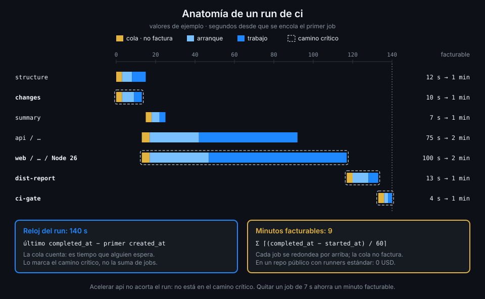

# Anatomía del tiempo de un run

> "El CI tarda nueve minutos" no dice qué hacer. Partido en cola, arranque y trabajo, y ordenado
> por el camino crítico, sí: te dice qué job tocar y qué ganarás al tocarlo.



## 🎯 Objetivos

Al terminar este archivo eres capaz de:

- Partir el tiempo de un job en cola, arranque y trabajo con los campos de la API
- Calcular el reloj de un run y explicar por qué no coincide con sus minutos facturables
- Encontrar el camino crítico de un run a partir de sus `needs`
- Saber qué mejora acorta el run y cuál solo abarata la factura
- Sacar los tiempos de jobs y steps con `gh run view` y `gh api`
- Medir una línea base antes de cambiar nada

## 1. Qué problema resuelve

Un run de `ci` en `tablero` son más de diez jobs: `changes`, una llamada por área, los jobs de
dentro de cada reutilizable, `summary` y `ci-gate`. La pestaña Actions te enseña cada uno con su
duración, pero no te dice cuánto de esa duración fue esperar una máquina, cuánto preparar el
entorno y cuánto hacer el trabajo, ni qué job marca el final del run.

Sin esa descomposición se optimiza a ciegas: alguien acelera los tests de `tools` un 50 % y el run
dura lo mismo, porque `tools` nunca era el que llegaba último. Este archivo te da el vocabulario y
los campos de la API para no hacerlo.

## 2. Cómo funciona

### Tres fases en cada job

| Fase | Desde → hasta | Qué la alarga | Qué la acorta |
|---|---|---|---|
| **Cola** | `created_at` → `started_at` del job | No hay runner libre: límite de concurrencia, runner propio ocupado | Menos jobs simultáneos, más runners |
| **Arranque** | `started_at` → fin del último step de preparación | Descargar actions, clonar, instalar herramientas y dependencias | Caché, clones ligeros, menos setup por job |
| **Trabajo** | Los steps que hacen lo que el job existe para hacer | Tests lentos, builds sin incremental | Paralelizar, hacer menos trabajo |

`created_at` es cuándo se encoló el job; `started_at`, cuándo lo tomó un runner;
`completed_at`, cuándo terminó. La cola es el hueco entre los dos primeros. En runners estándar
suele ser de segundos; en un runner propio único (S15) puede ser de minutos si hay otro job
delante.

La frontera entre arranque y trabajo no está en la API: la pones tú leyendo los steps. Cada job
trae en `steps` sus pasos con `name`, `started_at` y `completed_at`, incluidos dos que no
escribiste: **`Set up job`** (el runner prepara el directorio y descarga las actions) y
**`Complete job`** (limpieza y post-steps). Todo lo que va desde `Set up job` hasta el último
`setup-*` o `install` es arranque.

### Reloj y minutos

El **reloj** de un run es lo que tarda de punta a punta: desde que se encoló el primer job hasta
que terminó el último. Con la API de jobs, último `completed_at` menos primer `created_at`. Con la
API de runs, `updated_at` menos `run_started_at`.

¿Por qué `run_started_at` y no `created_at`? Porque un **re-run** conserva el `created_at` del
intento original. Si relanzas un run fallido al día siguiente, `updated_at − created_at` da más
de veinticuatro horas; `run_started_at` es el arranque del intento que estás midiendo.

Los **minutos facturables** son otra cosa: la suma de cada job redondeado por arriba (archivo 01).
No cuentan la cola, porque nadie ocupa un runner mientras espera, y suman los jobs paralelos uno
encima de otro. Un run con mucho paralelismo tiene un reloj corto y una factura larga; un run en
serie, al revés.

### El camino crítico

Los `needs` forman un grafo. El **camino crítico** es la cadena de jobs encadenados por `needs`
que más tarda de principio a fin. El reloj del run no puede ser menor que él.

En `ci`, cada área cuelga de `changes` y todo desemboca en `ci-gate`. Si la cadena más larga es
`changes` → `web` (los jobs del reutilizable de Node) → `dist-report` → `ci-gate`, las
consecuencias son:

- Acelerar `api`, que corre en paralelo y acaba antes, **no acorta el run**. Sí abarata la
  factura.
- Acelerar `changes` acorta **todos** los caminos, porque todos empiezan con él.
- Quitar un job que no está en ningún `needs` (como `runner-info`, del que solo dependía
  `summary`) no cambia el reloj si no era el último en acabar, pero ahorra su minuto en cada run.

Dónde está el camino crítico no se adivina: se mide, y puede cambiar de un PR a otro porque
`changes` salta áreas distintas.

### El arranque se paga en cada job

Cada job empieza en una máquina limpia. Lo que hizo el job de al lado no le sirve: vuelve a
descargar sus actions, a clonar, a instalar uv o pnpm y a restaurar las dependencias. Por eso el
arranque es un **coste fijo por job**, y se multiplica:

| Pieza del arranque | Dónde la ves | Qué la reduce |
|---|---|---|
| Descargar las actions del job | `Set up job` | Menos actions distintas por job |
| Clonar el repo | `actions/checkout` | `fetch-depth` y `filter` ajustados (archivo 05) |
| Instalar la herramienta | `setup-uv`, `pnpm/action-setup`, `setup-node` | Poca cosa: es rápida, pero se repite en cada job |
| Restaurar dependencias | `uv sync`, `pnpm install` con caché | La caché del archivo 03 |

Dos jobs de 40 segundos de trabajo con 30 de arranque cada uno pagan 60 segundos en preparar.
Fusionados en uno, pagarían 30. Esa cuenta es la que decide si partir un job compensa
(archivo 04).

_Verificado con la API REST de Actions, gh 2.104.0 y ubuntu-24.04, noviembre de 2026._

## 3. Cómo se usa

### Los jobs de un run con `gh`

`gh run view` da los tiempos de cada job en un formato cómodo:

```bash
gh run view "$RUN_ID" --json jobs \
  --jq '.jobs[] | "\(.name): \((.completedAt | fromdate) - (.startedAt | fromdate)) s"'
# Áreas que cambian: 9 s
# web / Web / Node 24: 48 s
# ...
```

Las salidas de este archivo son de ejemplo: los nombres y segundos los pone tu run. Los jobs de
un reutilizable aparecen con el nombre del job que llama delante, separado por ` / `. `gh run view`
trae `name`, `startedAt`, `completedAt`, `conclusion`, `steps`, `databaseId`, `status` y `url`,
pero **no** el momento en que se encoló el job: para la cola necesitas la API.

### La API de jobs

```bash
gh api "repos/{owner}/{repo}/actions/runs/$RUN_ID/jobs" --paginate --jq '.jobs[]
  | select(.conclusion != "skipped")
  | [.name,
     ((.started_at | fromdate) - (.created_at | fromdate)),
     ((.completed_at | fromdate) - (.started_at | fromdate))]
  | @tsv'
# Áreas que cambian	3	9
# web / Web / Node 24	4	48
```

Cada job trae `created_at`, `started_at`, `completed_at`, `conclusion`, `runner_name`, `labels` y
`steps`. `--paginate` importa: la API devuelve 30 jobs por página y un run de `ci` con todas las
áreas se acerca. El filtro de saltados quita los jobs que no ocuparon runner.

Por defecto el endpoint trae solo el **último intento** de cada job. Si un run tuvo re-runs,
`?filter=all` trae también los anteriores, o puedes pedir uno concreto con
`/runs/$RUN_ID/attempts/<n>/jobs`.

### Los steps de un job

Para separar arranque de trabajo, mira los steps del job más largo:

```bash
gh api "repos/{owner}/{repo}/actions/runs/$RUN_ID/jobs" --paginate --jq '.jobs[]
  | select(.name | endswith("Node 24")) | .steps[]
  | "\((.completed_at | fromdate) - (.started_at | fromdate)) s  \(.name)"'
# 2 s  Set up job
# 1 s  Run actions/checkout@3d3c42e5aac5ba805825da76410c181273ba90b1
# 14 s  Run <tu-org>/actions-tablero/setup-tablero@<sha-de-v1.0.0>
# 31 s  Tests
# 0 s  Complete job
```

### La línea base

Antes de optimizar, mide **tres runs** de `ci` en `main` y anota reloj, minutos facturables y los
tres jobs más largos. Un solo run engaña: la cola y la descarga de la caché varían de un run a
otro. `scripts/job-timings.sh`, que completas en la práctica 01, convierte la salida de la API de
jobs en una tabla con cola, duración y minutos facturables por job, y una línea con el reloj y el
total. Después de cada cambio, otra vez tres runs: si la diferencia es menor que la variación
entre runs, no has demostrado nada.

## 4. Antipatrones

| Antipatrón | Por qué duele | Qué hacer en su lugar |
|---|---|---|
| Optimizar el job que "parece lento" | Si no está en el camino crítico, el run dura lo mismo | Medir y localizar el camino crítico primero |
| Medir con un solo run | La cola y la caché varían; confundes ruido con mejora | Tres runs antes y tres después |
| Usar `created_at` del run como inicio | Un re-run conserva el `created_at` original | `run_started_at` |
| Confundir reloj con facturable | El paralelismo acorta uno y alarga el otro | Medir los dos y decidir cuál importa |
| `gh api .../jobs` sin `--paginate` | A partir de 30 jobs te faltan los últimos | `--paginate` siempre |
| Contar la cola como tiempo del job | Mezcla falta de runners con lentitud del job | Cola y duración en columnas separadas |

## 5. Trucos

- **El reloj sin cuentas**: `gh api "repos/{owner}/{repo}/actions/runs/$RUN_ID/timing" --jq .run_duration_ms`.
- **Qué runner tomó cada job**: `--jq '.jobs[] | "\(.name) \(.runner_name)"'` sobre la API de
  jobs. Con runners propios (S15, S16), una cola larga en un solo runner se ve al momento.
- **El step que más tarda de todo el run**: `--jq '[.jobs[] | .name as $j | .steps[] | {j: $j, s: .name, d: ((.completed_at | fromdate) - (.started_at | fromdate))}] | max_by(.d)'`.
  Con `--paginate`, añade `--slurp` y un `map(.jobs[])` para juntar las páginas antes del `max_by`.

## 📚 Recursos Adicionales

- [GitHub REST API: Workflow jobs](https://docs.github.com/en/rest/actions/workflow-jobs)
- [GitHub REST API: Workflow runs](https://docs.github.com/en/rest/actions/workflow-runs)
- [GitHub CLI: gh run view](https://cli.github.com/manual/gh_run_view)
- [jq manual: Dates](https://jqlang.org/manual/#dates)

## ✅ Checklist de Verificación

- [ ] Sé qué campos de la API marcan la cola y la duración de un job
- [ ] Sé dónde termina el arranque leyendo los steps de un job
- [ ] Sé por qué el reloj se mide con `run_started_at` y no con `created_at`
- [ ] Sé por qué el reloj y los minutos facturables no coinciden
- [ ] Sé qué es el camino crítico y por qué acelerar otro job no acorta el run
- [ ] Sé medir una línea base de tres runs con `gh api` y `--paginate`

---

| ← Anterior | Siguiente → |
|:---|---:|
| [Cuánto cuesta un minuto](01-cuanto-cuesta-un-minuto.md) | [La caché a fondo](03-la-cache-a-fondo.md) |
