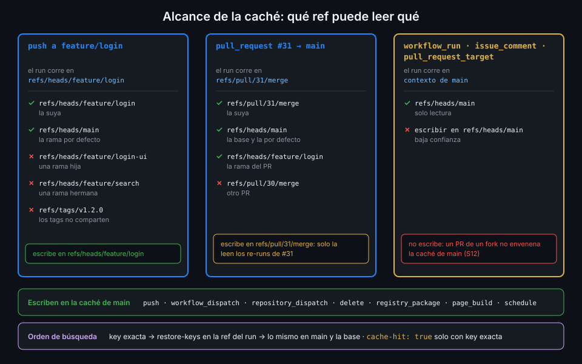

# La caché a fondo

> Desde la Semana 03 usas la caché sin mirarla: `setup-uv` y `setup-node` la gestionan por ti.
> Para que ahorre de verdad tienes que saber qué run puede leer qué entrada, cuándo se borra y
> cuándo cuesta más de lo que ahorra.



## 🎯 Objetivos

Al terminar este archivo eres capaz de:

- Explicar en qué orden busca una caché `actions/cache` y qué vale `cache-hit` en cada caso
- Decir desde qué refs puede restaurar un run y por qué las cachés de un PR no ayudan a nadie más
- Saber qué eventos pueden escribir en la caché de la rama por defecto y por qué
- Conocer el límite de 10 GB, la expulsión a los 7 días y los límites de subidas y descargas
- Separar restaurar de guardar para que solo `main` escriba
- Reconocer una caché que no compensa

## 1. Qué problema resuelve

Una caché bien usada convierte un `pnpm install` de un minuto en diez segundos. Mal usada, hace
tres cosas sin avisar: **no acierta** porque el run no tiene permiso para leer la entrada que
esperabas, **llena los 10 GB** del repo con entradas que nadie volverá a leer y expulsa las
buenas, o **tarda más en bajar** que lo que ahorra. Ninguna de las tres falla el job: el CI sigue
verde y solo se vuelve más lento o más caro. Por eso hay que entender el mecanismo, no solo la
sintaxis.

## 2. Cómo funciona

### Clave, prefijos y `cache-hit`

Cada entrada tiene una **clave** (`key`) y una **versión** que depende de las rutas y de la herramienta de compresión.
Al restaurar, `actions/cache` busca en este orden:

1. La clave exacta en la ref del run.
2. Una entrada cuya clave empiece por `key`; si no hay, cada prefijo de `restore-keys`, en
   orden. Todo en la ref del run y, si varios coinciden, gana el más reciente.
3. Lo mismo, clave y prefijos, en la rama por defecto (y en la base si es un PR).

`cache-hit` vale `true` **solo con coincidencia exacta de la clave**. La descripción del input
lo dice: con `restore-keys` se restaura una caché "stale" y "`cache-hit` returns false in this
case". Es lo que quieres: una caché parcial te ahorra descargar casi todo, pero el job tiene que
instalar lo que falta y la entrada nueva se guardará al final.

Las entradas son **inmutables**: si la clave ya existe, el guardado se omite. Una clave con el
hash del lockfile solo cambia cuando cambian las dependencias; una clave con `github.sha`
cambia en cada commit y crea una entrada nueva en cada run.

### Alcance: qué ref puede leer qué

Las cachés se guardan **por ref**. Un run puede restaurar:

| Desde | ¿Puede? |
|---|:--:|
| La ref del propio run | Sí |
| La rama por defecto (`main`) | Sí |
| En un PR, la rama base | Sí |
| En un PR, la rama del PR | Sí: cuenta como la rama actual |
| Una rama hija o una hermana | No |
| Otra etiqueta | No: los tags no comparten |

Un `pull_request` corre sobre `refs/pull/N/merge`, y ahí guarda lo que guarde. **Solo los re-runs
de ese mismo PR** pueden leer esas entradas. Cuando el PR se cierra, se quedan ocupando sitio
hasta que las expulse el tiempo o las borres tú (archivo 07).

La otra cara: quien pueda abrir un PR contra tu repo, también desde un fork, puede **leer** la
caché de la rama base. Nunca guardes en caché nada que no publicarías.

### Quién escribe en `main`

Los eventos de baja confianza, `pull_request_target`, `issue_comment` y `workflow_run`, corren
en el contexto de la rama por defecto pero **solo pueden leer** su caché. Escribir en el ámbito
de la rama por defecto queda para `push`, `workflow_dispatch`, `repository_dispatch`, `delete`,
`registry_package`, `page_build` y `schedule`. Es la defensa de GitHub contra el envenenamiento
de caché que viste en la Semana 12: un PR de un fork que lograra escribir en la caché de `main`
contaminaría el siguiente build de la rama protegida.

`setup-uv` añade su propia prudencia. Con `enable-cache: auto` (el valor por defecto) no usa la
caché en eventos de release, push de tags, `pull_request_target` ni `workflow_run`, y con
`save-cache: auto` no guarda en `merge_group`. Los runs de la merge queue corren en refs
temporales `gh-readonly-queue/main/...` que desaparecen tras fusionar: lo que guardaran ahí no lo
leería nadie.

### Expulsión y límites

| Límite | Valor por defecto | Qué pasa al tocarlo |
|---|---|---|
| Tamaño por repo | 10 GB | Se expulsa por último acceso, la más antigua primero |
| Sin acceso | 7 días | La entrada se borra |
| Subidas | 200 por minuto y repo | Las de más fallan hasta el reset (`Retry-After`) |
| Descargas | 1500 por minuto y repo | Igual |

Los dos primeros se pueden cambiar: los admins pueden subir el tamaño (hasta 10 TB en repos de
usuario; en una org, hasta lo que permita la org) y acortar o alargar la retención. Un nivel
inferior nunca supera el límite del superior. Recuerda el archivo 01: por encima de 10 GB, la
caché empieza a facturar.

La expulsión por tamaño es la trampa silenciosa: cachés de PR y de ramas muertas empujan fuera a
la de `main`, que es la única que comparten todos.

_Verificado con actions/cache@v6.1.0, astral-sh/setup-uv@v10.3.3 y ubuntu-24.04, noviembre de 2026._

## 3. Cómo se usa

### Inventario antes de tocar nada

```bash
gh api "repos/{owner}/{repo}/actions/cache/usage"
# {"full_name":"<tu-org>/tablero","active_caches_size_in_bytes":412337152,"active_caches_count":14}
gh cache list --limit 100 --json key,ref,sizeInBytes,lastAccessedAt \
  --jq 'group_by(.ref)[] | "\(.[0].ref): \(length) cachés"'
# refs/heads/main: 4 cachés
# refs/pull/31/merge: 4 cachés
```

`gh cache list` filtra con `--ref`, `--key` (por prefijo) y ordena con `--sort`
(`created_at`, `last_accessed_at`, `size_in_bytes`). Sin `--limit` trae 30.

### Solo `main` escribe

`actions/cache` restaura al principio y guarda en un post-step. Si separas las dos mitades con
`actions/cache/restore` y `actions/cache/save`, decides cuándo se guarda. Un patrón útil para
caches propias: los PR leen, solo el push a `main` escribe.

```yaml
name: cache-demo
on:
  push:
    branches: [main]
  pull_request:
permissions:
  contents: read
jobs:
  lint:
    runs-on: ubuntu-24.04
    timeout-minutes: 10
    steps:
      - uses: actions/checkout@3d3c42e5aac5ba805825da76410c181273ba90b1 # v7.0.1
        with:
          persist-credentials: false
      # La caché de uv la gestiona el ejemplo a mano: la de setup-uv queda apagada.
      - uses: astral-sh/setup-uv@68559e99cc807c1eb7e9238fd43a15bba460eec2 # v10.3.3
        with:
          enable-cache: false
      - uses: actions/cache/restore@55cc8345863c7cc4c66a329aec7e433d2d1c52a9 # v6.1.0
        id: cache
        with:
          path: ~/.cache/uv
          key: uv-${{ runner.os }}-${{ hashFiles('api/uv.lock') }}
          restore-keys: |
            uv-${{ runner.os }}-
      - name: Dependencias
        working-directory: api
        run: uv sync --locked
      # En un PR la entrada iría a refs/pull/N/merge: nadie más podría leerla.
      - name: Recortar la caché antes de guardarla
        if: github.event_name == 'push' && steps.cache.outputs.cache-hit != 'true'
        run: uv cache prune --ci
      - uses: actions/cache/save@55cc8345863c7cc4c66a329aec7e433d2d1c52a9 # v6.1.0
        if: github.event_name == 'push' && steps.cache.outputs.cache-hit != 'true'
        with:
          path: ~/.cache/uv
          key: ${{ steps.cache.outputs.cache-primary-key }}
```

Tres detalles. `cache-primary-key` devuelve la clave que se buscó, así no la escribes dos veces.
Guardar con `cache-hit` en `true` no haría nada (la entrada existe y es inmutable), así que la
condición ahorra el intento. `uv cache prune --ci` quita de la caché lo que es más barato
reconstruir que descargar, y la entrada pesa menos. En `tablero` no necesitas este patrón para
uv: `setup-uv` ya gestiona su caché. Sirve para lo que ninguna action cachea por ti.

El input `save-always` de `actions/cache` sigue existiendo, pero su propia descripción avisa de
que "does not work as intended and will be removed": la alternativa es esta separación.

### La caché que no compensa

Mira el step de restaurar y el de instalar en un run con acierto y en uno sin acierto. Si la
diferencia es pequeña, o si la restauración tarda más que la instalación sin caché, la caché
estorba. Pasa con dependencias que ya vienen precompiladas y se bajan rápido, con cachés de
varios cientos de MB para ahorrar pocos segundos, y con claves que cambian en cada run.

## 4. Antipatrones

| Antipatrón | Por qué duele | Qué hacer en su lugar |
|---|---|---|
| `github.sha` o `github.run_id` en la clave | Una entrada por run: llena los 10 GB y expulsa la de `main` | Hash del lockfile en la clave |
| Esperar que una rama lea la caché de otra rama de trabajo | Solo se lee la propia, la por defecto y la base | Que `main` tenga la caché buena |
| Guardar caché en cada PR | Solo ese PR puede releerla; se acumula sin dueño | Restaurar en PR, guardar en `push` a `main` |
| Leer `cache-hit` como "hubo caché" | Con un prefijo de `restore-keys` vale `false` | `cache-matched-key` para saber qué se restauró |
| `save-always: true` | Su propia descripción dice que no funciona como debe | `actions/cache/restore` + `actions/cache/save` |
| Cachear sin medir | Una caché grande puede tardar más que reinstalar | Comparar el step con y sin acierto |

## 5. Trucos

- **Qué se restauró exactamente**: `steps.<id>.outputs.cache-matched-key` dice la clave que
  coincidió, también en una coincidencia parcial.
- **¿Existe la caché sin descargarla?** `lookup-only: true` en `actions/cache/restore` solo
  comprueba. Útil para saltar un job de preparación entero si ya está todo.
- **Cachés de ramas que ya no existen**: `gh cache list --limit 1000 --json ref --jq '[.[].ref] | unique'`
  y compáralo con `gh api 'repos/{owner}/{repo}/branches' --paginate --jq '.[].name'`.
- **Empezar de cero en una ref**: `gh cache delete --all --ref refs/heads/<rama> --succeed-on-no-caches`.

## 📚 Recursos Adicionales

- [GitHub Docs: Dependency caching reference](https://docs.github.com/en/actions/reference/workflows-and-actions/dependency-caching)
- [actions/cache: restore y save](https://github.com/actions/cache/tree/main/restore)
- [GitHub REST API: GitHub Actions cache](https://docs.github.com/en/rest/actions/cache)
- [uv: Caching in continuous integration](https://docs.astral.sh/uv/concepts/cache/#caching-in-continuous-integration)

## ✅ Checklist de Verificación

- [ ] Sé en qué orden busca `actions/cache` y cuándo `cache-hit` vale `true`
- [ ] Sé desde qué refs puede restaurar un run y por qué las cachés de PR quedan aisladas
- [ ] Sé qué eventos pueden escribir en la caché de `main` y qué ataque evita esa regla
- [ ] Sé por qué `setup-uv` no guarda caché en la merge queue
- [ ] Sé qué límites tiene la caché del repo y cómo se expulsan las entradas
- [ ] Sé separar restaurar de guardar para que solo `main` escriba
- [ ] Sé reconocer una caché que tarda más de lo que ahorra

---

| ← Anterior | Siguiente → |
|:---|---:|
| [Anatomía del tiempo de un run](02-anatomia-del-tiempo-de-un-run.md) | [Paralelismo y sharding](04-paralelismo-y-sharding.md) |
