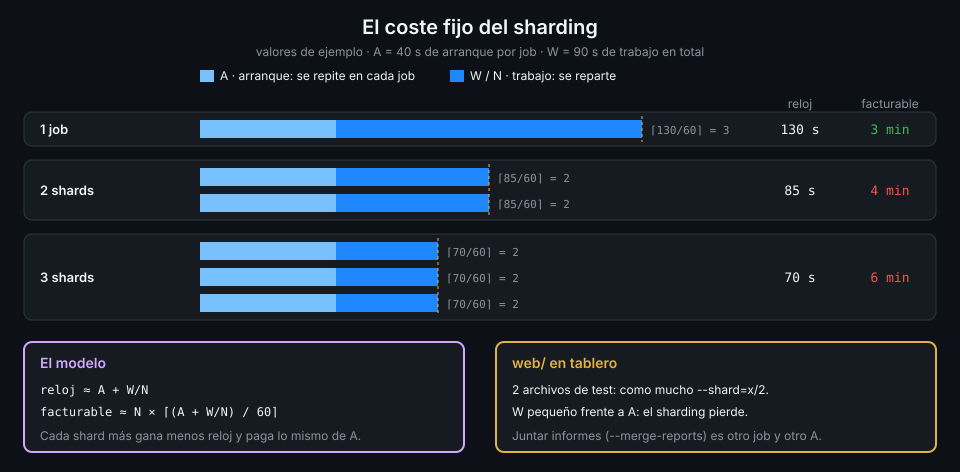

# Paralelismo y sharding

> Partir una suite en varios jobs acorta el reloj, pero cada job paga otra vez su arranque y su
> minuto redondeado. El sharding gana cuando el trabajo repartido pesa más que ese coste fijo.



## 🎯 Objetivos

Al terminar este archivo eres capaz de:

- Distinguir el paralelismo dentro de un job del paralelismo entre jobs
- Partir una suite de vitest en shards con una matriz y `--shard`
- Calcular con un modelo sencillo cuándo el sharding acorta el reloj y cuánto encarece la factura
- Explicar por qué un shard lento marca el reloj de todos
- Juntar los informes de varios shards y saber por qué la cobertura no se puede comprobar por
  shard
- Decidir con medidas, no con intuición, si el sharding compensa

## 1. Qué problema resuelve

Cuando una suite de tests crece, el job que la corre se convierte en el camino crítico del run
(archivo 02). La respuesta habitual es repartirla: en vez de un job que corre todo, cuatro jobs
que corren una cuarta parte cada uno. El reloj baja, pero no a la cuarta parte, y la factura sube.

Este archivo te da el modelo para saber de antemano cuánto ganarías y cuánto pagarías, y el
mecanismo concreto para hacerlo con vitest, el runner de tests de `web/`.

## 2. Cómo funciona

### Dos niveles de paralelismo

| Nivel | Cómo | Coste extra |
|---|---|---|
| **Dentro de un job** | El runner de tests usa varios procesos en la misma máquina. vitest reparte los archivos de test entre workers por defecto | Ninguno: mismos minutos, más CPU aprovechada |
| **Entre jobs** | Una matriz lanza N jobs, cada uno con su parte | N arranques y N redondeos al minuto |

El primero es gratis y conviene agotarlo antes de pasar al segundo. Un runner estándar tiene
varios núcleos (`nproc` te dice cuántos; el job `runner-info` lo imprimía), y vitest ya los usa.
Solo cuando una máquina no da más tiene sentido pagar otra.

### `--shard` en vitest

`vitest run --shard=<index>/<count>` corre solo la parte `index` de `count`. Reparte **archivos de
test**, no tests sueltos: un archivo enorme no se parte, y queda entero en un shard. Si pides
más shards que archivos hay, vitest se niega: "`--shard <count>` must be a smaller than count of
test files" (salvo con `passWithNoTests`).

`web/` en `tablero` tiene dos archivos de test, `tests/api.test.ts` y `tests/App.test.tsx`. El
máximo es `--shard=x/2`, y cada shard corre un archivo.

### El modelo del coste fijo

Llama **A** al arranque de un job (setup, instalación, todo lo que no es tu suite) y **W** al
trabajo total de la suite. Con N shards bien equilibrados:

- Reloj del job más lento ≈ A + W/N
- Minutos facturables ≈ N × ⌈(A + W/N) / 60⌉

Con A = 40 s y W = 90 s (valores de ejemplo):

| Shards | Reloj | Facturable | Ganancia de reloj |
|:--:|:--:|:--:|:--:|
| 1 | 130 s | 3 min | — |
| 2 | 85 s | 4 min | −45 s |
| 3 | 70 s | 6 min | −15 s más |
| 4 | 63 s | 8 min | −7 s más |

Cada shard nuevo gana menos reloj (el término W/N se encoge) y paga lo mismo de arranque. A
partir de cierto N, el reloj ya casi no baja y la factura sigue subiendo. Si **W es pequeño frente
a A**, como en `web/` con dos archivos, el sharding pierde desde el primer shard: el arranque
repetido se come la ganancia. Esa es la conclusión que mides en la práctica 02.

### El shard más lento manda

El modelo supone reparto equilibrado. vitest reparte por archivos, y si un archivo tarda mucho
más que los demás, el shard que lo recibe marca el reloj de todos. Dos shards de 10 s y 80 s
duran 80 s, no 45. Antes de partir, mira cuánto tarda cada archivo.

### Lo que se rompe al partir

- **Informes**: cada shard produce su resultado. vitest tiene el reporter `blob` para guardarlos y
  `--merge-reports` para juntarlos en un job final, que "won't run any tests, it will only report
  previously recorded tests".
- **Cobertura**: un shard solo cubre el código que tocan sus tests. Un umbral mínimo de cobertura
  comprobado por shard falla aunque la suite completa lo cumpla. `tablero` comprueba un 60 % en
  el job de cobertura de `ci-web`: ese job no se puede partir sin juntar antes la cobertura.
- **`fail-fast`**: en una matriz vale `true` por defecto. Si un shard falla, los demás se
  cancelan. Para tests es lo que quieres: no pagas los minutos de los shards que quedaban.

_Verificado con vitest 5.0.5, actions/upload-artifact@v7.0.2 y ubuntu-24.04, noviembre de 2026._

## 3. Cómo se usa

### La matriz de shards

```yaml
name: web-shards
on:
  pull_request:
permissions:
  contents: read
jobs:
  test:
    runs-on: ubuntu-24.04
    timeout-minutes: 10
    strategy:
      matrix:
        shard: [1, 2]
    defaults:
      run:
        working-directory: web
    steps:
      - uses: actions/checkout@3d3c42e5aac5ba805825da76410c181273ba90b1 # v7.0.1
        with:
          persist-credentials: false
      - uses: pnpm/action-setup@ea17c68df8912ef543352723c149a84f56e3d413 # v6.1.0
        with:
          package_json_file: web/package.json
      - uses: actions/setup-node@949feb2413d6458794dcd2491c4babbbce0c15c1 # v7.1.0
        with:
          node-version: "26"
          cache: pnpm
          cache-dependency-path: web/pnpm-lock.yaml
      - run: pnpm install --frozen-lockfile
      - name: Tests del shard
        env:
          SHARD: ${{ matrix.shard }}
        run: pnpm test --shard="$SHARD/2" --reporter=blob --outputFile="blob-report/blob-$SHARD.json"
      - uses: actions/upload-artifact@cf430e030ddbb5b0abf93d22962f4752f3646cd9 # v7.0.2
        with:
          name: blob-${{ matrix.shard }}
          path: web/blob-report/
          retention-days: 1
```

`pnpm test` es `vitest run`; lo que va detrás pasa a vitest. El número de shards aparece dos veces
(la lista y el `/2`): si cambias uno, cambia el otro. El artefacto vive un día porque solo lo
necesita el job siguiente.

### Juntar los informes

```yaml
  report:
    needs: test
    runs-on: ubuntu-24.04
    timeout-minutes: 5
    defaults:
      run:
        working-directory: web
    steps:
      # ... checkout, pnpm y pnpm install como en test ...
      - uses: actions/download-artifact@9000827ccba6bdab643e8b6fd33ac0654aef8333 # v8.0.2
        with:
          pattern: blob-*
          merge-multiple: true
          path: web/blob-report
      - run: pnpm exec vitest run --merge-reports blob-report
```

Fíjate en el precio: el job `report` es **otro arranque** completo, con su checkout y su
instalación, para no correr ni un test. En el modelo, suma a la factura y al reloj. Con dos
shards, la versión partida puede tardar más que la entera.

### Medir y decidir

Corre la versión partida tres veces y la entera otras tres. Compara con `job-timings.sh` el reloj
y los minutos facturables. Decide con una regla escrita de antemano, por ejemplo: "partir solo si
el reloj baja más de un 30 % y la factura sube menos de un 50 %".

## 4. Antipatrones

| Antipatrón | Por qué duele | Qué hacer en su lugar |
|---|---|---|
| Partir en jobs antes de usar los núcleos de la máquina | Pagas arranques para lo que los workers hacían gratis | Paralelismo dentro del job primero |
| Más shards que archivos de test | vitest falla con `--shard <count> must be...` | `count` ≤ número de archivos |
| Shards desequilibrados | El shard con el archivo lento marca el reloj | Medir cada archivo antes de partir |
| Umbral de cobertura por shard | Cada shard cubre solo una parte y falla | Juntar la cobertura antes de comprobarla |
| Partir una suite corta | El arranque repetido supera el trabajo repartido | Calcular A y W con la línea base |
| `fail-fast: false` en shards de tests | Pagas los shards restantes de un run que ya falló | El valor por defecto, `true` |

## 5. Trucos

- **Cuánto tarda cada archivo de test**: `pnpm exec vitest run --reporter=verbose` en local muestra
  la duración por archivo. Es el dato que necesitas para saber si los shards quedarán
  equilibrados.
- **Probar un shard en local**: `pnpm test --shard=2/2` corre exactamente lo que correrá el
  segundo job de la matriz. Si falla en CI y no en local, compara qué archivos te tocan.
- **Calcular A sin adivinar**: en la API de jobs, el arranque es la suma de los steps hasta
  `pnpm install` incluido (archivo 02). Mídelo en tres runs y usa la mediana.

## 📚 Recursos Adicionales

- [Vitest: Improving performance — sharding](https://vitest.dev/guide/improving-performance.html#sharding)
- [Vitest: CLI — --shard y --merge-reports](https://vitest.dev/guide/cli.html)
- [GitHub Docs: Running variations of jobs in a workflow](https://docs.github.com/en/actions/how-tos/write-workflows/choose-what-workflows-do/run-job-variations)
- [actions/download-artifact: download multiple artifacts](https://github.com/actions/download-artifact#download-multiple-filtered-artifacts-to-the-same-directory)

## ✅ Checklist de Verificación

- [ ] Sé la diferencia entre paralelismo dentro de un job y entre jobs, y cuál es gratis
- [ ] Sé partir una suite de vitest con una matriz y `--shard`
- [ ] Sé estimar el reloj y la factura de N shards con A y W
- [ ] Sé por qué un shard desequilibrado anula la ganancia
- [ ] Sé juntar informes con el reporter `blob` y `--merge-reports`, y lo que cuesta ese job
- [ ] Sé por qué un umbral de cobertura no se comprueba por shard

---

| ← Anterior | Siguiente → |
|:---|---:|
| [La caché a fondo](03-la-cache-a-fondo.md) | [Recortar el camino crítico](05-recortar-el-camino-critico.md) |
