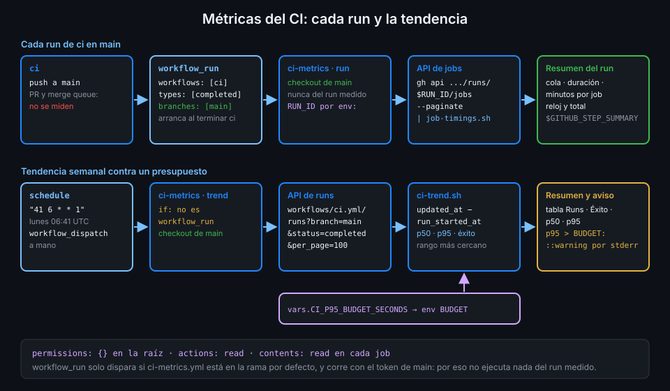

# Métricas y observabilidad del CI

> Una línea base caduca el día que la mides. Para enterarte de que el CI se ha vuelto lento antes
> que el equipo, el CI tiene que medirse solo, guardar la tendencia y avisar cuando se sale del
> presupuesto.



## 🎯 Objetivos

Al terminar este archivo eres capaz de:

- Saber qué te enseñan las métricas de Actions en Insights de la organización y qué no
- Diseñar métricas propias por API con dos ritmos: cada run y una tendencia periódica
- Usar `workflow_run` para medir un workflow cuando termina, con el patrón seguro de la S12
- Explicar por qué se miden percentiles y no medias, y calcular un p95 por rango más cercano
- Convertir un presupuesto en una variable del repo y en un aviso visible en el run
- Saber por qué un aviso escrito en stderr llega igual al log

## 1. Qué problema resuelve

Los CI no se vuelven lentos de golpe. Una dependencia más, un test de integración más, una
caché que deja de acertar: cada cambio añade segundos y ninguno parece importante. Seis meses
después el CI tarda el doble y nadie sabe desde cuándo.

La línea base de la práctica 01 es una foto. Lo que necesitas es una **serie**: cada run de `ci`
en `main` medido, un resumen periódico con la tendencia y un umbral que, si se cruza, se vea sin
que nadie tenga que ir a buscarlo. Eso es observabilidad del CI: el mismo trato que le das a la
aplicación en producción.

## 2. Cómo funciona

### Lo que da GitHub: Insights de la organización

En la pestaña **Insights** de la org hay dos vistas de Actions:

| Vista | Qué enseña | Disponibilidad |
|---|---|---|
| **Actions Performance Metrics** | Tiempos de los runs, tiempo en cola y tasa de fallo | Todos los planes de GitHub Cloud desde marzo de 2025 |
| **Actions Usage Metrics** | Minutos consumidos | Documentado para Enterprise Cloud: comprueba si tu org la ve |

Son útiles para una primera mirada y para comparar repos. Tienen tres límites: no saben cuál es
tu presupuesto, no avisan, y Usage Metrics cuenta minutos **sin aplicar multiplicadores** de
sistema operativo, así que no es la factura. Para un umbral propio y un aviso en el sitio donde
trabajas, hace falta medir tú.

### Dos ritmos

| Ritmo | Cuándo | Qué mide | Para qué |
|---|---|---|---|
| **Por run** | Cada vez que termina `ci` en `main` | Cola, duración y minutos de cada job | Ver qué job cambió en un commit concreto |
| **Tendencia** | Cada lunes y a mano | p50, p95 y tasa de éxito de los últimos 100 runs | Ver la deriva y compararla con el presupuesto |

Los dos van en un workflow aparte, `ci-metrics.yml`, y escriben en el **resumen del run**
(`$GITHUB_STEP_SUMMARY`): una tabla en Markdown que se ve en la página del run sin abrir logs.

### `workflow_run`: medir cuando el otro termina

Un job de `ci` no puede medir su propio run: cuando escribe, el run no ha terminado. Un workflow
disparado por `workflow_run` con `types: [completed]` arranca **después**, cuando todos los jobs
de `ci` ya tienen `completed_at`.

Tres reglas de `workflow_run` que ya conoces de las Semanas 07 y 12:

- **Solo dispara si el workflow que escucha está en la rama por defecto.** Mientras
  `ci-metrics.yml` viva solo en tu rama, no corre.
- **Corre en el contexto de la rama por defecto**, con su token y sus secretos, aunque el run
  medido fuera de un PR. Por eso es un disparador peligroso y zizmor lo marca.
- **`branches` filtra por la rama del run que lo disparó.** Con `branches: [main]`, los runs de
  PR y de la merge queue (`gh-readonly-queue/...`) no se miden: su duración no es la del CI de
  `main`.

El patrón seguro aquí es sencillo porque el workflow **no ejecuta nada del run medido**: hace
checkout de `main` (sus propios scripts), lee la API con permisos `actions: read` y
`contents: read`, y escribe en el resumen. El comentario
`# zizmor: ignore[dangerous-triggers]` lo justifica en la misma línea.

### Percentiles, no medias

Diez runs de 300 s y uno colgado de 3600 s dan una media de 600 s: el doble de lo que tarda el CI
casi siempre. Los percentiles no se dejan arrastrar:

- **p50** (la mediana): lo que tarda un run típico.
- **p95**: lo que tarda un run malo, pero no el peor. Es el que marca la paciencia del equipo.

El método más sencillo es el **rango más cercano**: ordena las n duraciones de menor a mayor y
toma la que ocupa la posición ⌈p·n⌉ (contando desde 1). Con 20 runs, el p95 es el 19.º; con 100,
el 95.º. Con pocas muestras el p95 coincide con el máximo, y un solo run raro lo mueve: por eso la
tendencia usa hasta 100 runs.

La duración de cada run sale de la API de runs: `updated_at` menos `run_started_at`. No
`created_at`: un re-run conserva el `created_at` del primer intento (archivo 02).

La **tasa de éxito** es la fracción de runs con `conclusion` igual a `success`. Un CI rápido que
falla uno de cada cinco runs no es rápido: cada fallo es un re-run.

### El presupuesto que avisa

El presupuesto es un número que decide el equipo: "el p95 de `ci` en `main` no pasa de N
segundos". Vive en una **variable del repo**, `CI_P95_BUDGET_SECONDS`, para cambiarlo sin tocar el
workflow, y llega al script por `env:` desde `vars.CI_P95_BUDGET_SECONDS`.

Si el p95 lo supera, el script emite un comando de workflow `::warning`. Se convierte en una
anotación amarilla en la página del run, visible sin abrir el log.

Hay un detalle: la salida estándar del script va al resumen, y si el aviso fuera por stdout
acabaría como texto dentro de la tabla. Por eso va a **stderr**. El runner procesa los comandos
de workflow en las dos salidas (en su código, `ScriptHandler` conecta el mismo gestor de comandos
a stdout y a stderr), así que la anotación aparece igual.

_Verificado con gh 2.104.0, actions/runner y ubuntu-24.04, noviembre de 2026._

## 3. Cómo se usa

### El disparador

```yaml
on:
  # Corre después de ci y con su propio token: lee la API, no ejecuta nada del run medido.
  workflow_run: # zizmor: ignore[dangerous-triggers] solo lee la API; el checkout es de main
    workflows: [ci]
    types: [completed]
    branches: [main]
  schedule:
    - cron: "41 6 * * 1"
  workflow_dispatch:
```

Un solo workflow, dos jobs: el de tiempos con `if: github.event_name == 'workflow_run'` y el de
tendencia con la condición contraria, para el cron y para lanzarlo a mano. El minuto 41 evita la
hora en punto, cuando se encolan más crons en GitHub.

### El run medido llega por `env:`

```yaml
        env:
          GH_TOKEN: ${{ github.token }}
          RUN_ID: ${{ github.event.workflow_run.id }}
```

`github.event.workflow_run.id` es un número, pero viene del evento: regla 4, por `env:` y nunca
dentro de `run:`.

### El presupuesto y el aviso

```bash
gh variable set CI_P95_BUDGET_SECONDS --body 600
gh variable get CI_P95_BUDGET_SECONDS
# 600
```

Lo que emite el script cuando el p95 se pasa, en stderr:

```text
::warning title=CI lento::p95 de 712 s, por encima del presupuesto de 600 s
```

`title=` pone el encabezado de la anotación. Si la variable no existe, `vars.CI_P95_BUDGET_SECONDS`
llega vacía, y el script no debe avisar ni fallar: sin presupuesto, solo informa.

## 4. Antipatrones

| Antipatrón | Por qué duele | Qué hacer en su lugar |
|---|---|---|
| Medir la media de duración | Un run colgado la duplica | p50 y p95 |
| `workflow_run` sin `branches` | Mezcla runs de PR y de la cola con los de `main` | `branches: [main]` |
| Checkout del commit del run medido en `workflow_run` | Ejecuta código de un PR con el token de `main` | Checkout de `main`, solo lectura de la API |
| `actions: write` "por si acaso" | Un workflow que solo lee puede borrar runs y cachés | `actions: read` y `contents: read` |
| El presupuesto escrito en el YAML | Cambiarlo exige un PR y pasar la cola | Variable del repo |
| El aviso por stdout cuando stdout va al resumen | La línea `::warning` aparece como texto | stderr |
| Fiarse solo de Insights | No conoce tu presupuesto ni avisa | Métricas propias además |

## 5. Trucos

- **El resumen de un run desde la terminal**: `gh run view <id>` no lo enseña, pero en la página
  del run sale arriba. `gh run view <id> --web` te lleva directo.
- **Anotaciones de un run**: `gh api "repos/{owner}/{repo}/check-runs/<job-id>/annotations"` lista
  los `::warning` de un job; el `<job-id>` es el `databaseId` de `gh run view --json jobs`.
- **Probar el aviso sin esperar al cron**: `gh variable set CI_P95_BUDGET_SECONDS --body 1` y
  `gh workflow run ci-metrics.yml --ref main`. Cualquier p95 supera un segundo.

## 📚 Recursos Adicionales

- [GitHub Docs: Viewing GitHub Actions metrics](https://docs.github.com/en/actions/how-tos/administer/view-metrics)
- [GitHub Docs: Events that trigger workflows — workflow_run](https://docs.github.com/en/actions/reference/workflows-and-actions/events-that-trigger-workflows#workflow_run)
- [GitHub Docs: Workflow commands — warning y job summaries](https://docs.github.com/en/actions/reference/workflows-and-actions/workflow-commands)
- [GitHub REST API: List workflow runs for a workflow](https://docs.github.com/en/rest/actions/workflow-runs#list-workflow-runs-for-a-workflow)

## ✅ Checklist de Verificación

- [ ] Sé qué enseñan Performance Metrics y Usage Metrics en Insights, y qué les falta
- [ ] Sé por qué las métricas se miden por run y como tendencia
- [ ] Sé las tres reglas de `workflow_run` que afectan a `ci-metrics.yml`
- [ ] Sé por qué `ci-metrics.yml` es seguro aunque use un disparador peligroso
- [ ] Sé calcular un p95 por rango más cercano y por qué no uso la media
- [ ] Sé guardar un presupuesto en una variable y emitir un aviso por stderr

---

| ← Anterior | Siguiente → |
|:---|---:|
| [Recortar el camino crítico](05-recortar-el-camino-critico.md) | [Retención y limpieza](07-retencion-y-limpieza.md) |
