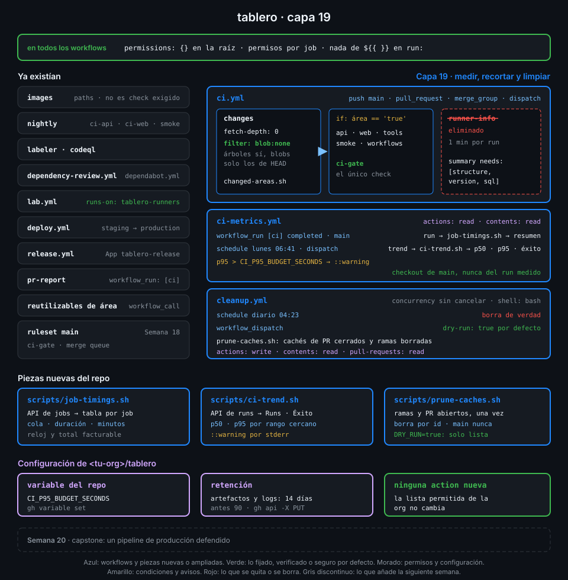

# Proyecto: capa 19 de tablero



## 🎯 Objetivo

Que el CI de `tablero` tenga números y no impresiones. Mides una línea base de `ci` en `main`
con la API, quitas lo que cuesta sin aportar y vuelves a medir. Después dejas el CI
observándose solo: cada run de `ci` en `main` publica cuánto tardó cada job y cuántos minutos
costaría en un repo privado, y cada semana sale la tendencia (p50, p95 y tasa de éxito) contra un
presupuesto que avisa si se pasa. Por último, la retención del repo baja a lo que el proyecto
necesita y un workflow diario borra las cachés que ya no tienen dueño antes de que echen a las
de `main`.

## 📦 Qué añade esta capa

| Pieza de `tablero` | Qué hace | Por qué existe |
|---|---|---|
| `scripts/job-timings.sh` (nuevo) | Convierte los jobs de un run (API) en una tabla con cola, duración y minutos facturables por job, más el reloj del run | La UI enseña duraciones sueltas; el coste sale de redondear cada job al minuto siguiente |
| `scripts/ci-trend.sh` (nuevo) | Convierte una lista de runs en runs, tasa de éxito, p50 y p95, y avisa con `::warning` si el p95 pasa de `BUDGET` | Un run lento es anécdota; el p95 de cien runs es una tendencia |
| `ci.yml`, sin `runner-info` | El job que imprimía sistema, CPU y memoria desaparece | Corría en cada run y no lo necesitaba ningún otro job |
| `ci.yml`, job `changes` con `filter: blob:none` | Trae todo el historial pero sin el contenido de los archivos | `git diff --name-only` solo compara árboles; los blobs eran peso muerto |
| `ci-metrics.yml` (nuevo) | Job `run` tras cada `ci` en `main` (`workflow_run`) y job `trend` cada lunes y a mano; los dos al resumen del run | Observabilidad propia, con permisos de solo lectura y sin tocar el código del run medido |
| Variable `CI_P95_BUDGET_SECONDS` (nueva) | El presupuesto de p95 de `ci` en segundos | Sin un umbral escrito, "el CI va lento" no es accionable |
| Retención del repo a 14 días | Artefactos y logs nuevos caducan a los 14 días en vez de a los 90 | Nada de `tablero` necesita un artefacto de hace tres meses |
| `scripts/prune-caches.sh` (nuevo) | Borra las cachés de PR cerrados y de ramas que ya no existen; con `DRY_RUN=true` solo las lista | Esas cachés no las puede restaurar nadie, pero ocupan el cupo de 10 GB |
| `cleanup.yml` (nuevo) | Corre `prune-caches.sh` cada día, y a mano en modo `dry-run` por defecto | La limpieza deja de depender de que alguien se acuerde |

| Situación | Qué pasa |
|---|---|
| Un PR entra en `main` por la cola | Termina el `ci` del push a `main` y `ci-metrics` publica sus tiempos en el resumen de su run |
| Termina un `ci` de un PR o de la merge queue | `ci-metrics` no corre: el filtro `branches: [main]` lo deja fuera |
| Es lunes por la mañana | El job `trend` publica la tendencia de los últimos 100 runs de `ci` en `main` |
| El p95 pasa de `CI_P95_BUDGET_SECONDS` | El run sigue en verde, pero sale un aviso "CI lento" en el resumen y en las anotaciones |
| Se cierra un PR sin fusionar | Sus cachés de `refs/pull/<n>/merge` desaparecen en la siguiente limpieza diaria |
| La merge queue fusiona un grupo | La rama `gh-readonly-queue/…` se borra y su caché cae en la siguiente limpieza |
| Lanzas `cleanup` a mano sin tocar nada | Solo lista lo que borraría: `dry-run` vale `true` por defecto |

La Semana 20 junta todo el pipeline de `tablero` en el capstone; esta capa le da los números con
los que lo defenderás.

## ✅ Requisitos verificables

- [ ] ci.yml ya no tiene el job runner-info: solo imprimía datos del runner y costaba un job por run
- [ ] El job changes de ci.yml clona el historial completo sin blobs (filter: blob:none)
- [ ] scripts/job-timings.sh calcula cola, duración y minutos facturables redondeados por job, y el reloj del run
- [ ] scripts/ci-trend.sh da runs, tasa de éxito, p50 y p95, y avisa con ::warning si el p95 pasa de BUDGET
- [ ] ci-metrics.yml corre al terminar ci en main, cada semana por cron y a mano
- [ ] ci-metrics.yml tiene permissions vacío en la raíz y sus jobs solo leen Actions y el código, con timeout
- [ ] El job run vuelca los jobs del run medido en scripts/job-timings.sh, y el job trend los runs de ci en main en scripts/ci-trend.sh con el presupuesto de vars.CI_P95_BUDGET_SECONDS; los dos al resumen
- [ ] scripts/prune-caches.sh borra solo las cachés de PR cerrados y de ramas que ya no existen, y con DRY_RUN=true no borra nada
- [ ] cleanup.yml corre cada día y a mano (con dry-run por defecto), y solo su job escribe en Actions
- [ ] Todos los workflows pasan actionlint y zizmor sin hallazgos
- [ ] La variable de repositorio CI_P95_BUDGET_SECONDS fija el presupuesto de p95 del CI en segundos
- [ ] ci-metrics terminó en success tras el ci del último commit de main
- [ ] La tendencia de ci-metrics corrió a mano en success sobre el último commit de main
- [ ] El repo guarda artefactos y logs 14 días
- [ ] cleanup terminó en success sobre el último commit de main

## 🎨 Criterios de calidad

Lo que el autograding no ve y la [rúbrica](../rubrica-evaluacion.md) sí:

- **La línea base está escrita.** La descripción del PR de la práctica 01 tiene la tabla de tres
  runs antes y tres después, y una frase que dice qué cambió y cuánto.
- **Cada optimización tiene su medida.** Si dices que algo es más rápido, hay un número delante y
  otro detrás. Lo que no mejoró también se apunta, como el sharding de la práctica 02.
- **El presupuesto tiene un porqué.** `CI_P95_BUDGET_SECONDS` sale del p95 que mediste más un
  margen que sabes justificar, no de un número redondo.
- **La limpieza es segura.** `prune-caches.sh` nunca toca `main` ni tags, y lo primero que hiciste
  con `cleanup` fue un `dry-run`.
- **Los permisos son los justos.** `ci-metrics` solo lee; `cleanup` escribe en Actions y nada más.
- **Los scripts se pueden probar sin GitHub.** `job-timings.sh` y `ci-trend.sh` leen de stdin:
  con un JSON guardado se prueban en local.

## 💡 Adaptación a tu dominio

| Si tu proyecto es… | La línea base mide… | El presupuesto vigila… | La limpieza borra… |
|---|---|---|---|
| Una API con tests de integración lentos | El job de integración frente al resto: suele ser el camino crítico | El p95 del job de integración, no del run | Cachés de PR y bases de datos de prueba en artefactos |
| Un frontend con E2E en navegador | La instalación de navegadores y el reparto en shards | El p95 de los shards y el más lento de ellos | Cachés de navegadores de ramas borradas |
| Una librería con matriz de versiones | El coste en minutos de cada celda de la matriz | Los minutos facturables por run, más que el reloj | Artefactos de builds por versión con retención corta |
| Un monorepo grande | El job `changes` y el clon: con historia larga, `blob:none` se nota de verdad | El p95 por área, con un `ci-metrics` por reutilizable | Cachés de ramas de la merge queue, que se crean a docenas |

## 🚦 Cómo entregarlo

Si hiciste las cuatro prácticas ya lo tienes casi todo. Si no, parte del starter y sigue el orden
de las prácticas. Desde la Semana 18, todo llega a `main` por PR y por la merge queue.

1. Copia el starter en una rama y completa los `TODO 1` a `TODO 12`:

   ```bash
   cd ~/code/tablero
   git switch main && git pull --ff-only
   git switch -c ci/layer-19
   S=~/code/bc-github-actions/bootcamp/week-19-rendimiento_coste_y_observabilidad/3-proyecto/starter
   cp -r "$S"/. .
   grep -rnE "TODO [0-9]+" .github scripts | wc -l
   # 12
   ```

2. Mide la línea base, completa `job-timings.sh`, quita `runner-info`, añade `filter: blob:none`
   y vuelve a medir ([práctica 01](../2-practicas/01-medir-la-linea-base.md)).

3. Inventaría la caché y haz el experimento de sharding en un PR que no se fusiona
   ([práctica 02](../2-practicas/02-cache-y-paralelismo-medidos.md)).

4. Completa `ci-trend.sh` y `ci-metrics.yml`, fusiona, crea `CI_P95_BUDGET_SECONDS` y lanza la
   tendencia ([práctica 03](../2-practicas/03-metricas-del-ci.md)). Antes del push:

   ```bash
   actionlint && GH_TOKEN=$(gh auth token) zizmor -q .github/ && echo limpio
   # limpio
   ```

5. Baja la retención, completa `prune-caches.sh` y `cleanup.yml`, fusiona y lanza la limpieza
   ([práctica 04](../2-practicas/04-retencion-y-limpieza.md)).

6. Los checks remotos miran el **último** commit de `main`. Si fusionaste algo después de lanzar
   la tendencia o la limpieza, vuelve a lanzarlas sobre `main`:

   ```bash
   gh workflow run ci-metrics.yml --ref main
   gh workflow run cleanup.yml --ref main
   sleep 5
   gh run watch "$(gh run list --workflow cleanup.yml --limit 1 --json databaseId --jq '.[0].databaseId')" --exit-status
   ```

7. Lanza la verificación:

   ```bash
   cd ~/code/bc-github-actions
   ./scripts/check-week.sh 19
   # 15/15 comprobaciones superadas.
   ```

## 🧯 Errores comunes

| Síntoma | Causa | Solución |
|---|---|---|
| `ci-metrics` no corre nunca tras `ci` | `workflow_run` solo se dispara si `ci-metrics.yml` ya está en la rama por defecto; en el PR no hace nada | Fusiónalo y espera al siguiente `ci` en `main` ([práctica 03](../2-practicas/03-metricas-del-ci.md), paso 3) |
| `ci-metrics` corre también tras el `ci` de cada PR y de la cola | Falta `branches: [main]` bajo `workflow_run` (`TODO 5`) | [Práctica 03](../2-practicas/03-metricas-del-ci.md), paso 2 |
| El job `run` falla con `HTTP 403` al pedir los jobs | El job no tiene `actions: read` | [Práctica 03](../2-practicas/03-metricas-del-ci.md), paso 2 |
| Los minutos facturables salen menos que la suma de duraciones entre 60 | Divides el total en vez de redondear cada job hacia arriba (`TODO 1`) | [Práctica 01](../2-practicas/01-medir-la-linea-base.md), paso 2 |
| El p95 sale siempre igual que el máximo | Usas `max` en vez de `pct(0.95)` (`TODO 3`); con menos de 20 runs coinciden de verdad | [Práctica 03](../2-practicas/03-metricas-del-ci.md), paso 1 |
| El aviso "CI lento" no aparece aunque el p95 se pasa | La variable no existe en el repo, o el `::warning` va a un archivo y no a stdout o stderr | [Práctica 03](../2-practicas/03-metricas-del-ci.md), paso 4 |
| `cleanup` falla con `HTTP 403: Resource not accessible by integration` | Falta `actions: write` en el job (`TODO 11`) | [Práctica 04](../2-practicas/04-retencion-y-limpieza.md), paso 3 |
| `cleanup` borró la caché de un PR abierto | El `case` de `refs/pull/*/merge` no compara con `open_prs` (`TODO 7`) | [Práctica 04](../2-practicas/04-retencion-y-limpieza.md), paso 2 |
| `changes` marca todo `true` tras añadir `filter: blob:none` | Quitaste `fetch-depth: 0`: sin historia, la base no está en el clon | Las dos claves juntas ([práctica 01](../2-practicas/01-medir-la-linea-base.md), paso 5) |
| `check-week.sh 01` y `02` marcan en rojo `ci-jobs` y `ci-summary-needs` | Ya estaban en rojo desde capas anteriores; ahora además falta `runner-info` | Es lo esperado: [comprobaciones superadas por capas posteriores](../../../docs/autograding.md#comprobaciones-superadas-por-capas-posteriores) |

## 🔗 Navegación

---

| ← Anterior | Siguiente → |
|:---|---:|
| [Práctica 04 — Retención y limpieza](../2-practicas/04-retencion-y-limpieza.md) | [Rúbrica de evaluación](../rubrica-evaluacion.md) |
