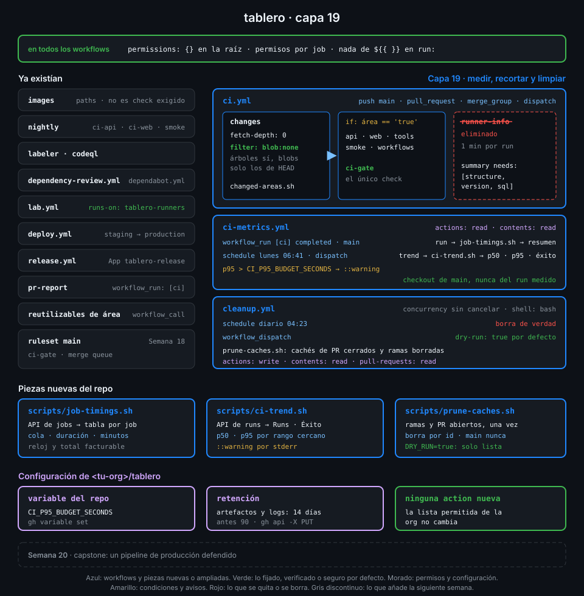

# Semana 19 — Rendimiento, coste y observabilidad

> El CI de `tablero` ya es correcto y seguro; ahora toca saber cuánto tarda, cuánto costaría y dónde se va el tiempo.
> Esta semana mides antes de optimizar, recortas con datos y dejas al CI vigilándose y limpiándose solo.

## 🎯 Objetivos de la Semana

Al terminar la semana eres capaz de:

- Explicar cómo factura GitHub Actions: qué es gratis, cómo se redondea cada job, qué cuesta el
  almacenamiento y por qué en una empresa cada job de más se paga
- Descomponer el tiempo de un run en cola, arranque y trabajo, y encontrar su camino crítico con
  la API de jobs
- Usar la caché a fondo: claves, `restore-keys`, alcance por rama y por PR, expulsión, límites y
  cuándo una caché cuesta más de lo que ahorra
- Repartir una suite con matrices y sharding sabiendo cuándo el coste fijo de cada job se come
  la ganancia
- Recortar el camino crítico de un pipeline con cambios medidos: jobs que sobran, clones más
  ligeros y trabajo que no hace falta
- Observar el CI con métricas propias por API: tiempos por job, p50/p95, tasa de éxito y un
  presupuesto que avisa
- Gobernar la retención de artefactos, logs y cachés, y limpiar lo que ya no tiene dueño

## 📋 Prerrequisitos

| Necesitas | Dónde se aprende |
|---|---|
| `check-week.sh 18` en verde | [Semana 18](../week-18-merge_queue_rulesets_y_monorepos/README.md) |
| `actions/cache`, `gh cache list` y `gh cache delete` | [Semana 03](../week-03-ci_de_python_con_uv/README.md) |
| Matrices, artefactos y retención | [Semana 04](../week-04-ci_de_frontend_pnpm_matrices_y_artefactos/README.md) |
| `schedule`, `workflow_run` y `timeout-minutes` | [Semana 07](../week-07-disparadores_filtros_y_concurrencia/README.md) |
| `workflow_run` con el patrón seguro y cache poisoning | [Semana 12](../week-12-modelo_de_amenazas_y_endurecimiento/README.md) |
| `ci.yml` como punto de entrada único, `ci-gate` y la merge queue | [Semana 18](../week-18-merge_queue_rulesets_y_monorepos/README.md) |

## 🗂️ Estructura de la Semana

```
week-19-rendimiento_coste_y_observabilidad/
├── README.md
├── rubrica-evaluacion.md
├── checks.json                    15 comprobaciones
├── 0-assets/                      diagramas SVG
├── 1-teoria/                      7 archivos, uno por concepto
├── 2-practicas/                   4 prácticas guiadas
├── 3-proyecto/
│   ├── README.md
│   └── starter/                   job-timings.sh, ci-trend.sh, prune-caches.sh, ci-metrics.yml y cleanup.yml
├── 4-recursos/{ebooks-free,videografia,webgrafia}/README.md
└── 5-glosario/README.md
```

## 📝 Contenidos

### Teoría

| # | Archivo | Qué aprendes | Tiempo |
|:--:|---|---|:--:|
| 01 | [Cuánto cuesta un minuto](1-teoria/01-cuanto-cuesta-un-minuto.md) | Qué es gratis, el redondeo por job, precios por runner, almacenamiento y presupuestos | 25 min |
| 02 | [Anatomía del tiempo de un run](1-teoria/02-anatomia-del-tiempo-de-un-run.md) | Cola, arranque y trabajo; reloj frente a minutos; camino crítico con la API de jobs | 25 min |
| 03 | [La caché a fondo](1-teoria/03-la-cache-a-fondo.md) | Claves, `restore-keys`, alcance por ref, expulsión, límites y la caché que no compensa | 30 min |
| 04 | [Paralelismo y sharding](1-teoria/04-paralelismo-y-sharding.md) | Repartir una suite en jobs, el coste fijo de cada uno y cuándo el sharding pierde | 25 min |
| 05 | [Recortar el camino crítico](1-teoria/05-recortar-el-camino-critico.md) | Jobs que sobran, clones sin blobs, trabajo condicional, cancelación y timeouts con datos | 25 min |
| 06 | [Métricas y observabilidad del CI](1-teoria/06-metricas-y-observabilidad.md) | Insights de Actions, métricas propias por API, percentiles y un presupuesto que avisa | 25 min |
| 07 | [Retención y limpieza](1-teoria/07-retencion-y-limpieza.md) | Cuánto vive cada cosa, cómo se cambia y qué borra un workflow de limpieza | 25 min |

### Prácticas

| # | Archivo | Qué haces | Tiempo |
|:--:|---|---|:--:|
| 01 | [Medir la línea base](2-practicas/01-medir-la-linea-base.md) | Mides tres runs de `ci` con la API, quitas el job que sobra y clonas sin blobs | 1 h |
| 02 | [Caché y paralelismo medidos](2-practicas/02-cache-y-paralelismo-medidos.md) | Inventarías la caché, ves su alcance por PR y pruebas a partir los tests de la web | 1 h |
| 03 | [Métricas del CI](2-practicas/03-metricas-del-ci.md) | `ci-metrics.yml` resume cada run de `ci` en `main` y la tendencia semanal contra un presupuesto | 1 h |
| 04 | [Retención y limpieza](2-practicas/04-retencion-y-limpieza.md) | Bajas la retención del repo y `cleanup.yml` borra cada día las cachés sin dueño | 1 h |

### Proyecto

[Capa 19 de `tablero`](3-proyecto/README.md): el CI tiene una línea base medida y un job menos,
`ci-metrics.yml` publica tiempos y tendencia en cada run, y `cleanup.yml` mantiene la caché
limpia.



## ⏱️ Distribución del Tiempo (10 horas)

| Actividad | Horas |
|---|:--:|
| Teoría (7 archivos) | 3 |
| Práctica 01 — Medir la línea base | 1 |
| Práctica 02 — Caché y paralelismo medidos | 1 |
| Práctica 03 — Métricas del CI | 1 |
| Práctica 04 — Retención y limpieza | 1 |
| Proyecto — capa 19 | 1.5 |
| Autoevaluación con la rúbrica | 1.5 |
| **Total** | **10** |

## 🎓 En el examen

GH-200 pregunta por **qué no consume minutos** (runners estándar en repos públicos, runners
propios), cómo se **redondea** el tiempo de cada job, el **límite de caché por repo** y cuándo
se expulsa una entrada, **desde qué ramas** puede restaurar caché un run (la suya, la por
defecto y, en un PR, la base), qué hace `restore-keys` y qué vale `cache-hit` en una
coincidencia parcial, la **retención por defecto** de artefactos y logs y dónde se cambia, y qué
métricas de Actions enseña la pestaña **Insights** de una organización.

## 🎩 Trucos y atajos

- **El reloj de un run sin abrir la UI**: `gh api repos/{owner}/{repo}/actions/runs/<id>/timing --jq .run_duration_ms`.
  En un repo privado, el mismo endpoint trae `billable` con los milisegundos facturables de cada
  job y sistema operativo.
- **Las cachés que más ocupan**: `gh cache list --sort size_in_bytes --limit 5 --json key,ref,sizeInBytes`.
  Si arriba sale una de `refs/pull/…/merge`, esa caché solo la puede usar ese PR.
- **Cuánto ocupa la caché del repo entero**: `gh api repos/{owner}/{repo}/actions/cache/usage --jq '"\(.active_caches_count) cachés, \(.active_caches_size_in_bytes / 1048576 | floor) MiB"'`.
- **Borrar de un golpe las cachés de un PR cerrado**: `gh cache delete --all --ref refs/pull/42/merge --succeed-on-no-caches`.
  Sin `--succeed-on-no-caches`, un PR sin cachés hace fallar el script.
- **Duración de cada job de un run en una línea**: `gh run view <id> --json jobs --jq '.jobs[] | "\(.name): \((.completedAt | fromdate) - (.startedAt | fromdate)) s"'`.

## 📌 Entregables

- `scripts/job-timings.sh`, `scripts/ci-trend.sh` y `scripts/prune-caches.sh`
- `ci.yml` sin `runner-info` y con el job `changes` clonando sin blobs
- `ci-metrics.yml` y `cleanup.yml` en `main`, los dos con al menos un run en verde
- La variable `CI_P95_BUDGET_SECONDS` y la retención de artefactos y logs a 14 días
- La línea base antes y después, anotada en la descripción del PR de la práctica 01
- La rúbrica respondida

## ✅ Verificación

```bash
cd ~/code/bc-github-actions
./scripts/check-week.sh 19
# Semana 19 — Rendimiento, coste y observabilidad  [repo: <tu-org>/tablero]
#
#   ✅ ci.yml ya no tiene el job runner-info: solo imprimía datos del runner y costaba un job por run
#   ...
# 15/15 comprobaciones superadas.
```

Si algo sale en rojo, la pista te dice qué práctica y qué paso lo arreglan.

## 🔗 Navegación

---

| ← Anterior | Siguiente → |
|:---|---:|
| [Semana 18 — Merge queue, rulesets y monorepos](../week-18-merge_queue_rulesets_y_monorepos/README.md) | [Cuánto cuesta un minuto](1-teoria/01-cuanto-cuesta-un-minuto.md) |
