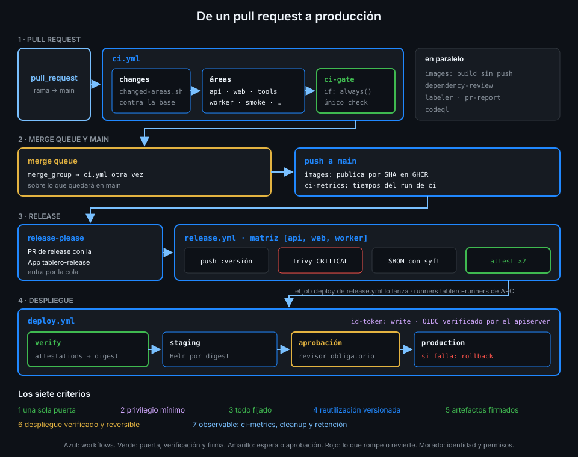

# Qué hace de un pipeline uno de producción

> Un pipeline "funciona" cuando el run sale verde. Es de producción cuando además sabes decir por
> qué es verde, quién puede cambiarlo, qué publica, cómo se comprueba lo publicado y qué pasa si
> falla. Este archivo fija esos criterios y los recorre sobre `tablero`.



## 🎯 Objetivos

Al terminar este archivo eres capaz de:

- Enumerar los siete criterios que separan un pipeline de producción de uno que solo pasa
- Recorrer el camino completo de un cambio en `tablero`, del push al pod en production
- Situar cada pieza del pipeline en la semana que la introdujo
- Reconocer qué criterio cubre cada workflow y cuál quedaría al descubierto si lo borras
- Decir qué añade la capa 20 y por qué es la última

## 1. Qué problema resuelve

Durante diecinueve semanas has ido añadiendo capas a `tablero`, y cada una resolvía un problema
concreto: que los tests corrieran, que las imágenes se publicaran, que nadie pudiera inyectar
código, que el despliegue se aprobara. El riesgo de construir por capas es perder la vista de
conjunto: un pipeline con veinte workflows correctos puede tener un hueco entre dos de ellos que
ninguno ve por separado.

El capstone te pide lo contrario de lo que has hecho hasta ahora. No añades una capacidad nueva:
demuestras que el conjunto aguanta. Para eso necesitas un criterio explícito de qué es "de
producción", porque sin criterio la auditoría (archivo 03) no sabe qué buscar y la defensa
(archivo 04) no sabe qué demostrar.

## 2. Cómo funciona

### Los siete criterios

| # | Criterio | Qué pregunta responde | Dónde lo tiene `tablero` |
|:--:|---|---|---|
| 1 | **Una sola puerta** | ¿Qué tiene que estar verde para que algo entre en `main`? | `ci-gate` como único check requerido del ruleset, con merge queue (S18) |
| 2 | **Privilegio mínimo** | ¿Qué puede hacer un job si lo comprometen? | `permissions: {}` en la raíz y permisos por job; datos no confiables por `env:` (S12) |
| 3 | **Todo fijado** | ¿Lo que corre hoy es lo mismo que corrió ayer? | `uses:` por SHA, herramientas con checksum, imágenes por digest (S01, S12, S14) |
| 4 | **Reutilización versionada** | ¿Dónde se cambia el CI de diez repos? | Reutilizables y actions en `actions-tablero`, con releases inmutables (S09-S11) |
| 5 | **Artefactos firmados** | ¿Cómo sé que esta imagen la construyó mi pipeline? | SBOM, procedencia SLSA y `gh attestation verify` (S14) |
| 6 | **Despliegue verificado y reversible** | ¿Qué llega al clúster y cómo se deshace? | `deploy.yml` por digest verificado, environments con aprobación, OIDC, rollback de Helm (S13, S17) |
| 7 | **Observable** | ¿Cuánto tarda, cuánto falla y cuánto cuesta? | `ci-metrics.yml` con p50/p95, `cleanup.yml` y retención (S19) |

Ninguno de los siete es opcional. Un pipeline con todo fijado pero sin puerta única deja entrar
un PR con un job saltado que nadie exigía. Uno con artefactos firmados pero sin verificación en el
despliegue firma para nadie. Uno con todo lo demás pero sin métricas se degrada sin que nadie lo
note hasta que el CI tarda veinte minutos.

### El camino de un cambio

Sigue un commit desde la rama hasta production. Cada paso es una pieza que ya escribiste:

1. **Pull request.** `ci.yml` arranca con `pull_request`. El job `changes` ejecuta
   `scripts/changed-areas.sh` contra la base del PR y decide qué áreas corren.
2. **Áreas.** Cada área llama a su reutilizable (`ci-api`, `ci-web`, `ci-tools`, `smoke`,
   `lint-workflows`), que a su vez llama a los del repo central fijados por SHA.
3. **Puerta.** `ci-gate` espera a todos con `if: always()` y falla si alguno falló o se canceló.
   Es el único check que pide el ruleset de `main`.
4. **Paralelo al CI.** `images.yml` construye las imágenes sin publicarlas; `dependency-review`
   mira las dependencias nuevas; `labeler` y `pr-report` etiquetan y comentan con el patrón seguro.
5. **Merge queue.** El PR entra en la cola, `ci.yml` corre otra vez con `merge_group` sobre lo que
   quedará en `main`, y solo entonces se fusiona.
6. **`main`.** `images.yml` publica por SHA; `ci-metrics.yml` mide el run de `ci` en `main`.
7. **Release.** release-please mantiene un PR de release. Al fusionarlo, `release.yml` publica
   cada imagen por versión, la escanea con Trivy, genera su SBOM con syft y firma las dos
   attestations.
8. **Despliegue.** El job `deploy` de `release.yml` lanza `deploy.yml`, que verifica las
   attestations, saca el digest y despliega con Helm a `staging` y, con aprobación, a
   `production`, en runners propios de ARC y con un token OIDC que el apiserver verifica.

### El mapa por fases

| Fase | Semanas | Qué aportó al pipeline |
|---|:--:|---|
| Fundamentos | 01-04 | `ci.yml` con `structure`, `version` y `summary`; `ci-api` con uv, ruff y cobertura; `ci-web` con pnpm, matriz de Node y artefacto `web-dist` |
| Integración | 05-08 | PostgreSQL como service container y `smoke.yml` con Compose; `images.yml` a GHCR; `paths`, `concurrency`, `timeout-minutes` y `nightly.yml`; `lint-workflows.yml` con actionlint y zizmor |
| Reutilización | 09-11 | `_python.yml`, `_node.yml`, `_image.yml` y tres actions propias, movidos a `actions-tablero` con release inmutable v1.0.0 |
| Seguridad | 12-14 | `permissions: {}` por todas partes, `labeler` y `pr-report` seguros, CodeQL, Dependabot; environments y OIDC con `tools/oidc-verifier`; release-please, Trivy, SBOM y attestations |
| Runners y despliegue | 15-17 | Runner JIT en Docker, ARC en kind con `tablero-runners`, `deploy.yml` por digest verificado con aprobación y rollback |
| Escala y operación | 18-20 | `ci.yml` como entrada única con `ci-gate`, ruleset y merge queue; métricas, limpieza y retención; y esta semana, el worker, la auditoría y la defensa |

El detalle capa a capa está en
[`docs/proyecto-hilo-conductor.md`](../../../docs/proyecto-hilo-conductor.md). Léelo entero una vez
esta semana: es el borrador del "Mapa del pipeline" de tu documento de defensa.

### Qué añade la capa 20

Tres pruebas de que los siete criterios se sostienen:

- **Crece sin copiar.** `worker/` entra en CI, imágenes y release sin un solo job propio
  (archivo 02). Si el criterio 4 fuera de verdad, añadir un componente cuesta diez líneas.
- **Se audita a sí mismo.** `scripts/audit-workflows.sh` convierte los criterios 2 y 3 en reglas
  que corren en el CI, y las pasa también sobre el repo central (archivo 03).
- **Se explica.** `docs/pipeline.md` recoge mapa, amenazas, decisiones, riesgos y evidencias
  (archivo 04).

## 3. Cómo se usa

### Los criterios como lista de revisión

Antes de dar un pipeline por bueno, en `tablero` o en el de tu próximo trabajo, recorre la tabla
con estas preguntas, cada una con su comando:

```bash
# 1. Una sola puerta: qué checks exige el ruleset de main
gh api "repos/{owner}/{repo}/rules/branches/main" \
  --jq '.[] | select(.type == "required_status_checks") | .parameters.required_status_checks[].context'
# ci-gate

# 2 y 3. Privilegio mínimo y todo fijado: tu política (archivo 03)
scripts/audit-workflows.sh
# 0 hallazgos

# 5. Artefactos firmados: la procedencia de la última imagen publicada
gh attestation verify "oci://ghcr.io/<tu-org>/tablero-api:<versión>" --repo <tu-org>/tablero \
  --signer-workflow <tu-org>/tablero/.github/workflows/release.yml
# ✓ Verification succeeded!

# 7. Observable: el último run de las métricas
gh run list --workflow ci-metrics.yml --limit 1 --json conclusion --jq '.[0].conclusion'
# success
```

Si alguno de los comandos no te sale, ese criterio no está demostrado, aunque el YAML exista.

### Qué workflow cubre qué

Un ejercicio útil antes de la defensa: para cada workflow, di qué criterio quedaría al descubierto
si lo borraras mañana. Si para alguno la respuesta es "ninguno", o sobra o no sabes para qué está.

| Si borras… | Pierdes… |
|---|---|
| `ci-gate` | El criterio 1: el ruleset exigiría un check que no llega o habría que exigir cada job |
| `lint-workflows.yml` | La garantía de que los criterios 2 y 3 siguen cumpliéndose en el próximo PR |
| `release.yml` | El criterio 5: las imágenes de `main` no tienen versión ni firma |
| `deploy.yml` | El criterio 6: alguien desplegaría a mano, sin verificación |
| `ci-metrics.yml` | El criterio 7: el CI se haría lento sin que nadie lo viera |
| `cleanup.yml` | Parte del 7: la caché se llenaría de entradas de PR cerrados |

### Evaluar un pipeline que no escribiste

Los siete criterios valen igual para el pipeline que te encuentres en tu próximo equipo. En un
repo ajeno no tienes `audit-workflows.sh` ni conoces la historia, pero diez minutos de `grep` te
dicen por dónde empezar:

| Criterio | Señal rápida | Qué buscar |
|---|---|---|
| 1 | Checks requeridos del ruleset | Muchos nombres de job en vez de uno, o ninguno |
| 2 | `grep -L '^permissions:' .github/workflows/*.yml` | Workflows sin `permissions:` en la raíz |
| 3 | `grep -hE 'uses: [^.$][^@]*@' .github/workflows/*.yml \| grep -vE '@[0-9a-f]{40}'` | `uses:` por tag o por rama |
| 4 | Workflows con los mismos steps copiados | Tres `ci-*.yml` con el mismo bloque de setup |
| 5 | `gh attestation verify` sobre la última imagen | "no attestations found" |
| 6 | El job que despliega | Un tag en vez de un digest, o credenciales estáticas del clúster |
| 7 | Algún workflow con `schedule` que mida algo | Nadie sabe cuánto tarda el CI |

El orden de arreglo casi siempre es el mismo: 2 y 3 primero, porque son baratos y cierran los
ataques más comunes; luego 1, que protege `main`; y después el resto, que piden diseño.

## 4. Antipatrones

| Antipatrón | Por qué duele | Qué hacer en su lugar |
|---|---|---|
| Dar por bueno el pipeline porque el último run está verde | Un verde dice que lo que corrió pasó, no que corriera lo necesario | Recorrer los siete criterios con su comando |
| Exigir en el ruleset cada job por nombre | Un job saltado por filtro deja el check pendiente para siempre, y cada área nueva obliga a tocar el ruleset | Un job puerta (`ci-gate`) como único check requerido |
| Firmar artefactos sin verificarlos al desplegar | La firma no protege a nadie si nadie la comprueba | `gh attestation verify` como primer job del despliegue |
| Medir el CI solo cuando alguien se queja | Cuando llega la queja, ya llevas semanas pagando la lentitud | Métricas programadas con presupuesto y aviso |
| Considerar el repo central "de confianza" sin auditarlo | Lo ejecutan todos tus repos: un fallo allí vale por diez | La misma política sobre el central (archivo 03) |
| Añadir un componente copiando el workflow de otro | Dos copias que divergen en el tercer cambio | Llamar a los reutilizables; si falta algo, se añade allí con una release |

## 5. Trucos

- **El YAML que de verdad hay en `main`**: `gh workflow view ci.yml --ref main --yaml` te enseña
  el workflow tal como está en esa rama, sin clonar ni cambiar de rama. Útil para revisar el mapa
  contra lo que corre, no contra tu copia local.
- **Todos los workflows y su estado de un vistazo**: `gh workflow list --all` incluye los
  deshabilitados. Un workflow deshabilitado que nadie recuerda es un hueco en el mapa.
- **El último run de cada workflow en `main`**: `gh run list --branch main --limit 50 --json workflowName,conclusion`
  con `--jq 'unique_by(.workflowName)[]'` te da una fila por workflow para la sección de evidencias.

## 📚 Recursos Adicionales

- [GitHub Docs: Security hardening for GitHub Actions](https://docs.github.com/en/actions/reference/security/secure-use)
- [GitHub Docs: About rulesets](https://docs.github.com/en/repositories/configuring-branches-and-merges-in-your-repository/managing-rulesets/about-rulesets)
- [GitHub Docs: Using artifact attestations](https://docs.github.com/en/actions/how-tos/secure-your-work/use-artifact-attestations/use-artifact-attestations)
- [SLSA: Supply-chain Levels for Software Artifacts](https://slsa.dev/)

## ✅ Checklist de Verificación

- [ ] Sé enumerar los siete criterios y qué pregunta responde cada uno
- [ ] Sé recorrer un cambio de `tablero` desde el PR hasta production, pieza a pieza
- [ ] Sé qué fase del bootcamp aportó cada parte del pipeline
- [ ] Sé con qué comando se demuestra cada criterio
- [ ] Sé qué criterio pierdo si borro cada workflow
- [ ] Sé qué tres pruebas añade la capa 20 y por qué cierra el bootcamp

---

| ← Anterior | Siguiente → |
|:---|---:|
| [Semana 20 — Capstone: un pipeline de producción defendido](../README.md) | [Integrar un componente sin escribir CI](02-integrar-un-componente-sin-escribir-ci.md) |
