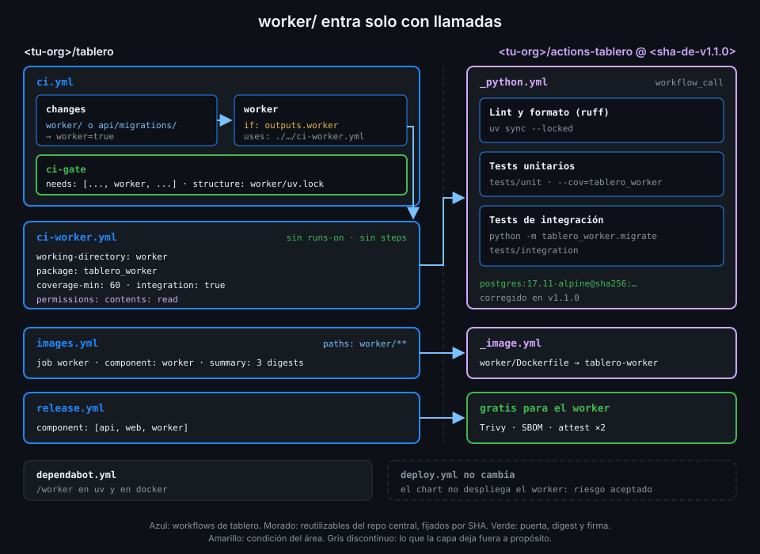

# Integrar un componente sin escribir CI

> La prueba de que los reutilizables valen la pena no es el día que los escribes: es el día que
> llega un componente nuevo y entra en el pipeline sin una sola línea de CI copiada.



## 🎯 Objetivos

Al terminar este archivo eres capaz de:

- Explicar qué contrato tiene que cumplir un componente para entrar por `_python.yml` e `_image.yml`
- Escribir un workflow de componente sin steps propios, solo con la llamada al reutilizable
- Decidir qué rutas disparan el área de un componente, incluidas las que no son suyas
- Enumerar los seis sitios del pipeline que tocas al añadir un componente y por qué cada uno
- Distinguir cuándo un hueco se arregla en el componente y cuándo en el repo central

## 1. Qué problema resuelve

`tablero` tenía dos componentes con imagen (`api` y `web`) y una herramienta (`tools/oidc-verifier`).
Esta semana llega el tercero: `worker/`, un proceso que borra las tareas `done` con más de
`RETENTION_DAYS` días y termina. Está escrito en Python con uv, tiene tests unitarios y de
integración contra PostgreSQL, y su Dockerfile es multi-stage como el de la API.

La tentación es copiar `ci-api.yml`, cambiar `api` por `worker` y seguir. Funciona el primer día.
El tercer mes, `ci-api.yml` ha ganado un paso de caché que `ci-worker.yml` no tiene, la versión
de ruff es distinta en cada uno y nadie sabe cuál es el bueno. La Semana 09 te enseñó a no hacer
eso, y la Semana 11 movió los reutilizables a un repo central versionado. El capstone comprueba
que esa inversión se cobra: el worker entra **solo con llamadas**.

## 2. Cómo funciona

### El contrato de `_python.yml`

Un reutilizable define una interfaz y asume una forma del proyecto. Antes de llamarlo, comprueba
que tu componente la cumple. La de `_python.yml` del central:

| Input | Qué espera | En el worker |
|---|---|---|
| `working-directory` | Carpeta con `pyproject.toml` y `uv.lock` | `worker` |
| `package` | Paquete que mide la cobertura y que trae el módulo `migrate` | `tablero_worker` |
| `coverage-min` | Cobertura mínima de `tests/unit`, en porcentaje (60 por defecto) | `60` |
| `integration` | Si corre `tests/integration` contra un PostgreSQL de servicio | `true` |

Y lo que asume sin decirlo en los inputs, porque lo hace en sus steps:

- `uv sync --locked` funciona: el `uv.lock` está al día.
- Los tests unitarios están en `tests/unit` y los de integración en `tests/integration`.
- `python -m <package>.migrate` aplica el esquema antes de los tests de integración. En el worker,
  `tablero_worker.migrate` aplica las migraciones de `../api/migrations/`: el esquema es de la API
  y el worker no tiene migraciones propias.

`worker/` se escribió para cumplir ese contrato. Si un componente no lo cumple, tienes dos
caminos: adaptar el componente (mover sus tests, añadir un `migrate`) o ampliar el reutilizable
con un input nuevo y publicar una release del central. Lo que no haces es copiar el job.

### Los seis sitios que tocas

| Sitio | Cambio | Por qué |
|---|---|---|
| `ci-worker.yml` (nuevo) | Un job que llama a `_python.yml` | La forma de llamar al central desde `ci.yml`, igual que `ci-api.yml` |
| `scripts/changed-areas.sh` | Línea `worker=` | Sin área, `ci.yml` no sabe cuándo correrlo |
| `ci.yml` | Output, job `worker`, `ci-gate.needs` y `structure` | Sin entrar en `ci-gate`, un fallo del worker no bloquea nada |
| `images.yml` | `worker/**` en `paths` y job con `_image.yml` | La imagen se construye en cada PR que la toca |
| `release.yml` | `worker` en la matriz | Trivy, SBOM y attestations salen gratis |
| `dependabot.yml` | `/worker` en `uv` y `docker` | Lo que nadie actualiza envejece |

`deploy.yml` no cambia: el chart de `deploy/k8s` no despliega el worker. Es una decisión que
anotas en tu documento de defensa (archivo 04), con lo que haría falta para cerrarla (un CronJob).

## 3. Cómo se usa

### `ci-worker.yml`

Este es el archivo entero, con el SHA de la release del central que publicas en la práctica 03:

```yaml
name: ci-worker
on:
  # Lo llama ci.yml cuando cambia worker/ o el esquema de la API, que el worker usa.
  workflow_call:
  workflow_dispatch:
permissions: {}
jobs:
  worker:
    name: Worker
    uses: <tu-org>/actions-tablero/.github/workflows/_python.yml@<sha-de-v1.1.0> # v1.1.0
    with:
      working-directory: worker
      package: tablero_worker
      coverage-min: 60
      integration: true
    permissions:
      contents: read
```

No tiene `runs-on`, ni `timeout-minutes`, ni steps: un job que llama a un reutilizable no corre
en un runner, solo delega. Los tres jobs del central (`Lint y formato (ruff)`, `Tests unitarios`
y `Tests de integración (PostgreSQL 17)`) traen su runner y su timeout. En la UI aparecen como
`worker / Worker / …` dentro del run de `ci`.

`workflow_dispatch` está para poder lanzar el CI del worker a mano sin pasar por `ci.yml`. El
`permissions: {}` de la raíz y el `contents: read` del job son el techo: `_python.yml` declara
`contents: read` como su propio techo y no puede pedir más de lo que le das.

### El área: qué rutas la disparan

```bash
# El worker no tiene esquema propio: usa el de la API, así que sus migraciones también lo prueban.
echo "worker=$(area '^(worker/|api/migrations/)')"
```

La segunda ruta es la decisión interesante. El worker borra filas de la tabla `tasks`, cuyo
esquema vive en `api/migrations/`. Una migración que renombra `created_at` rompe el worker sin
tocar un archivo de `worker/`. Si el área solo mirara su carpeta, ese PR pasaría verde.

Compruébalo con un commit de prueba en una rama que después borras:

```bash
git switch -c try/migration
touch api/migrations/9999_probe.sql
git add api/migrations && git commit -qm "test: probe migration area"
scripts/changed-areas.sh HEAD~1 | grep -E '^(api|web|worker)='
# api=true
# web=false
# worker=true
git switch - && git branch -D try/migration
```

### `ci.yml`: cuatro cambios

```yaml
    outputs:
      worker: ${{ steps.diff.outputs.worker }}
```

```yaml
  worker:
    needs: changes
    if: needs.changes.outputs.worker == 'true'
    uses: ./.github/workflows/ci-worker.yml # zizmor: ignore[self-repository]
    permissions:
      contents: read
```

`ci-gate.needs` gana `worker`, y el bucle de `structure` comprueba también `worker/uv.lock`. Si
olvidas el `needs` de `ci-gate`, el worker corre, puede fallar, y la merge queue fusiona igual:
el ruleset solo mira `ci-gate`. Es el fallo más probable de la práctica 01.

### Imagen y release

En `images.yml` el job `worker` es el de `web` con `component: worker`. `_image.yml` construye
`<component>/Dockerfile` y llama a la imagen `tablero-<component>`, así que el nombre sale solo.
`summary` pasa a necesitar `[api, web, worker]` y añade su fila de digest.

En `release.yml` el cambio es una palabra:

```yaml
      matrix:
        component: [api, web, worker]
```

Todo lo que la Semana 14 escribió para cada imagen (Trivy, syft, `actions/attest` dos veces)
está dentro de la matriz, así que `tablero-worker:<versión>` sale publicada, escaneada y firmada
sin un step nuevo.

## 4. Antipatrones

| Antipatrón | Por qué duele | Qué hacer en su lugar |
|---|---|---|
| Copiar `ci-api.yml` como `ci-worker.yml` con steps | Dos copias que divergen; un arreglo de seguridad en una no llega a la otra | Llamar a `_python.yml`; el workflow del componente no tiene steps |
| Añadir un step "solo para el worker" junto a la llamada | Un job que llama a un reutilizable no admite `steps`; un job aparte rompe el contrato | Añadir el input al reutilizable del central y publicar una release |
| Área que solo mira la carpeta del componente | Un cambio de esquema rompe el worker y el PR pasa verde | Incluir en el área todo lo que el componente consume (`api/migrations/`) |
| Olvidar el componente en `ci-gate.needs` | El job corre y falla, pero la cola fusiona porque solo mira `ci-gate` | `needs` de `ci-gate` con todas las áreas |
| Llamar al central por `@v1` o por rama | El reutilizable cambia bajo tus pies sin PR ni revisión | SHA de la release con el tag en comentario |
| Dockerfile del componente sin digest "porque es nuevo" | Lo nuevo hereda los riesgos de lo viejo desde el primer día | Base y `COPY --from` por tag y digest, como la API desde la S14 |

## 5. Trucos

- **Ver los jobs que trae un reutilizable antes de llamarlo**:
  `gh api "repos/<tu-org>/actions-tablero/contents/.github/workflows/_python.yml?ref=<sha-de-v1.1.0>" --jq .content | base64 -d | yq '.jobs | keys'`
  te da sus jobs en el SHA exacto que vas a fijar.
- **Los inputs de un reutilizable de un vistazo**: con el mismo comando, `yq '.on.workflow_call.inputs | keys'`.
  Si el input que necesitas no está, no lo inventes: actionlint lo marca como desconocido.
- **Lanzar solo el CI del componente**: `gh workflow run ci-worker.yml --ref <rama>` corre el
  área sin el resto de `ci.yml`, útil mientras lo pones a punto. No sustituye al run de `ci`:
  el check que cuenta sigue siendo `ci-gate`.

## 📚 Recursos Adicionales

- [GitHub Docs: Reuse workflows](https://docs.github.com/en/actions/how-tos/reuse-automations/reuse-workflows)
- [GitHub Docs: Workflow syntax, `jobs.<job_id>.uses`](https://docs.github.com/en/actions/reference/workflows-and-actions/workflow-syntax#jobsjob_iduses)
- [uv: Locking and syncing](https://docs.astral.sh/uv/concepts/projects/sync/)
- [Dependabot: `directories`](https://docs.github.com/en/code-security/reference/supply-chain-security/dependabot-options-reference#directories)

## ✅ Checklist de Verificación

- [ ] Sé qué inputs tiene `_python.yml` y qué asume del proyecto sin decirlo
- [ ] Sé por qué `ci-worker.yml` no tiene `runs-on`, `timeout-minutes` ni steps
- [ ] Sé por qué el área `worker` incluye `api/migrations/`
- [ ] Sé qué pasa si olvido `worker` en `ci-gate.needs`
- [ ] Sé qué seis sitios toco para añadir un componente y por qué `deploy.yml` no es uno
- [ ] Sé dónde se arregla un hueco del reutilizable: en el central, con una release

---

| ← Anterior | Siguiente → |
|:---|---:|
| [Qué hace de un pipeline uno de producción](01-que-hace-de-un-pipeline-uno-de-produccion.md) | [Auditar un pipeline](03-auditar-un-pipeline.md) |
