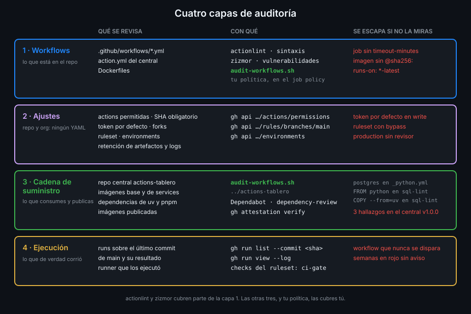

# Auditar un pipeline

> actionlint te dice si el YAML es válido y zizmor si tiene vulnerabilidades conocidas. Ninguno
> de los dos sabe cuáles son tus reglas. Una auditoría completa mira cuatro capas, y la que no
> mira ninguna herramienta la escribes tú.



## 🎯 Objetivos

Al terminar este archivo eres capaz de:

- Nombrar las cuatro capas de una auditoría de CI/CD y qué riesgo cubre cada una
- Decir qué ve actionlint, qué ve zizmor y qué no ve ninguno de los dos
- Convertir las reglas del bootcamp en una política ejecutable con salida y código de salida útiles
- Evitar la trampa de precedencia de `,` y `|` en yq
- Auditar el repo central con la misma política y corregirlo con una release
- Revisar con la API los ajustes que ningún YAML contiene

## 1. Qué problema resuelve

En la Semana 12 aprendiste las reglas: permisos mínimos, nada sin fijar, nada interpolado en un
`run:`. En la Semana 14 fijaste por digest las bases de `tablero`. Pero las reglas que solo están
en la cabeza de alguien se cumplen mientras ese alguien revisa cada PR. Al tercer PR con prisa,
entra un `uses: algo@v2` o un job sin `timeout-minutes`, y ninguna herramienta protesta, porque
para actionlint es YAML válido y para zizmor no es una vulnerabilidad.

Hay un segundo problema: el alcance. Auditar solo los workflows de `tablero` deja fuera el repo
central, que ejecutan todos tus repos, y deja fuera los ajustes de la org, que ningún archivo
contiene. La auditoría del capstone encontró justo eso: el central v1.0.0 tenía tres imágenes sin
digest que `tablero` ya había corregido en la Semana 14 en su propio código.

## 2. Cómo funciona

### Las cuatro capas

| Capa | Qué se revisa | Con qué | Lo que se escapa si no la miras |
|---|---|---|---|
| **Workflows** | YAML de `.github/workflows/`, `action.yml`, Dockerfiles | actionlint, zizmor, tu política | Un job sin timeout, una imagen sin digest, una etiqueta `-latest` |
| **Ajustes** | Org y repo: actions permitidas, token por defecto, aprobación de forks, ruleset, environments, retención | La API con `gh api` | Un token por defecto en `write` hace inútil el `permissions:` que olvidaste |
| **Cadena de suministro** | Lo que tu pipeline consume y publica: el repo central, imágenes base, dependencias, attestations | Dependabot, `dependency-review`, tu política sobre el central, `gh attestation verify` | Un reutilizable del central con una imagen sin fijar |
| **Ejecución** | Lo que de verdad corrió: en qué commit, con qué resultado, con qué runner | `gh run list`, `gh run view`, los checks del ruleset | Un workflow que existe pero nunca se dispara, o que lleva semanas en rojo |

### Qué ve cada herramienta

| Herramienta | Ve | No ve |
|---|---|---|
| actionlint | Sintaxis, expresiones, tipos de inputs y outputs, `shellcheck` en `run:`, etiquetas de runner desconocidas | Si tu política exige timeout o digest |
| zizmor (offline) | Inyección de plantillas, `persist-credentials`, permisos excesivos, `pull_request_target` peligroso, `uses:` sin fijar | Ajustes de la org, Dockerfiles, timeouts |
| zizmor (online) | Además: commits impostores, actions con vulnerabilidades conocidas, tag que no coincide con el SHA | Lo mismo que offline fuera de los workflows |
| Tu política | Exactamente las reglas que escribes | Todo lo demás: no sustituye a las otras dos |

Las tres se complementan. La política no repite lo que zizmor ya detecta: cubre el hueco entre
"YAML válido y sin vulnerabilidad conocida" y "cumple las reglas de este equipo".

### La política de `tablero`

`scripts/audit-workflows.sh` comprueba seis reglas, cada una con su origen en el bootcamp:

| Regla | Hallazgo cuando | Semana |
|---|---|:--:|
| `permissions-root` | Un workflow no tiene `permissions:` en la raíz | 01, 12 |
| `write-all` | Aparece `write-all` en cualquier sitio | 12 |
| `timeout` | Un job con `runs-on` no tiene `timeout-minutes` | 07 |
| `runner-latest` | Una etiqueta de `runs-on` termina en `-latest` | 01 |
| `unpinned-uses` | Un `uses:` no es `./`, `$/`, `@<40 hex>` ni `docker://…@sha256:<64>` | 01, 12 |
| `image-digest` | Una imagen de `services`, `container`, `FROM` o `COPY --from` sin `@sha256:` | 14 |

Dos excepciones que no son concesiones, sino precisión:

- Un job que **llama a un reutilizable** no tiene `runs-on` y no admite `timeout-minutes`: el
  timeout lo ponen los jobs del reutilizable. La regla `timeout` solo mira jobs con `runs-on`.
- En un Dockerfile, `FROM build` o `COPY --from=build` apuntan a una **etapa local**, no a un
  registro. Tampoco `scratch` ni una imagen calculada con `${{ }}` se pueden fijar en estático.

### El formato de salida

Una línea por hallazgo, `ruta: regla: detalle`, y al final el recuento. Código de salida 1 si hay
alguno:

```text
../actions-tablero/.github/workflows/_python.yml: image-digest: postgres:17.11-alpine
../actions-tablero/sql-lint/Dockerfile: image-digest: FROM python:3.15.2-slim-trixie
../actions-tablero/sql-lint/Dockerfile: image-digest: COPY --from=ghcr.io/astral-sh/uv:0.13.6
3 hallazgos
```

Esa forma no es estética: `ruta:` al principio deja que un problem matcher la convierta en
anotación si un día lo quieres, `grep image-digest` filtra una regla, y el código de salida es lo
que hace fallar el job `policy`.

### La trampa de yq

En yq, la coma tiene **menos** precedencia que la tubería. Esta expresión parece listar los
`uses:` de job y de step quitando los nulos:

```bash
# prueba.yml: job a con runs-on y un step "uses: foo@1"; job b que llama a "bar@2"
yq -r '.jobs[] | .uses, (.steps[]? | .uses) | select(. != null)' prueba.yml
# null
# bar@2
```

Pero se lee como `(.jobs[] | .uses), ((.steps[]? | .uses) | select(. != null))`. La primera
mitad imprime el `uses` de cada job, `null` incluido, que la política tomaría por un `uses:` sin
fijar. La segunda se aplica a la raíz del documento, que no tiene `steps`: el `foo@1` del step
desaparece sin error. Agrupa con paréntesis:

```bash
yq -r '.jobs[] | (.uses, (.steps[]? | .uses)) | select(. != null)' prueba.yml
# bar@2
# foo@1
```

_Verificado con yq v4.54.1 y ubuntu-24.04, noviembre de 2026._

## 3. Cómo se usa

### En local, sobre los dos repos

```bash
scripts/audit-workflows.sh
# 0 hallazgos
scripts/audit-workflows.sh ../actions-tablero
# ...
# 3 hallazgos
```

El script acepta varias raíces. Con los dos repos clonados uno al lado del otro, un solo comando
audita lo que ejecutas y lo que llamas.

### En el CI

```yaml
name: lint-workflows
on:
  workflow_call:
  workflow_dispatch:
permissions: {}
jobs:
  policy:
    name: Política de tablero
    runs-on: ubuntu-24.04
    timeout-minutes: 5
    steps:
      - uses: actions/checkout@3d3c42e5aac5ba805825da76410c181273ba90b1 # v7.0.1
        with:
          persist-credentials: false
      # yq viene en la imagen ubuntu-24.04: el script no instala nada.
      - name: Workflows y Dockerfiles contra la política
        run: scripts/audit-workflows.sh
    permissions:
      contents: read
```

Este es solo el job nuevo; en tu `lint-workflows.yml` va junto a `actionlint` y `zizmor`. Para
que un cambio en la propia política también pase por el CI, el área `workflows` de
`changed-areas.sh` pasa a mirar `scripts/audit-workflows.sh`. Un cambio en `.github/` ya corría
todas las áreas.

### Corregir el central

Los tres hallazgos del central no se arreglan en `tablero`: se arreglan en `actions-tablero`, con
un PR, y se publican como **v1.1.0**, release inmutable como la v1.0.0 de la Semana 11. Después
`tablero` mueve **todas** sus referencias al SHA de v1.1.0: `ci-api`, `ci-web`, `ci-tools`,
`ci-worker`, `images` y el `sql-lint` de `ci.yml`. Mezclar versiones del central en un mismo repo
es mezclar dos políticas.

```bash
grep -rhoE 'actions-tablero/[^@]+@[0-9a-f]{40}' .github/workflows | sed 's/.*@//' | sort -u
# <sha-de-v1.1.0>
```

Una sola línea: un solo commit del central en todo `tablero`.

### Los ajustes, por API

Ningún YAML contiene la configuración de la org. Se audita leyéndola:

```bash
gh api "orgs/<tu-org>/actions/permissions/workflow" --jq .default_workflow_permissions
# read
gh api "repos/{owner}/{repo}/actions/permissions/fork-pr-contributor-approval" --jq .approval_policy
# all_external_contributors
gh api "repos/{owner}/{repo}/actions/permissions/artifact-and-log-retention" --jq .days
# 14
```

Cada respuesta va a la sección de evidencias de tu defensa (archivo 04), con la fecha.

## 4. Antipatrones

| Antipatrón | Por qué duele | Qué hacer en su lugar |
|---|---|---|
| Auditar solo con actionlint | Valida sintaxis, no política: un job sin timeout es YAML válido | actionlint + zizmor + tu política |
| Política que solo corre en local | Deja de cumplirse el día que alguien no la corre | Job `policy` en `lint-workflows.yml` |
| Auditar `tablero` y no el central | El central lo ejecutan todos tus repos y escapa a la revisión | La misma política sobre los dos |
| Corregir el central copiando el arreglo en `tablero` | Dos fuentes de verdad; el siguiente repo hereda el fallo | PR al central, release nueva, mover las referencias |
| Exigir `timeout-minutes` en un job que llama a un reutilizable | No se admite y la regla da falsos positivos que acaban ignorados | Mirar solo jobs con `runs-on` |
| Una política sin código de salida | Imprime hallazgos y el job sale verde | Salir con 1 si hay hallazgos |
| Mirar los workflows y no los ajustes | El token por defecto en `write` deshace lo que el YAML promete | Leer los ajustes con `gh api` |

## 5. Trucos

- **La misma auditoría sobre otro repo**: `scripts/audit-workflows.sh ../actions-tablero` acepta
  cualquier clon como raíz, también uno de un proyecto que no es tuyo y quieres evaluar.
- **Solo una regla**: `scripts/audit-workflows.sh | grep ': image-digest:'` mientras arreglas
  digests, sin ruido del resto.
- **zizmor online sobre los dos repos a la vez**: `GH_TOKEN=$(gh auth token) zizmor . ../actions-tablero`
  pasa las auditorías que consultan la API (impostor, vulnerables, tag desalineado) en una sola
  llamada.

## 📚 Recursos Adicionales

- [actionlint: checks](https://github.com/rhysd/actionlint/blob/main/docs/checks.md)
- [zizmor: audit rules](https://docs.zizmor.sh/audits/)
- [yq: operators](https://mikefarah.gitbook.io/yq/operators)
- [GitHub REST API: GitHub Actions permissions](https://docs.github.com/en/rest/actions/permissions)

## ✅ Checklist de Verificación

- [ ] Sé nombrar las cuatro capas y qué se escapa si me salto cada una
- [ ] Sé qué ve actionlint, qué ve zizmor y qué hueco cubre la política propia
- [ ] Sé las seis reglas de la política de `tablero` y de qué semana sale cada una
- [ ] Sé por qué la regla `timeout` no mira los jobs que llaman a un reutilizable
- [ ] Sé por qué `a, b | select(...)` no filtra lo que parece en yq
- [ ] Sé cómo se corrige un hallazgo del central y por qué todo `tablero` va al mismo SHA
- [ ] Sé leer con `gh api` los ajustes que ningún YAML contiene

---

| ← Anterior | Siguiente → |
|:---|---:|
| [Integrar un componente sin escribir CI](02-integrar-un-componente-sin-escribir-ci.md) | [Defender un pipeline](04-defender-un-pipeline.md) |
