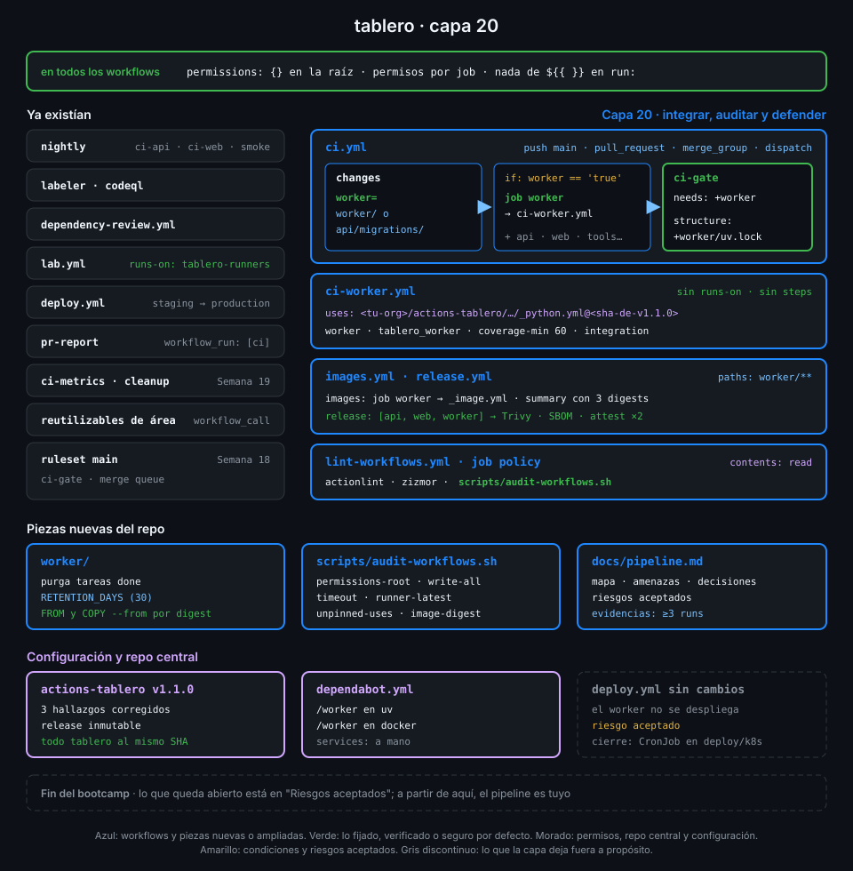

# Defender un pipeline

> Un pipeline que solo entiende quien lo escribió dura lo que esa persona en el equipo. Defenderlo
> es explicarlo a alguien que no estuvo, responder a sus preguntas con pruebas y decir en voz
> alta lo que todavía no cubre.



## 🎯 Objetivos

Al terminar este archivo eres capaz de:

- Escribir un documento de defensa con sus cinco secciones y lo que va en cada una
- Construir un modelo de amenazas en forma de tabla Activo | Amenaza | Defensa
- Escribir una decisión con su porqué y la alternativa descartada
- Distinguir un riesgo aceptado concreto de una vaguedad
- Respaldar cada afirmación con un run, un comando o una respuesta de la API
- Responder a las preguntas típicas de una revisión sin abrir el YAML

## 1. Qué problema resuelve

Llevas veinte semanas tomando decisiones: `ci-gate` en vez de exigir cada job, runners efímeros
en vez de persistentes, OIDC en vez de una clave del clúster, el digest en vez del tag. Cada una
tiene un porqué que conoces hoy. Dentro de seis meses, alguien (o tú) verá un `if: always()` en
`ci-gate` y pensará que sobra. Si lo quita, un fallo en un área deja de bloquear el merge y nadie
lo nota hasta el primer incidente.

Un documento de defensa evita eso. No es documentación de uso ("cómo lanzar un deploy"): es el
argumento de por qué el pipeline es así, de qué protege y qué deja abierto. Y como cualquier
argumento, vale lo que valgan sus pruebas.

## 2. Cómo funciona

### Las cinco secciones

`docs/pipeline.md` en `tablero` tiene exactamente estas, en este orden:

| Sección | Qué responde | Formato |
|---|---|---|
| `## Mapa del pipeline` | Qué hace qué, de un push a producción, y cuál es el único check | Lista o tabla corta; el camino del archivo 01 |
| `## Modelo de amenazas` | Qué protejo, de qué y cómo | Tabla Activo · Amenaza · Defensa |
| `## Decisiones` | Por qué es así y no de otra forma | Decisión · porqué · alternativa descartada |
| `## Riesgos aceptados` | Qué sé que no está cubierto | Riesgo · por qué lo acepto · qué lo cerraría |
| `## Evidencias` | Qué prueba lo anterior | Enlaces a runs y comandos con su salida |

El orden importa. Quien lee empieza por el mapa para orientarse, sigue por lo que se defiende y
termina en las pruebas. Si las evidencias estuvieran primero, serían enlaces sin contexto.

### El modelo de amenazas

La [Semana 12](../../week-12-modelo_de_amenazas_y_endurecimiento/1-teoria/01-modelo-de-amenazas-de-un-pipeline.md) lo construyó con actores, fronteras y activos. Para la defensa, quédate con la forma
de tabla y cubre al menos cuatro activos:

| Activo | Amenaza | Defensa |
|---|---|---|
| `GITHUB_TOKEN` | Un PR inyecta código en un `run:` y usa el token | `permissions: {}` en la raíz, permisos por job, datos por `env:` |
| Imágenes publicadas | Una base o dependencia cambia bajo el mismo tag | Bases por digest, Trivy en la release, attestations verificadas al desplegar |
| Runner propio | Un PR de un fork ejecuta código en tu máquina | Runner efímero de ARC, solo para `tablero`, solo en `main` o environments protegidos |
| Clúster | Un runner comprometido despliega lo que quiere | OIDC verificado por el apiserver, RBAC por environment, Pod Security `restricted` |

Cada fila tiene que poder bajar a un archivo y una línea. Si escribes "permisos mínimos", alguien
te preguntará "¿dónde?", y la respuesta es `permissions: {}` en cada workflow y la regla
`permissions-root` de tu política, que lo comprueba en cada PR.

### Decisiones: el porqué y lo que descartaste

Una decisión sin alternativa no es una decisión, es una descripción. Compara:

- ❌ "Usamos un repo central para los reutilizables."
- ✅ "Los reutilizables viven en `actions-tablero` y se llaman por SHA de release. Descarté
  tenerlos en `tablero` con `./` porque cada repo nuevo los copiaría; el coste es que un cambio
  de CI necesita una release y un PR de actualización."

La segunda dice qué ganas, qué pagas y por qué lo pagas. Es la que resiste una pregunta.

Dos más de `tablero`, con la misma forma:

- **Un único check requerido.** `ci-gate` espera a todas las áreas con `if: always()` y es lo
  único que exige el ruleset. Descarté exigir cada job porque un job saltado por su área dejaría
  el check pendiente; el coste es que `ci-gate.needs` hay que mantenerlo al añadir un área.
- **Runners propios efímeros para desplegar.** `deploy.yml` corre en `tablero-runners` de ARC,
  un pod nuevo por job. Descarté un runner persistente porque un job podría dejar algo para el
  siguiente; el coste es el arranque del pod en cada despliegue.

### Riesgos aceptados: concretos o no son riesgos

| Vago (no vale) | Concreto (vale) |
|---|---|
| "La seguridad podría mejorarse" | "Dependabot no actualiza el digest de `postgres` en `_python.yml`: lo reviso en cada release del central" |
| "El worker no está del todo integrado" | "El chart no despliega el worker; cerrarlo requiere un CronJob en `deploy/k8s` y su RBAC" |
| "Dependemos de GitHub" | "Si GHCR no responde, `deploy.yml` no verifica y no despliega: prefiero no desplegar a desplegar sin verificar" |

Un riesgo concreto se puede discutir: alguien puede decir "eso no lo acepto" y proponer el cierre.
Uno vago no se puede ni rebatir.

### Evidencias

Cada afirmación fuerte va con su prueba. Tres tipos sirven:

- **Un run**: `https://github.com/<tu-org>/tablero/actions/runs/<id>`, con una frase de qué
  demuestra. El check de la semana pide al menos tres.
- **Un comando con su salida**: `gh attestation verify …` con el `✓`, `scripts/audit-workflows.sh`
  con `0 hallazgos`.
- **Una respuesta de la API** de los ajustes (archivo 03), con la fecha en que la leíste.

Un enlace a un run caduca con la retención (14 días en `tablero` desde la Semana 19). Elige como
evidencia runs que puedas regenerar, y di cómo: "lánzalo con `gh workflow run ci.yml --ref main`".

## 3. Cómo se usa

### Sacar los enlaces sin la UI

```bash
gh run list --workflow ci.yml --branch main --event workflow_dispatch --limit 1 \
  --json url,headSha,conclusion --jq '.[0] | "\(.url) \(.headSha[:7]) \(.conclusion)"'
# https://github.com/<tu-org>/tablero/actions/runs/<id> 1a2b3c4 success
```

Lo mismo con `--workflow release.yml` para la release con `tablero-worker` firmado, y con
`--workflow lint-workflows.yml` o el `ci` del PR que añadió `policy` para la auditoría.

### Las preguntas que vas a recibir

Una revisión de pipeline repite casi siempre las mismas. Prepárate la respuesta corta y la prueba
de cada una:

| Pregunta | Respuesta corta | Prueba |
|---|---|---|
| ¿Qué tiene que pasar para que algo entre en `main`? | `ci-gate` en verde en la merge queue | El ruleset por API y un run de `merge_group` |
| ¿Qué pasa si un fork abre un PR que cambia `ci.yml`? | Corre sin secretos, con token de lectura, y necesita aprobación | `approval_policy` y el run del PR |
| ¿Cómo sé que la imagen de production es la que construyó `release.yml`? | `deploy.yml` verifica la procedencia y despliega por digest | `gh attestation verify` y el log del job `verify` |
| ¿Qué pasa si el despliegue a production falla? | Helm revierte y queda la revisión anterior | El run de la práctica de rollback de la S17 |
| ¿Quién puede cambiar los reutilizables? | Un PR al central y una release; `tablero` no cambia hasta que lo mueves | Las referencias por SHA y el historial de releases |
| ¿Cómo sabes que el CI no se está haciendo lento? | `ci-metrics.yml` avisa si el p95 supera el presupuesto | El último run de `trend` |
| ¿Qué no cubre este pipeline? | Lo que está en "Riesgos aceptados" | La propia sección |

La última es la que separa una defensa honesta de una venta. Si no tienes nada en "Riesgos
aceptados", la respuesta que oirán es "no lo has mirado".

### Ensayar

La práctica 04 termina con un ensayo cronometrado. Tres reglas:

1. **Diez minutos de exposición, sin abrir un YAML.** Si necesitas el YAML para explicar algo,
   falta en el documento.
2. **Cada respuesta en dos frases** y, si la piden, la prueba.
3. **"No lo sé, lo compruebo así"** es una respuesta válida. Inventar no lo es.

### Mantener el documento vivo

Un documento de defensa que no se actualiza miente a los tres meses. Tres hábitos lo evitan:

- **El PR que cambia una decisión cambia el documento.** Si un PR quita `ci-gate` del ruleset
  o añade un environment, la revisión pregunta "¿y `docs/pipeline.md`?". `docs/` no está en el
  `CODEOWNERS` de la Semana 18; si quieres que esa pregunta sea obligatoria, añádelo.
- **Un riesgo aceptado tiene fecha de revisión.** "Lo reviso en cada release del central" es una
  fecha: la siguiente release. "Algún día" no lo es.
- **Las evidencias se regeneran antes de cada defensa.** Lanza los runs, sustituye los enlaces y
  comprueba que todos dan `success` sobre el último commit de `main`.

Si al regenerar una evidencia sale en rojo, no la quites: es un hallazgo. O se arregla, o pasa a
"Riesgos aceptados" con su porqué.

## 4. Antipatrones

| Antipatrón | Por qué duele | Qué hacer en su lugar |
|---|---|---|
| Documento que repite el YAML en prosa | Envejece con el primer cambio y no explica nada que el YAML no diga | Explicar el porqué y enlazar el archivo |
| Afirmaciones sin evidencia | "Está firmado" no se puede comprobar ni rebatir | Enlace al run y comando de verificación |
| Riesgos aceptados vacíos | Nadie se cree un pipeline sin huecos | Listar lo que sabes que falta, con su cierre |
| Decisiones sin alternativa | No se sabe si se pensó o se heredó | Escribir qué se descartó y por qué |
| Evidencias que caducan sin forma de regenerarlas | Tras la retención, el documento enlaza a nada | Runs reproducibles con su comando de lanzamiento |
| Defender leyendo el YAML | Quien escucha se pierde y la defensa se convierte en un recorrido de archivos | Exponer desde el mapa y bajar al archivo solo si lo piden |

## 5. Trucos

- **Enlace a una línea exacta en el commit del run**: en la vista de un archivo en GitHub, pulsa
  `y` y la URL pasa a llevar el SHA. Una evidencia "esta línea" enlazada así no cambia aunque
  `main` avance.
- **El run de un commit concreto**: `gh run list --commit <sha> --json workflowName,url` te da
  todos los runs que disparó ese commit, útil para la evidencia "el último commit de `main`
  pasó todo".
- **El ruleset en una línea para el documento**:
  `gh api "repos/{owner}/{repo}/rules/branches/main" --jq '[.[].type] | unique | join(", ")'`.

## 📚 Recursos Adicionales

- [GitHub Docs: Security hardening for GitHub Actions](https://docs.github.com/en/actions/reference/security/secure-use)
- [OWASP: Threat Modeling Cheat Sheet](https://cheatsheetseries.owasp.org/cheatsheets/Threat_Modeling_Cheat_Sheet.html)
- [Michael Nygard: Documenting Architecture Decisions](https://cognitect.com/blog/2011/11/15/documenting-architecture-decisions)
- [GitHub CLI: gh run list](https://cli.github.com/manual/gh_run_list)

## ✅ Checklist de Verificación

- [ ] Sé qué cinco secciones tiene `docs/pipeline.md` y por qué en ese orden
- [ ] Sé construir el modelo de amenazas con al menos cuatro activos
- [ ] Sé escribir una decisión con su porqué y la alternativa descartada
- [ ] Sé distinguir un riesgo aceptado concreto de uno vago
- [ ] Sé sacar los enlaces a runs con `gh run list` y elegir evidencias regenerables
- [ ] Sé responder en dos frases a las preguntas típicas de una revisión

---

| ← Anterior | Siguiente → |
|:---|---:|
| [Auditar un pipeline](03-auditar-un-pipeline.md) | [Lo que el examen pregunta y aún no viste](05-lo-que-el-examen-pregunta-y-aun-no-viste.md) |
