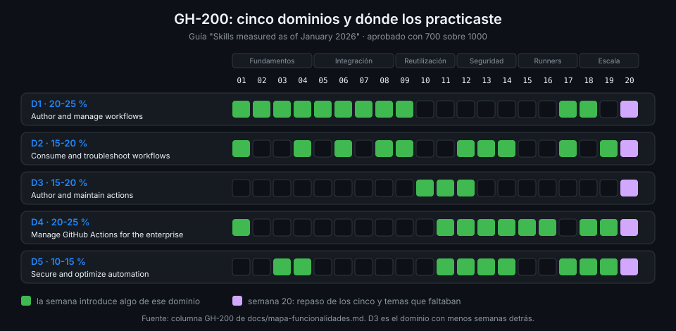

# Lo que el examen pregunta y aún no viste

> `tablero` te llevó por casi toda la guía del GH-200, pero no por toda. Lo que queda son temas
> que un monorepo público en una org gratuita no necesitaba: anclas de YAML, el software de las
> imágenes, listas de IP de Enterprise, immutable actions y un puñado de operaciones de `gh`.



## 🎯 Objetivos

Al terminar este archivo eres capaz de:

- Reutilizar un mapa, un step o un job entero con anclas y alias de YAML, y saber por qué `<<` no vale
- Saber qué ofrecen las plantillas de workflow de un repo `.github` privado o interno
- Averiguar qué software trae un runner alojado y dónde buscan primero las `setup-*`
- Explicar por qué una etiqueta `-latest` cambia de imagen y qué hace una org para impedir su uso
- Decir qué exige una lista de IP permitidas a GitHub Actions
- Distinguir immutable actions de releases inmutables y saber cuál existe hoy
- Deshabilitar un workflow sin perder historial y reejecutar un solo job de una matriz

## 1. Qué problema resuelve

La guía del GH-200 vigente ("Skills measured as of January 2026") describe lo que mide el examen,
no lo que necesita un proyecto concreto. `tablero` cubrió los cinco dominios a fondo, pero algunas
funcionalidades no tenían sitio en él: ninguna org gratuita tiene listas de IP, y un pipeline que
fija `ubuntu-24.04` nunca sufre un cambio de `-latest`. Este archivo las recoge con la misma regla
que el resto del bootcamp: lo que se puede probar se prueba, y lo que no se dice que no se probó.

## 2. Cómo funciona

### Anclas y alias de YAML

Desde el 18 de septiembre de 2025, GitHub admite **anclas** (`&nombre`) y **alias** (`*nombre`)
en los workflows. Un ancla marca un nodo (un mapa, una lista, un valor) y un alias lo repite tal
cual en otro sitio:

```yaml
name: anchors
on:
  pull_request:
permissions:
  contents: read
jobs:
  lint:
    runs-on: ubuntu-24.04
    timeout-minutes: 5
    env: &python-env
      PYTHONUTF8: "1"
      UV_FROZEN: "1"
    steps:
      - &checkout
        uses: actions/checkout@3d3c42e5aac5ba805825da76410c181273ba90b1 # v7.0.1
        with:
          persist-credentials: false
      - run: env | grep -E '^(PYTHONUTF8|UV_FROZEN)='
  test:
    runs-on: ubuntu-24.04
    timeout-minutes: 10
    env: *python-env
    steps:
      - *checkout
      - run: env | grep -E '^(PYTHONUTF8|UV_FROZEN)='
```

`test` recibe el mismo `env` y el mismo step de checkout que `lint`. El ancla tiene que aparecer
**antes** que su alias en el archivo. Un alias también puede ser un job entero:

```yaml
name: alias-job
on: workflow_dispatch
permissions: {}
jobs:
  smoke-staging: &smoke
    runs-on: ubuntu-24.04
    timeout-minutes: 5
    steps:
      - run: echo "$GITHUB_JOB"
  smoke-production: *smoke
```

Lo que **no** puedes hacer es "copiar y cambiar una clave". En YAML eso es la clave de fusión
`<<`, y aunque la guía del examen la menciona, GitHub no la admite:

```yaml
  smoke-production:
    <<: *smoke   # antipatron: GitHub no admite la clave de fusión
    timeout-minutes: 10
```

actionlint lo rechaza con `GitHub Actions does not support YAML merge key "<<" [syntax-check]`.
Si necesitas variaciones, usa una matriz o un reutilizable con inputs.

_Verificado con actionlint 1.7.12, noviembre de 2026._

### Plantillas de workflow no públicas

En la Semana 11 publicaste plantillas en `workflow-templates/` del repo `<tu-org>/.github`, que
era público. En el mismo cambio de septiembre de 2025, GitHub empezó a ofrecer a los miembros
de la org las plantillas de un repo `.github` **privado o interno**. Ya no hace falta hacer
público ese repo para compartir plantillas dentro de la empresa.

### Software preinstalado y toolcache

Cada imagen de runner alojado publica su lista de software en
[`actions/runner-images`](https://github.com/actions/runner-images): un README por imagen
(Ubuntu 24.04, Windows Server, macOS) con versiones de lenguajes, herramientas y navegadores, y
notas por release. `yq`, que usa la política del archivo 03, sale en esa lista de ubuntu-24.04.

Dos sitios donde mirarlo desde un run:

- El paso **"Set up job"** del log trae un grupo "Runner Image" con la versión de la imagen, el
  enlace a su lista de software ("Included Software") y el de sus notas de release.
- **`RUNNER_TOOL_CACHE`** (`/opt/hostedtoolcache` en Linux) es el directorio donde las `setup-*`
  buscan primero una versión antes de descargarla, y donde guardan lo que descargan. Una versión
  que ya está en el toolcache de la imagen se instala en segundos.

### Las etiquetas `-latest` cambian de imagen

`ubuntu-latest`, `windows-latest` y `macos-latest` son alias que GitHub mueve. El changelog del
14 de mayo de 2026 anunció dos movimientos: `windows-latest` pasa a la imagen con Visual Studio
2026 (entre el 8 y el 15 de junio de 2026) y `macos-latest` pasa de macOS 15 a macOS 26 (desde el
15 de junio de 2026, a lo largo de 30 días). Quien quiera quedarse fija `windows-2022` o `macos-15`.

El 25 de junio de 2026 llegó la otra mitad: en Team y Enterprise, una org puede **deshabilitar**
las etiquetas estándar como `ubuntu-latest` para todos sus repos. Un job con esa etiqueta deja de
encontrar runner. Por eso el bootcamp fija `ubuntu-24.04` desde el primer workflow, y la regla
`runner-latest` de la política lo comprueba.

### Listas de IP permitidas

Una **lista de IP permitidas** (*IP allow list*) restringe el acceso a los recursos de una org o
empresa a ciertas direcciones. Solo existe en **GitHub Enterprise Cloud**. Con la lista activa,
los runners alojados estándar no pueden hablar con tus repos privados, porque sus IP no son fijas:

```bash
gh api /meta --jq '.actions | length'
# 8350
```

Son miles de rangos (8350 el 14 de noviembre de 2026) y cambian. Las salidas que da la
documentación: runners propios, cuyas IP añades a la lista, o runners grandes con IP estática.
Hay además una opción para añadir automáticamente las IP de las GitHub Apps instaladas.

### Immutable actions

La guía cita las *immutable actions*: actions publicadas como paquete OCI en GHCR, que no se
pueden mover una vez publicadas. La herramienta para publicarlas, `actions/publish-immutable-action`,
sigue marcada "not ready for public use" (comprobado el 14 de noviembre de 2026). Lo que sí
existe hoy y te da la misma garantía:

- **Releases inmutables** (Semana 11): un tag de release que no se puede mover ni borrar.
- **Fijar por SHA** (Semanas 01 y 12): la referencia que consume tu workflow no cambia aunque
  alguien mueva el tag.

### Tres operaciones de `gh` que el examen da por sabidas

| Necesidad | Comando | Efecto |
|---|---|---|
| Parar un workflow sin perder nada | `gh workflow disable nightly.yml` | Deja de dispararse y no sale en `gh workflow list` sin `--all`; los runs se conservan. `enable` lo reactiva |
| Retirarlo del todo | Borrar el archivo | Deja de dispararse, pero sus runs siguen; cada uno se borra con `gh run delete <id>` |
| Reejecutar un solo job de una matriz | `gh run rerun <id> --job <job-id>` | Reejecuta ese job y los que dependen de él; el `<job-id>` sale de `gh run view <id> --json jobs` |

### Dos menciones

- **Badge de estado** (Semana 01): `https://github.com/<tu-org>/tablero/actions/workflows/ci.yml/badge.svg`,
  con `?branch=main` o `?event=push` para filtrar qué runs cuenta.
- **Extensión de VS Code "GitHub Actions"** (`github.vscode-github-actions`): autocompletado y
  validación del YAML y vista de runs desde el editor. El bootcamp no la ha probado; actionlint
  sigue siendo la validación de referencia.

## 3. Cómo se usa

### Cuándo usar anclas

Las anclas reducen repetición **dentro de un archivo**. Úsalas para un bloque idéntico en varios
jobs (el checkout sin credenciales, un `env` común). Para repetir entre archivos o entre repos,
la herramienta sigue siendo el reutilizable o la action composite: un ancla no cruza archivos.

Ten en cuenta a las herramientas: actionlint 1.7.12 valida los alias sin problema, pero zizmor
1.31.1 avisa con un `WARN` de que el archivo contiene anclas y enlaza a su documentación sobre
cómo las trata. En un repo que exige zizmor limpio, úsalas con moderación.

### Qué versión de una herramienta tendrás

```bash
gh run view <id> --log | grep -E -A4 'group\]Runner Image$' | cut -f3 | head -5
# 2026-11-15T03:10:28.2511595Z ##[group]Runner Image
# 2026-11-15T03:10:28.2512196Z Image: ubuntu-24.04
# 2026-11-15T03:10:28.2512734Z Version: 20261111.127.1
# 2026-11-15T03:10:28.2513818Z Included Software: https://github.com/actions/runner-images/blob/ubuntu24/...
# 2026-11-15T03:10:28.2515552Z Image Release: https://github.com/actions/runner-images/releases/tag/ubuntu24%2F...
```

Cada línea del log lleva delante el job y el step separados por tabuladores; `cut -f3` los
quita. El `$` del patrón evita el grupo vecino "Runner Image Provisioner", que no es la imagen.

Si un job empieza a fallar sin cambios tuyos, compara la versión de imagen del run verde y del
rojo. Si cambió, las notas de release de `actions/runner-images` dicen qué se movió.

## 4. Antipatrones

| Antipatrón | Por qué duele | Qué hacer en su lugar |
|---|---|---|
| `<<: *ancla` para heredar y sobrescribir | GitHub no lo admite y actionlint lo rechaza | Matriz o reutilizable con inputs |
| Anclas para compartir CI entre repos | Un ancla vive en un archivo | Reutilizable o action del repo central |
| Confiar en la versión preinstalada sin fijarla | La imagen se actualiza cada semana | `setup-*` con versión exacta; el toolcache solo acelera |
| `windows-latest` o `macos-latest` en un pipeline de producción | Cambian de sistema con un aviso en el changelog | Etiqueta con versión (`windows-2022`, `macos-15`) |
| Activar una lista de IP sin plan para Actions | Los runners alojados dejan de llegar a tus repos privados | Runners propios o grandes con IP estática, antes de activarla |
| Esperar a las immutable actions para fijar dependencias | No están listas; mientras tanto, nada te protege | SHA y releases inmutables, ya |
| Borrar un workflow para pararlo un tiempo | Pierdes la forma de lanzarlo y el archivo | `gh workflow disable` |

## 5. Trucos

- **Qué imagen ejecutó un job**, sin abrir el log en la web: el grupo "Runner Image" de "Set up
  job" sale en `gh run view <id> --log`, como en el ejemplo de arriba.
- **Por qué una lista de IP no encaja con runners alojados**, en un comando:
  `gh api /meta --jq '.actions | length'`.
- **Workflows deshabilitados olvidados**: `gh workflow list --all --json name,state --jq '.[] | select(.state != "active")'`.

## 📚 Recursos Adicionales

- [GitHub Docs: Reusing workflow configurations](https://docs.github.com/en/actions/reference/workflows-and-actions/reusing-workflow-configurations)
- [GitHub Changelog: Actions YAML anchors and non-public workflow templates (2025-09-18)](https://github.blog/changelog/)
- [actions/runner-images](https://github.com/actions/runner-images)
- [GitHub Docs: Managing allowed IP addresses for your organization](https://docs.github.com/en/organizations/keeping-your-organization-secure/managing-security-settings-for-your-organization/managing-allowed-ip-addresses-for-your-organization)
- [GitHub roadmap #592: immutable actions](https://github.com/github/roadmap/issues/592)

## ✅ Checklist de Verificación

- [ ] Sé reutilizar un `env`, un step o un job con `&` y `*`, y por qué `<<` no funciona
- [ ] Sé que las plantillas de un repo `.github` privado o interno ya se ofrecen a la org
- [ ] Sé dónde está la lista de software de cada imagen y qué es `RUNNER_TOOL_CACHE`
- [ ] Sé qué cambió en `windows-latest` y `macos-latest` en 2026 y qué puede hacer una org Team
- [ ] Sé qué exige una lista de IP permitidas a Actions y en qué plan existe
- [ ] Sé qué son las immutable actions y qué uso hoy en su lugar
- [ ] Sé deshabilitar un workflow, borrarlo y reejecutar un solo job de una matriz

---

| ← Anterior | Siguiente → |
|:---|---:|
| [Defender un pipeline](04-defender-un-pipeline.md) | [El examen GH-200](06-el-examen-gh-200.md) |
