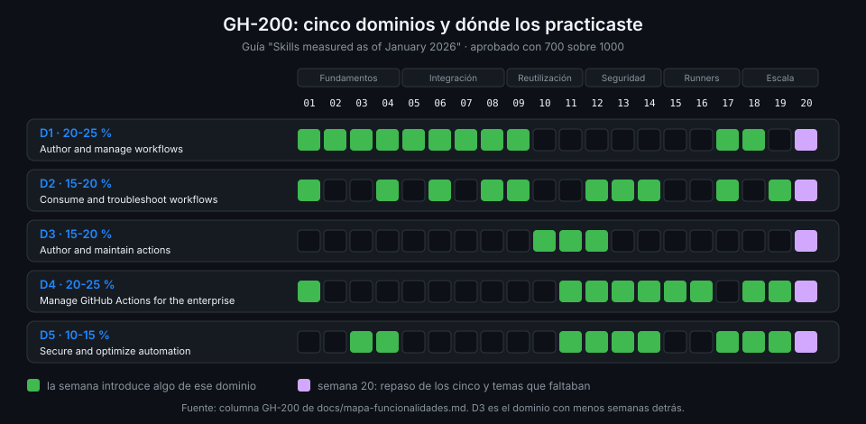

# El examen GH-200

> El GH-200 certifica GitHub Actions. Después de veinte semanas ya sabes casi todo lo que mide;
> lo que te falta es saber dónde está cada cosa en su mapa de dominios y repasar con el peso
> de cada uno en la cabeza.



## 🎯 Objetivos

Al terminar este archivo eres capaz de:

- Nombrar los cinco dominios vigentes del GH-200 y su peso
- Decir qué cambió en la revisión de enero de 2026 respecto a la guía anterior
- Localizar, para cada dominio, las semanas del bootcamp que lo cubren
- Detectar tu dominio más flojo y planificar el repaso por peso
- Distinguir lo que el examen da por sabido de lo que te pide razonar
- Saber qué datos del examen tienes que consultar en la fuente oficial y no en este archivo

## 1. Qué problema resuelve

Has aprendido Actions construyendo un pipeline, que es el orden en que se aprende bien: cada
concepto llega cuando hace falta. El examen lo ordena de otra forma: por dominios, con pesos, y
sin ningún proyecto que te dé contexto. Una pregunta sobre `workflow_run` no te dice "esto es lo
de `pr-report`"; te describe un escenario y te pide la opción correcta.

Este archivo hace el puente: te da el mapa de dominios, cruza cada uno con las semanas donde lo
practicaste y te propone cómo repasar en el tiempo que te quede.

## 2. Cómo funciona

### La guía vigente

La fuente es la guía de estudio de Microsoft Learn, "Skills measured as of January 2026". La
revisión de enero de 2026 fue grande: hasta 2025 la guía tenía cuatro dominios; ahora tiene
**cinco**. Renombró dos y sacó la seguridad y la optimización a un dominio propio.

| Dominio | Peso | Abreviatura |
|---|:--:|:--:|
| Author and manage workflows | 20-25 % | D1 |
| Consume and troubleshoot workflows | 15-20 % | D2 |
| Author and maintain actions | 15-20 % | D3 |
| Manage GitHub Actions for the enterprise | 20-25 % | D4 |
| Secure and optimize automation | 10-15 % | D5 |

Dos datos más de la fuente oficial: el aprobado es **700 sobre 1000**, y la mayoría de preguntas
cubren funcionalidades disponibles de forma general (GA); puede aparecer alguna en preview si es
de uso común.

Lo que este archivo **no** te dice: duración, número de preguntas, precio ni idiomas. No están en
la guía de estudio y cambian. Consúltalos en la página oficial del examen el día que reserves.

_Guía comprobada el 14 de noviembre de 2026._

### Cada dominio en el bootcamp

La columna GH-200 de [`docs/mapa-funcionalidades.md`](../../../docs/mapa-funcionalidades.md)
asigna dominios a cada semana. Agrupada por dominio:

| Dominio | Semanas | Qué practicaste allí |
|---|---|---|
| D1 · Author and manage workflows | 01-09, 17, 18, 20 | Eventos y filtros, expresiones y contextos, jobs, `needs`, outputs, matrices, services, artefactos, `concurrency`, reutilizables, `merge_group`, anclas de YAML |
| D2 · Consume and troubleshoot workflows | 01, 04, 06, 08, 09, 12, 13, 14, 17, 19, 20 | Leer runs y logs, `gh run`, depurar con `ACTIONS_STEP_DEBUG`, problem matchers, reejecutar, environments y deployments, attestations, tiempos y API de jobs |
| D3 · Author and maintain actions | 10, 11, 12, 20 | Actions composite, JavaScript y Docker, `action.yml`, versionado SemVer, releases inmutables, Marketplace, dependencias de actions |
| D4 · Manage GitHub Actions for the enterprise | 01, 11-16, 18-20 | Políticas de actions de la org, plantillas de workflow, secretos de org, runners propios y ARC, runner groups, rulesets, retención, listas de IP |
| D5 · Secure and optimize automation | 03, 04, 11-14, 17-19, 20 | Caché, permisos del `GITHUB_TOKEN`, inyección, `pull_request_target`, OIDC, SHA, SBOM y procedencia, merge queue, coste y rendimiento |

Fíjate en D3: es el dominio con menos semanas detrás (10, 11 y 12, más el repaso de esta) y pesa
lo mismo que D2. Si las actions propias se te quedaron lejos, empieza por ahí.

### Cómo pregunta

La guía describe habilidades, y las preguntas suelen convertirlas en escenarios. Tres tipos que
reconocerás:

- **Elegir la sintaxis correcta**: qué clave, qué contexto, qué evento. Aquí cuenta la
  precisión: `github.event.pull_request.head.sha` frente a `github.sha` en un `pull_request`,
  `needs.<job>.outputs` frente a `steps.<id>.outputs`.
- **Elegir el mecanismo**: reutilizable o composite, secreto de repo o de environment,
  `GITHUB_TOKEN` o GitHub App, runner alojado o propio. Aquí cuenta el porqué, que es lo que el
  bootcamp ha repetido en cada antipatrón.
- **Diagnosticar**: un síntoma ("el job no arranca", "el check queda pendiente", "el token no
  puede crear el PR") y la causa. Aquí cuentan los "🧯 Si algo sale mal" de cada práctica.

## 3. Cómo se usa

### Un plan de repaso

1. **Lee la guía oficial entera una vez** y marca cada habilidad con ✅ (la practicaste), 🟡 (la
   viste en teoría) o ❌ (no te suena). El archivo 05 cubre las que el bootcamp no había tocado.
2. **Ordena por peso**: D1 y D4 pesan hasta un 25 % cada uno. Un ❌ en D4 vale más que uno en D5.
3. **Repasa con el bootcamp, no con resúmenes**: para cada 🟡 o ❌, vuelve a la semana de la tabla
   de arriba, relee la teoría y repite el paso de la práctica que lo ejercita. Una práctica hecha
   se recuerda; un resumen leído, no.
4. **Repasa la sintaxis con la referencia**: la página "Workflow syntax" y la de "Contexts" son
   el temario de D1. Léelas de arriba abajo y comprueba que reconoces cada clave.
5. **Haz el simulacro** de la rúbrica de esta semana, cronometrado. Y los minisimulacros de cierre
   de fase (Semanas 04, 08, 11, 14 y 17) para el dominio que tengas más flojo.

### Las preguntas de repaso de cada semana

Cada `rubrica-evaluacion.md` trae diez preguntas conceptuales con sus respuestas en `<details>`.
Son preguntas escritas sobre lo que hiciste. Úsalas por dominio: las semanas de D3 son la 10,
la 11 y la 12, así que sus rúbricas son tu repaso de D3:

```bash
ls bootcamp/week-1[0-2]-*/rubrica-evaluacion.md
# bootcamp/week-10-actions_propias/rubrica-evaluacion.md
# bootcamp/week-11-actions_a_escala_de_organizacion/rubrica-evaluacion.md
# bootcamp/week-12-modelo_de_amenazas_y_endurecimiento/rubrica-evaluacion.md
```

Contesta sin abrir el `<details>`, en voz alta o por escrito, y después compara. Las que falles
son tu lista de repaso.

### Cinco escenarios, uno por dominio

Así se razona una pregunta de escenario: identifica el mecanismo, descarta lo que no encaja y
justifica la opción con lo que sabes del bootcamp.

**D1.** "Un workflow tiene tres jobs; el tercero necesita un valor que calcula el primero." El
primero declara `outputs:` a partir de un `steps.<id>.outputs`, y el tercero lo lee con
`needs.<job>.outputs.<nombre>`, con el primero en su `needs`. `$GITHUB_ENV` no cruza jobs: solo
vale dentro del mismo job (Semana 02).

**D2.** "Un check requerido se queda en *Expected — Waiting for status to be reported*." El
workflow que lo produce no se disparó, típicamente por un filtro `paths`. Un workflow saltado
deja el check pendiente; un job saltado cuenta como éxito. La solución de `tablero` fue el job
puerta `ci-gate` en un workflow que corre siempre (Semana 18).

**D3.** "Una action tiene que limpiar un recurso aunque el job falle." Una action JavaScript
con `post:` y `post-if: always()` (o el valor por defecto, que ya corre siempre), guardando lo
necesario con `$GITHUB_STATE` en el `main`. Un step final con `if: always()` en cada workflow
que la use la obligaría a repetir la limpieza en todos (Semana 10).

**D4.** "Una org quiere que solo se usen actions propias y de GitHub, fijadas por SHA." La
política de actions de la org: `allowed_actions: selected` con `github_owned_allowed` y los
patrones propios, más `sha_pinning_required`. No se hace con un workflow ni con CODEOWNERS
(Semana 11).

**D5.** "Un job necesita desplegar en un proveedor cloud sin guardar una clave de larga
duración." OIDC: `permissions: id-token: write` en ese job, una relación de confianza en el
proveedor ligada a los claims (`sub`, `repository`, environment) y ningún secreto estático
(Semana 13).

Si alguno de los cinco te costó, ya sabes qué semana releer.

### Gestionar el tiempo del examen

No sabrás de antemano cuántas preguntas te tocan si no lo miras en la página oficial, pero las
reglas de gestión valen para cualquier formato:

- **Primera pasada rápida.** Contesta lo que sabes seguro y marca lo dudoso para revisarlo.
- **Descarta antes de elegir.** En una pregunta de mecanismo suele haber dos opciones que no
  pueden funcionar (un `$GITHUB_ENV` entre jobs, un secreto en un `if:` de job). Quitarlas
  convierte una duda entre cuatro en una entre dos.
- **No cambies una respuesta sin un motivo nuevo.** Si al revisar no recuerdas algo que no
  sabías en la primera pasada, deja la que pusiste.

### Lo que no tienes que memorizar

El examen no pide que recuerdes un SHA ni la versión exacta de una action. Sí pide que sepas
**por qué** se fija por SHA y qué pasa si no. Tampoco pide los precios por minuto, pero sí que
sepas qué consume minutos y qué no. Memoriza mecanismos, no números.

## 4. Antipatrones

| Antipatrón | Por qué duele | Qué hacer en su lugar |
|---|---|---|
| Estudiar con la guía de cuatro dominios | Desde enero de 2026 los pesos y los nombres son otros | La guía "Skills measured as of January 2026" |
| Repasar lo que ya dominas porque es cómodo | El tiempo se va en D1 y D3 se queda sin tocar | Ordenar el repaso por peso y por ❌ |
| Fiarte de datos del examen copiados en un foro | Duración, número de preguntas y precio cambian | La página oficial del examen el día que reserves |
| Memorizar listas de claves sin escenario | Las preguntas describen situaciones, no piden listas | Repetir el paso de la práctica que usa esa clave |
| Saltarte el simulacro | Llegas sin saber cómo gestionas el tiempo | Simulacro cronometrado de la rúbrica |
| Dar por sabido lo de preview | La mayoría de preguntas son de funciones GA | Priorizar GA; preview solo si es de uso común |

## 5. Trucos

- **El mapa de un dominio en una línea**: `grep -E '^\| [0-9]{2} .*(D3|D1-D5)' docs/mapa-funcionalidades.md | cut -d'|' -f2`
  te devuelve las semanas que tocan D3 (la 20 figura como `D1-D5`), sin abrir la tabla.
- **Las referencias de sintaxis, sin perderte**: en la página "Workflow syntax", cada clave tiene
  un ancla (`#jobsjob_idneeds`, `#onworkflow_callinputs`). Es la misma forma que usan los
  enlaces de los recursos de cada semana.
- **El día antes**: relee las tablas de antipatrones de las teorías de las Semanas 12 y 13. Son
  la versión condensada de casi todo D5.

## 📚 Recursos Adicionales

- [Microsoft Learn: GH-200 study guide](https://learn.microsoft.com/en-us/credentials/certifications/resources/study-guides/gh-200)
- [GitHub Docs: Workflow syntax](https://docs.github.com/en/actions/reference/workflows-and-actions/workflow-syntax)
- [GitHub Docs: Contexts](https://docs.github.com/en/actions/reference/workflows-and-actions/contexts)
- [GitHub Docs: Security hardening for GitHub Actions](https://docs.github.com/en/actions/reference/security/secure-use)

## ✅ Checklist de Verificación

- [ ] Sé nombrar los cinco dominios y su peso
- [ ] Sé qué cambió en enero de 2026 y por qué no estudio con la guía anterior
- [ ] Sé qué semanas del bootcamp repasar para cada dominio
- [ ] Sé por qué D3 merece atención aunque pese lo mismo que D2
- [ ] Sé marcar la guía con ✅ / 🟡 / ❌ y ordenar el repaso por peso
- [ ] Sé qué datos del examen consulto en la página oficial y no aquí

---

| ← Anterior | Siguiente → |
|:---|---:|
| [Lo que el examen pregunta y aún no viste](05-lo-que-el-examen-pregunta-y-aun-no-viste.md) | [Práctica 01 — Integrar el worker](../2-practicas/01-integrar-el-worker.md) |
