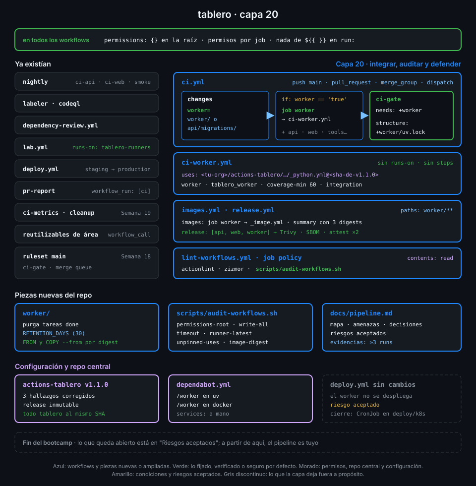

# Proyecto: capa 20 de tablero



## 🎯 Objetivo

Demostrar que el pipeline de `tablero` aguanta como pipeline de producción. Primero, que crece sin
copiar CI: el componente nuevo `worker/` entra en el CI, en las imágenes y en la release solo con
llamadas a los reutilizables del repo central, sin un job propio. Después, que está auditado con
una política escrita, que corre en el CI y que también pasa el repo central. Lo que la auditoría
encuentra se corrige con una release nueva de `actions-tablero`. Por último, que lo sabes
defender: `docs/pipeline.md` explica el mapa, las amenazas, las decisiones y los riesgos que
aceptas, y enlaza los runs que lo prueban.

## 📦 Qué añade esta capa

| Pieza | Qué hace | Por qué existe |
|---|---|---|
| `worker/` (nuevo, desde `app/`) | Purga las tareas hechas más antiguas que `RETENTION_DAYS` y termina | Es el componente que el capstone integra: Python con uv, tests unitarios y de integración, y su propia imagen |
| `ci-worker.yml` (nuevo) | Un único job que llama a `_python.yml` del repo central con `worker/`, `tablero_worker` e integración | Lint, tests, cobertura y PostgreSQL ya están escritos y versionados en un sitio: el worker no repite ni una línea |
| `scripts/changed-areas.sh`, área `worker` | `worker=true` si cambia `worker/` o `api/migrations/` | El worker usa el esquema de la API: una migración nueva también lo tiene que probar |
| `ci.yml`, job `worker` | Llama a `ci-worker.yml` cuando su área cambia; `ci-gate` lo espera | Sin entrar en `ci-gate`, un fallo del worker no bloquearía ningún merge |
| `worker/Dockerfile` por digest | Base y uv fijadas por tag y digest, como la API desde la Semana 14 | El tag `3.15.2-slim-trixie` puede apuntar mañana a otra imagen |
| `images.yml` y `release.yml` con el worker | `tablero-worker` se construye en cada PR y se publica, escanea y firma en cada release | La cadena de suministro de la Semana 14 vale para un componente nuevo sin escribirla otra vez |
| Dependabot en `/worker` | `uv` y `docker` vigilan su lockfile y su Dockerfile | Lo que nadie actualiza envejece con vulnerabilidades |
| `scripts/audit-workflows.sh` (nuevo) | Comprueba la política de `tablero`: permisos en la raíz, sin `write-all`, `timeout-minutes`, sin etiquetas `-latest`, `uses:` por SHA e imágenes por digest | actionlint valida la sintaxis y zizmor busca vulnerabilidades, pero ninguno de los dos exige tus reglas |
| `lint-workflows.yml`, job `policy` | Pasa la auditoría en cada cambio de workflows o de la propia política | Una política que solo se mira a mano deja de cumplirse en el tercer PR |
| `actions-tablero` v1.1.0 | `_python.yml` con PostgreSQL por digest y `sql-lint` con base y uv por digest | La auditoría encontró en el repo central lo mismo que la Semana 14 ya había arreglado en `tablero` |
| `docs/pipeline.md` (nuevo) | El documento de defensa: mapa, amenazas, decisiones, riesgos aceptados y evidencias | Si el pipeline no se puede explicar, nadie lo podrá mantener cuando no estés tú |

| Situación | Qué pasa |
|---|---|
| Un PR toca solo `worker/` | `ci` corre `changes`, `worker` y `ci-gate`; `images` construye `tablero-worker` sin publicarla |
| Un PR añade una migración en `api/migrations/` | Corren el área `api` y también el área `worker` |
| Un PR toca solo `web/` | El job `worker` se salta y `ci-gate` lo cuenta como `skipped`, no como fallo |
| Un PR mete un `uses:` sin SHA o un job sin `timeout-minutes` | El job `policy` falla, `ci-gate` falla y la merge queue no lo deja entrar |
| Se fusiona el PR de release-please | `release.yml` publica `tablero-api`, `tablero-web` y `tablero-worker` con SBOM y procedencia firmadas |
| Alguien pregunta por qué el worker no se despliega | Está en "Riesgos aceptados" o en "Decisiones" de `docs/pipeline.md`, con lo que haría falta para desplegarlo |

Esta capa cierra el bootcamp: no desbloquea ninguna semana siguiente. Lo que queda abierto lo
anotas en "Riesgos aceptados", y a partir de ahí es tu pipeline.

## ✅ Requisitos verificables

- [ ] worker/ está en tablero con su uv.lock, su Dockerfile y sus tests unitarios y de integración
- [ ] ci-worker.yml no tiene steps propios: su único job llama a _python.yml del repo central por SHA, con integración
- [ ] scripts/changed-areas.sh marca worker si cambia worker/ o api/migrations/, y no si solo cambia web/
- [ ] ci.yml llama a ci-worker.yml cuando el área worker cambia y ci-gate lo espera
- [ ] worker/Dockerfile trae su imagen base y uv fijadas por digest
- [ ] images.yml construye tablero-worker con _image.yml del repo central y lo resume con los otros dos digests
- [ ] release.yml publica, escanea y firma tablero-worker en la misma matriz que api y web
- [ ] Dependabot vigila el uv.lock y el Dockerfile de worker/
- [ ] scripts/audit-workflows.sh detecta cada regla de la política en un repo de prueba y sale con 1
- [ ] scripts/audit-workflows.sh no encuentra nada en tablero
- [ ] lint-workflows.yml pasa scripts/audit-workflows.sh en cada cambio de workflows
- [ ] La release v1.1.0 de actions-tablero pasa la auditoría sin hallazgos
- [ ] Todas las referencias de tablero al repo central apuntan al commit de v1.1.0
- [ ] Todos los workflows pasan actionlint y zizmor sin hallazgos
- [ ] El último commit de main pasó un ci completo lanzado a mano, con los tres jobs del worker en verde
- [ ] tablero-worker de la última release tiene attestations de procedencia y de SBOM firmadas por release.yml
- [ ] docs/pipeline.md tiene las cinco secciones de la defensa y enlaza al menos tres runs como evidencia

## 🎨 Criterios de calidad

Lo que el autograding no ve y la [rúbrica](../rubrica-evaluacion.md) sí:

- **El worker no tiene CI propio.** `ci-worker.yml` tiene diez líneas útiles. Si te hizo falta un
  step, falta un input en el reutilizable central. Eso se arregla allí, con una release, y no
  copiando el job.
- **La política es tuya y está escrita.** Cada regla de `audit-workflows.sh` sale de una regla
  que el bootcamp te enseñó y sabes explicar. Si añades una, también tiene su porqué.
- **El repo central se audita igual que `tablero`.** El código que ejecutan todos tus repos merece
  la misma política que el código que ejecuta uno.
- **Cada afirmación de `docs/pipeline.md` tiene evidencia.** "Las imágenes están firmadas" va con
  el enlace al run de release y con el comando de verificación. Sin pruebas, una afirmación no
  defiende nada.
- **Los riesgos aceptados son concretos.** "Podría mejorarse la seguridad" no es un riesgo.
  "Dependabot no actualiza el digest de `postgres` en `_python.yml` y lo reviso en cada release
  del central" sí lo es.
- **El documento se lee en diez minutos.** Una persona que no hizo el bootcamp entiende el
  pipeline sin abrir un solo YAML.

## 💡 Adaptación a tu dominio

| Si tu proyecto es… | El componente nuevo es… | La política añade… | La defensa insiste en… |
|---|---|---|---|
| Una API con colas de mensajes | Un consumidor de la cola con su imagen | Que todo service container (el broker incluido) vaya por digest | Qué pasa si el consumidor se despliega con un esquema de mensaje viejo |
| Un frontend con varias apps | Una app nueva que entra por `_node.yml` | Que ningún job de build tenga `contents: write` | Cómo se publica cada app y quién puede promoverla |
| Una librería que se publica en un registro | Un paquete nuevo del monorepo | Que el job que publica solo corra en tags y con environment | La procedencia del paquete y cómo la verifica quien lo instala |
| Infraestructura como código | Un módulo nuevo con su `plan` en los PR | Que el `apply` solo corra con aprobación y OIDC, nunca con claves | Qué ve un PR de un fork y qué no |

## 🚦 Cómo entregarlo

Si hiciste las cuatro prácticas, ya lo tienes casi todo. Si no, parte del starter y sigue el orden
de las prácticas. Todo llega a `main` por PR y por la merge queue.

1. Copia el worker y el starter en una rama, y completa los `TODO 1` a `TODO 12`:

   ```bash
   cd ~/code/tablero
   git switch main && git pull --ff-only
   git switch -c ci/layer-20
   cp -r ~/code/bc-github-actions/app/worker .
   S=~/code/bc-github-actions/bootcamp/week-20-capstone/3-proyecto/starter
   cp -r "$S"/. .
   grep -rnE "TODO [0-9]+" .github scripts docs | wc -l
   # 12
   ```

2. Integra el worker en el CI y fusiona por la merge queue
   ([práctica 01](../2-practicas/01-integrar-el-worker.md)).

3. Fija su Dockerfile, añádelo a `images.yml`, `release.yml` y Dependabot, y fusiona el PR de
   release ([práctica 02](../2-practicas/02-imagen-y-release-del-worker.md)).

4. Completa `audit-workflows.sh`, corrige el repo central, publica v1.1.0, mueve `tablero` a ese
   commit y añade el job `policy` ([práctica 03](../2-practicas/03-auditoria-completa.md)). Antes
   de cada push:

   ```bash
   scripts/audit-workflows.sh && actionlint && GH_TOKEN=$(gh auth token) zizmor -q .github/ && echo limpio
   # 0 hallazgos
   # limpio
   ```

5. Escribe `docs/pipeline.md` con sus evidencias y fusiónalo
   ([práctica 04](../2-practicas/04-defensa-del-pipeline.md)).

6. El check `ci-full-run-green` mira el **último** commit de `main`. Después del último merge,
   lanza un `ci` completo sobre `main`:

   ```bash
   git switch main && git pull --ff-only
   gh workflow run ci.yml --ref main
   sleep 5
   gh run watch "$(gh run list --workflow ci.yml --event workflow_dispatch --limit 1 --json databaseId --jq '.[0].databaseId')" --exit-status
   ```

7. Lanza la verificación:

   ```bash
   cd ~/code/bc-github-actions
   ./scripts/check-week.sh 20
   # 17/17 comprobaciones superadas.
   ```

8. Prepara la defensa y haz el simulacro de la [rúbrica](../rubrica-evaluacion.md).

## 🧯 Errores comunes

| Síntoma | Causa | Solución |
|---|---|---|
| `ci` no arranca (`startup_failure`) y el error señala a `ci-worker.yml` | Falta `workflow_call` en `on` (`TODO 1`): `ci.yml` no puede llamarlo | [Práctica 01](../2-practicas/01-integrar-el-worker.md), paso 2 |
| Los tests del worker fallan por cobertura (`Module … was never imported`) o con `No module named …migrate` | `package` no es `tablero_worker`, o `working-directory` no es `worker` (`TODO 2`) | [Práctica 01](../2-practicas/01-integrar-el-worker.md), paso 2 |
| La integración del worker falla con `relation "tasks" does not exist` | Se borró `api/migrations/` del clon, o `migrate.py` apunta a otra ruta | El esquema es de la API: `worker/src/tablero_worker/migrate.py` lee `../api/migrations/` ([práctica 01](../2-practicas/01-integrar-el-worker.md), paso 1) |
| Un PR con una migración nueva no prueba el worker | El área `worker` solo mira `^worker/` | Añade `api/migrations/` a su patrón ([práctica 01](../2-practicas/01-integrar-el-worker.md), paso 3) |
| Un fallo del worker no bloquea el merge | `worker` no está en `needs` de `ci-gate` | [Práctica 01](../2-practicas/01-integrar-el-worker.md), paso 4 |
| `release.yml` publica api y web pero no el worker | La release salió antes de añadir `worker` a la matriz | Haz otro `feat:` o `fix:` en `worker/` y fusiona el siguiente PR de release ([práctica 02](../2-practicas/02-imagen-y-release-del-worker.md), paso 5) |
| `audit-workflows.sh` da `unpinned-uses: null` | Falta agrupar en yq: `(a, b) \| select(. != null)`, porque `,` tiene menos precedencia que `\|` | [Práctica 03](../2-practicas/03-auditoria-completa.md), paso 2 |
| `audit-workflows.sh` marca `COPY --from=build` | Falta saltar las etapas declaradas con `AS` (`TODO 7`) | [Práctica 03](../2-practicas/03-auditoria-completa.md), paso 2 |
| `central-pinned-v1.1.0` sale con dos SHA | Quedó alguna referencia en v1.0.0 (lo normal: `ci.yml` con `sql-lint`, o `ci-web.yml` con `coverage-report`) | [Práctica 03](../2-practicas/03-auditoria-completa.md), paso 6 |
| `ci-full-run-green` falla aunque `ci` está en verde | El último run es de un `push` (sin el área del worker) o es de un commit anterior | Lanza `gh workflow run ci.yml --ref main` después del último merge (paso 6 de esta guía) |
| `check-week.sh 18` marca en rojo `ci-gate-needs-all` y compañía | La capa 20 añade el área `worker` a propósito | Es lo esperado: [comprobaciones superadas por capas posteriores](../../../docs/autograding.md#comprobaciones-superadas-por-capas-posteriores) |

## 🔗 Navegación

---

| ← Anterior | Siguiente → |
|:---|---:|
| [Práctica 04 — Defensa del pipeline](../2-practicas/04-defensa-del-pipeline.md) | [Rúbrica de evaluación](../rubrica-evaluacion.md) |
