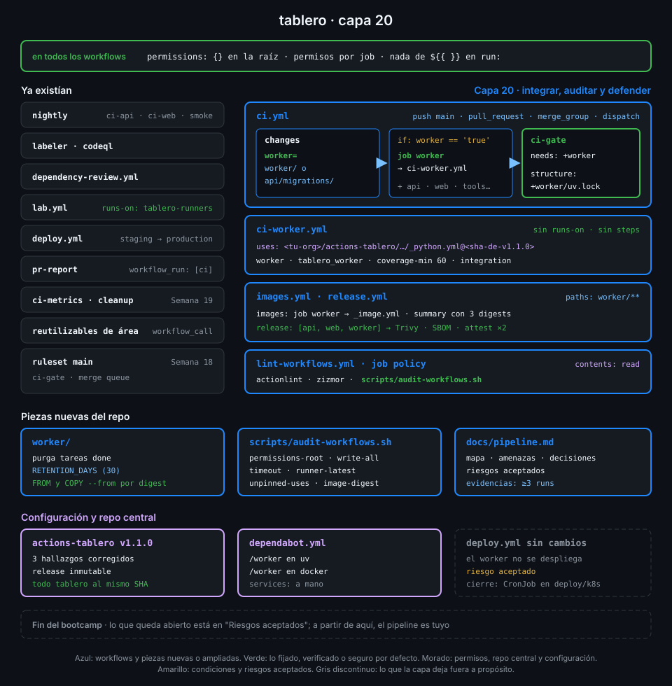

# Semana 20 — Capstone: un pipeline de producción defendido

> Diecinueve capas después, `tablero` tiene un pipeline que prueba, publica, firma, despliega y se vigila.
> Esta semana metes un componente nuevo sin escribir CI, auditas todo con tu propia política y defiendes cada decisión con evidencias.

## 🎯 Objetivos de la Semana

Al terminar la semana eres capaz de:

- Explicar qué separa un pipeline de producción de uno que "funciona": un solo check requerido,
  permisos mínimos, todo fijado, reutilización versionada, artefactos firmados, despliegue
  verificado y observabilidad
- Integrar un componente nuevo (`worker/`) en el CI, las imágenes y la release solo con llamadas a
  los reutilizables del repo central, sin escribir un job propio
- Auditar un pipeline en cuatro capas: workflows, ajustes del repo y de la org, cadena de
  suministro y ejecución, con una política propia que corre en el CI
- Corregir lo que la auditoría encuentra en el repo central con una release nueva y mover a ella
  todas las referencias
- Defender el pipeline por escrito y de palabra: mapa, modelo de amenazas, decisiones, riesgos
  aceptados y runs que lo prueban
- Llegar al GH-200 sabiendo sus cinco dominios vigentes y los temas que el examen pregunta y que
  `tablero` no necesitó

## 📋 Prerrequisitos

| Necesitas | Dónde se aprende |
|---|---|
| `check-week.sh 19` en verde | [Semana 19](../week-19-rendimiento_coste_y_observabilidad/README.md) |
| Reutilizables del repo central y releases inmutables | [Semana 09](../week-09-workflows_reutilizables/README.md) y [Semana 11](../week-11-actions_a_escala_de_organizacion/README.md) |
| Modelo de amenazas, zizmor online y permisos por job | [Semana 12](../week-12-modelo_de_amenazas_y_endurecimiento/README.md) |
| release-please, digests, attestations y `gh attestation verify` | [Semana 14](../week-14-releases_cadena_de_suministro_y_attestations/README.md) |
| Despliegue por digest verificado a kind | [Semana 17](../week-17-despliegue_continuo_a_kubernetes/README.md) |
| `ci.yml` como punto de entrada, `scripts/changed-areas.sh`, `ci-gate` y la merge queue | [Semana 18](../week-18-merge_queue_rulesets_y_monorepos/README.md) |

## 🗂️ Estructura de la Semana

```
week-20-capstone/
├── README.md
├── rubrica-evaluacion.md          defensa del capstone y simulacro tipo GH-200
├── checks.json                    17 comprobaciones
├── 0-assets/                      diagramas SVG
├── 1-teoria/                      6 archivos, uno por concepto
├── 2-practicas/                   4 prácticas guiadas
├── 3-proyecto/
│   ├── README.md
│   └── starter/                   ci-worker.yml, audit-workflows.sh y la plantilla de docs/pipeline.md
├── 4-recursos/{ebooks-free,videografia,webgrafia}/README.md
└── 5-glosario/README.md
```

## 📝 Contenidos

### Teoría

| # | Archivo | Qué aprendes | Tiempo |
|:--:|---|---|:--:|
| 01 | [Qué hace de un pipeline uno de producción](1-teoria/01-que-hace-de-un-pipeline-uno-de-produccion.md) | Los criterios del capstone y el mapa completo de `tablero`, de un push a producción | 25 min |
| 02 | [Integrar un componente sin escribir CI](1-teoria/02-integrar-un-componente-sin-escribir-ci.md) | El contrato que un componente cumple para entrar por los reutilizables, y lo que cambia en áreas, imágenes y release | 25 min |
| 03 | [Auditar un pipeline](1-teoria/03-auditar-un-pipeline.md) | Las cuatro capas de una auditoría, qué ve cada herramienta y una política propia en el CI | 30 min |
| 04 | [Defender un pipeline](1-teoria/04-defender-un-pipeline.md) | El documento de defensa, las preguntas que vas a recibir y cómo se responde con evidencias | 20 min |
| 05 | [Lo que el examen pregunta y aún no viste](1-teoria/05-lo-que-el-examen-pregunta-y-aun-no-viste.md) | Anclas de YAML, software preinstalado, cambios de imagen, listas de IP, immutable actions y más | 30 min |
| 06 | [El examen GH-200](1-teoria/06-el-examen-gh-200.md) | Los cinco dominios vigentes, qué semanas cubren cada uno y cómo prepararte | 20 min |

### Prácticas

| # | Archivo | Qué haces | Tiempo |
|:--:|---|---|:--:|
| 01 | [Integrar el worker](2-practicas/01-integrar-el-worker.md) | `worker/` entra en `ci.yml` con `ci-worker.yml`, que solo llama a `_python.yml` del repo central | 1.25 h |
| 02 | [Imagen y release del worker](2-practicas/02-imagen-y-release-del-worker.md) | `tablero-worker` se construye, se publica, se escanea y se firma con lo que ya tenías | 1.25 h |
| 03 | [Auditoría completa](2-practicas/03-auditoria-completa.md) | Escribes tu política, corriges el repo central en v1.1.0 y la auditoría pasa a correr en el CI | 1.5 h |
| 04 | [Defensa del pipeline](2-practicas/04-defensa-del-pipeline.md) | Escribes `docs/pipeline.md` con evidencias y ensayas la defensa | 1 h |

### Proyecto

[Capa 20 de `tablero`](3-proyecto/README.md): `worker/` probado, publicado y firmado sin un solo
job propio, una auditoría que corre en cada cambio de workflows, el repo central en v1.1.0 y el
documento de defensa con sus evidencias.



## ⏱️ Distribución del Tiempo (10 horas)

| Actividad | Horas |
|---|:--:|
| Teoría (6 archivos) | 2.5 |
| Práctica 01 — Integrar el worker | 1.25 |
| Práctica 02 — Imagen y release del worker | 1.25 |
| Práctica 03 — Auditoría completa | 1.5 |
| Práctica 04 — Defensa del pipeline | 1 |
| Proyecto — capa 20 y run final | 0.5 |
| Defensa del capstone y preguntas de la rúbrica | 0.5 |
| Simulacro tipo GH-200 | 1.5 |
| **Total** | **10** |

## 🎓 En el examen

Desde enero de 2026, el GH-200 mide **cinco** dominios. La seguridad y la optimización tienen
ahora uno propio:

| Dominio | Peso |
|---|:--:|
| Author and manage workflows | 20-25 % |
| Consume and troubleshoot workflows | 15-20 % |
| Author and maintain actions | 15-20 % |
| Manage GitHub Actions for the enterprise | 20-25 % |
| Secure and optimize automation | 10-15 % |

La [teoría 06](1-teoria/06-el-examen-gh-200.md) cruza cada dominio con las semanas que lo cubren.
La [teoría 05](1-teoria/05-lo-que-el-examen-pregunta-y-aun-no-viste.md) cubre lo que la guía pide
y `tablero` no usó: anclas de YAML, software preinstalado, listas de IP e immutable actions. La
rúbrica termina con un simulacro tipo GH-200 cronometrado.

## 🎩 Trucos y atajos

- **El YAML de un workflow en otra rama sin clonar**: `gh workflow view ci.yml --ref main --yaml`.
  Sirve para auditar lo que de verdad está en `main`, no lo que tienes en tu copia local.
- **Qué cambia una release del repo central antes de moverte a ella**:
  `gh api repos/<tu-org>/actions-tablero/compare/v1.0.0...v1.1.0 --jq '.files[].filename'`.
  Si sale un reutilizable que usas, léelo antes de cambiar el SHA en `tablero`.
- **Auditar otro repo con tu política**: `scripts/audit-workflows.sh ../actions-tablero` pasa las
  mismas reglas a un clon del repo central. Acepta varias raíces a la vez.
- **El estado de todos los workflows de un vistazo**: `gh api 'repos/{owner}/{repo}/actions/workflows' --jq '.workflows[] | "\(.state) \(.path)"'`.
  Un `disabled_manually` o `disabled_inactivity` es un workflow que existe pero ya no protege nada.

## 📌 Entregables

- `worker/` en `tablero`, con su base y uv fijadas por digest
- `ci-worker.yml` sin steps propios, y `ci.yml`, `images.yml`, `release.yml` y Dependabot con el
  worker
- `scripts/audit-workflows.sh` y el job `policy` en `lint-workflows.yml`
- `actions-tablero` v1.1.0 sin hallazgos, y todas las referencias de `tablero` a su commit
- Un run completo de `ci` en verde sobre el último commit de `main`, y `tablero-worker` firmado en
  la última release
- `docs/pipeline.md` con sus cinco secciones y al menos tres runs como evidencia
- La defensa y el simulacro de la rúbrica

## ✅ Verificación

```bash
cd ~/code/bc-github-actions
./scripts/check-week.sh 20
# Semana 20 — Capstone: un pipeline de producción defendido  [repo: <tu-org>/tablero]
#
#   ✅ worker/ está en tablero con su uv.lock, su Dockerfile y sus tests unitarios y de integración
#   ...
# 17/17 comprobaciones superadas.
```

Si algo sale en rojo, la pista te dice qué práctica y qué paso lo arreglan.

## 🔗 Navegación

---

| ← Anterior | Siguiente → |
|:---|---:|
| [Semana 19 — Rendimiento, coste y observabilidad](../week-19-rendimiento_coste_y_observabilidad/README.md) | [Qué hace de un pipeline uno de producción](1-teoria/01-que-hace-de-un-pipeline-uno-de-produccion.md) |
